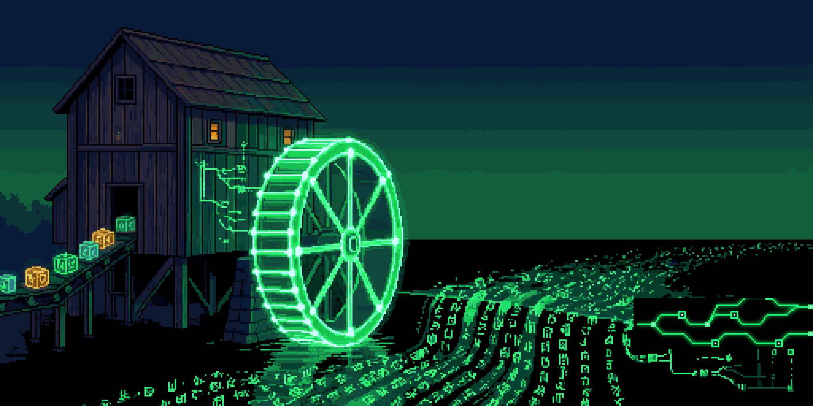

# mill

A deterministic harness that turns a goal into a graph of tasks, runs a coding agent for each
task in isolation, checks the result with your project's gate and an independent verifier, and
delivers each task as its own branch for you to review and merge in your forge.

Status: **M6 (extensions) in progress**: the single-task pipeline, goals, review, publishing, `mill keep`, `mill tui`, the herdr host, forge hooks and CI status. See [docs/PROGRESS.md](docs/PROGRESS.md).

- Requirements: [docs/REQUIREMENTS.md](docs/REQUIREMENTS.md)
- Milestones: [docs/MILESTONES.md](docs/MILESTONES.md)

## Build and test

Needs Go 1.27+ and git 2.38+.

mill resolves git once per process. A git found on PATH is used as is. On macOS, when PATH
resolves to `/usr/bin/git` (Apple's `xcrun` shim), mill asks `xcrun --find git` and runs the real
binary directly, which is faster; if that fails, it keeps `/usr/bin/git`. `mill doctor` prints
the path of the git it uses.

When mill cancels a git command (for example on Ctrl-C), it sends SIGTERM first, so git removes its
lock files (`index.lock`, `HEAD.lock`, ref locks) before it exits. A git still running after a grace
period of about 2s is killed.

```sh
make check     # gofmt, go vet, go test (zero tokens, no network)
make build     # bin/mill
make install   # go install (only from a merged main)
```

**Linux.** mill runs on Linux and macOS. The herdr wrapper and the tests also work under dash
(Ubuntu's `/bin/sh`), which has no job control: the herdr host starts each worker's process group
through the hidden `mill __pgrun` command instead of relying on the shell. CI runs `make check` on
ubuntu-latest and macos-latest (`.github/workflows/check.yml`). The `flaky` CI job runs
`make flaky` (`go test -count=3 -race ./...`) on ubuntu-latest to repeat the tests under the race
detector and expose flaky tests; it is not part of `make check`.

## Use

```sh
cd your-repo
mill init      # creates .mill/ (config.toml, .gitignore, mill.db, runs/)
mill doctor    # checks git, repo, config, database, runner, host; --json for scripts
```

`mill doctor` warns (`sizes`) when a legacy `[sizes]` block is ignored because `[models]` is set;
delete the blocks it names (see [Models](#models)).

The database is migrated forward when mill opens it. Each migration is either additive (a new
table or column that older versions ignore) or not, and the database records the newest
non-additive one. An older mill opens a newer database when its own schema reaches that
migration; otherwise it refuses with `upgrade mill`.

Set `check_cmd` in `.mill/config.toml` (your project's gate, e.g. `make check`), then write a
task file outside the checkout:

```json
{
  "id": "add-reverse",
  "title": "Add Reverse to strutil",
  "kind": "implement",
  "spec": "Add func Reverse(s string) string to package strutil. Reverse by runes, not bytes.",
  "acceptance": ["Reverse(\"abc\") returns \"cba\"", "A table-driven test covers it"],
  "checks": ["go test ./strutil/"],
  "owns": ["strutil/reverse.go", "strutil/reverse_test.go"],
  "size": "S",
  "complexity": "medium",
  "complexity_reason": "one new function, no existing callers to change"
}
```

`complexity` (`low`, `medium` or `high`; default `medium`) says how hard the task is. Together with
`size` it picks the model (see [Models](#models)). `complexity_reason` is one line of at most 120
characters saying why; `mill plan show` and `mill task show` display it. An optional `model`
(no whitespace, at most 100 characters) overrides the mapping for this task's first attempt.

```sh
mill task run --file ../add-reverse.json            # implement → gate → verify → retry
mill task show add-reverse                          # status, complexity, model, attempts (with model, reason and time per attempt), spend, findings (--json)
mill task list                                      # current work first, then blocked and failed, then the 20 newest others (--all: every task, oldest first; --status S, --json)
mill task run --file ../add-reverse.json --retry    # after editing the spec or raising a budget
mill task edit <id> [--file spec.json]              # change a pending, blocked or failed task's spec
mill task rebase <id>                                # move a pending, blocked or failed task's own commits onto its base's current tip
```

`mill task list` by default shows running and claimed tasks first, then blocked and failed tasks,
both oldest first, then the 20 newest of the others. A row that a mill command holds a claim on
shows the claim in its status, for example `claimed: approve: gate, held 2m`; the holder is
`mill <command>` when it gave no activity. A running task's claim by `mill run` is not shown,
because the status already says `running`; claims by other commands, and claims on tasks that are
not running, are shown. When more tasks exist, the last line says
`… N older task(s) not shown; use --all`. `--all` lists every task oldest first, and `--json`
lists every task oldest first too, with the claim of each claimed task.

`mill task edit` opens the task's current spec (id, title, kind, spec, acceptance, checks, owns,
depends_on, size, complexity, complexity_reason, model) in `$EDITOR`, or reads `--file`. `--file`
also accepts the output of `mill task show <id> --json`: the fields that show prints and edit
cannot change are ignored and named. Running and verified tasks are refused. The id
cannot change. Dependencies of a goal task can be added (same goal, no cycles; pending, blocked or
failed tasks only) but not removed or reordered, because published stacks and branches depend on
them. If the task already has a branch, its own commits are moved onto the new base: the new
dependency's branch when that is the deepest, otherwise the usual rule. If the new dependency is
not verified yet, run `mill task rebase <id>` later. A conflict blocks the task and lists the
conflicting files. `mill task show` lists the dependencies that were added. An invalid edit prints
the problems and keeps the file.

`mill task rebase <id>` fixes a task that gate triage blocked because a check also fails on its
starting point: after you fix the base branch, it replays only the task's own commits (from its
recorded start) onto the base branch's current tip, or, for a goal task with one dependency, onto
that verified dependency's branch head. A task with several dependencies is restacked: its branch
is reset to its deepest dependency's branch head (or to the remote base branch tip when that
dependency landed), the other dependencies that have not landed are merged again, and its own
commits (the non-merge commits after its recorded start) are replayed on top; the commit after
the merges becomes its new starting point. It prints the old and new starting points and the next
step (`mill task run --file <file> --retry`, or `mill run <goal> --retry-blocked`). It refuses
running and verified tasks, tasks without a branch, a worktree with uncommitted changes, and
dependencies that are not verified, published or landed. On a conflict it aborts, leaves the
branch unchanged, lists the conflicting files and exits 1. A branch that already contains the new
tip (or every dependency) is reported as up to date and left alone.

A verified task is a branch `mill/t/<id>` in a worktree outside your checkout; mill prints the
command to review its diff. mill pushes only `review/<task>` branches, on `mill review approve`, and never touches `main`.

### Plans and goals

A goal is a request broken into tasks with dependencies. Let the planner agent write the plan
from a goal text, or write it by hand (see `docs/examples/plan-todos.json`: a `goal`, optional
`assumptions`, and `tasks` that each have `id`, `title`, `kind`, `spec`, `acceptance`,
`checks`, `owns`, `depends_on` and `size`, plus `complexity`, `complexity_reason` and an optional
`model` override, as in a task file):

```sh
mill plan "add a --json flag to list"   # the planner writes a plan; creates draft goal g1, prints the planning cost
mill plan --file plan.json      # validate, create draft goal g1; prints every problem and creates nothing if invalid
mill plan show g1               # tasks in dependency order with complexity, model and estimated cost; checks are untrusted until approved (--json)
mill plan edit g1               # edit in $EDITOR (default vi); or: mill plan edit g1 --file plan.json
mill plan approve g1            # create the goal's tasks; the plan can no longer be edited
mill goal list                  # ID, STATUS, TASKS (verified/total), TOKENS, COST, TITLE (--json)
mill goal show g1               # tasks in plan order with status, dependencies, attempts, spend (--json)
mill goal graph g1              # the task graph as lanes, dependencies above dependents (--mermaid for a Mermaid flowchart)
mill run                        # one scheduler: run every approved goal and queued single task
mill run g1                     # same scheduler, only goal g1's tasks, in dependency order
mill run g1 --retry-blocked     # after fixing the cause: blocked and failed tasks go back to pending
mill run g1 --wait-on-limit     # on a usage limit, wait for the reset and continue instead of stopping
mill watch [g1|g1/a]            # running attempts: task, attempt, role, elapsed, tokens, cost, latest action; tasks a command holds a claim on; redraws every 2s (--once, --interval 5s)
mill review                     # verified and published tasks, oldest first: ID, STATUS, ATTEMPTS, COST, TITLE, BRANCH, CI (--json)
mill review show g1/a           # spec, acceptance, last verdict and gate, attempts, cost, branch, CI, diff stat, skipped tests added (--diff, --json)
mill review changes g1/a -m "text"   # operator comments (blank line = one finding) for the next attempt; task goes pending (or --file)
mill review reject g1/a -m "why"     # block the task; its non-landed descendants go on hold
mill review approve g1/a        # publish: one squashed commit force-pushed (with lease) to review/g1/a on the remote
mill review approve --goal g1 [--no-combined]   # approve every verified task, parents first; children of unpublished parents are queued
mill sync                       # after merges on the forge: mark landed, restack, re-gate and re-publish children (--json)
mill hook run g1/a [--event publish|update|status]   # re-run a published task's on_publish, on_update or status hook (default: publish until one succeeded, then update)
mill clean                      # remove worktrees and local branches of landed tasks (--remote, --dry-run)
mill stats models               # first-pass rate, avg attempts and avg $ by size, complexity and first-attempt model (--json)
```

`mill watch` also lists tasks that a mill command holds a claim on without running them (for
example `mill review approve` while it gates, or `mill task edit`), one line each: the task, the
command and pid holding it, what it says it is doing (`-` when it says nothing) and how long it
has held the claim, for example `g1/a  claimed by review approve (pid 4242): approve: gate  held 1m`.

`mill watch` shows each running attempt's stage. A task being run (`mill run`, `mill task run`)
that is waiting for a gate slot (see `max_parallel_gates` below) shows the stage
`waiting for gate` with no detail; once its gate starts, the stage is `gate` and the detail is
the newest gate log's last line. Gates that `mill sync` and `mill keep` re-run after restacks
are not listed there.

`mill plan` and `mill plan show` warn when a task's `checks` contain a whole-package `go test`
without `-run` while `check_cmd` already runs `go test ./...` (or `make check`): the gate runs
those tests anyway, so the task check should be narrow, for example
`go test -run 'TestName' ./pkg/`. The warning does not stop the plan from being created.

`mill plan` and `mill plan show` also warn when a task depends on another task and their `owns`
overlap only on test files (`*_test.go`), for example `b depends on a but they share only test
files (...)`: consider moving the shared test into its own task. The warning does not stop the plan.

`mill plan` and `mill plan show` also warn when an acceptance criterion asks to change a path that
another task owns (for example `Update internal/x.go` or `internal/x.go documents ...` when task b
owns `internal/x.go` and the criterion's task does not). Merely mentioning the path does not warn,
so a criterion that only reads a file or names it as a fixture is fine.

`mill plan show` prints a `Longest chain` line after the estimated cost: the dependency chain that
takes longest, with its task ids in order and its estimated duration. A task's estimate is the
median duration of past implementer attempts of the same size, complexity and model, plus the
median gate duration. When every task has an estimate, the chain with the longest estimated
duration is shown. When some task has none, the chain with the most tasks is shown, with an unknown
duration. `--json` carries it as `longest_chain` (`ids`, `estimate_ms`, `null` when unknown).

`mill goal graph g1` draws one row per task in dependency order, with ASCII lines from each
task to its dependencies, the status mark (landed ✓, published ↑, verified ●, running ▶,
pending ○, blocked/failed ✗), the task id, its status and its direct dependencies after `←`, then
the counts by status. Unrelated tasks never share a lane on consecutive rows (a blank line
separates them):

```
*   ✓ a  landed
|\
* | ● b  verified  ← a
| * ▶ c  running   ← a
|/
*   ○ d  pending   ← b, c
4 tasks: 1 landed, 1 verified, 1 running, 1 pending
```

`mill goal graph g1 --mermaid` prints the same graph as a Mermaid flowchart, one node per task
coloured by status, which GitHub renders when pasted into a ` ```mermaid ` block:

```
flowchart TD
  a["a<br/>landed"]
  b["b<br/>verified"]
  c["c<br/>running"]
  d["d<br/>pending"]
  a --> b
  a --> c
  b --> d
  c --> d
  classDef landed fill:#2da44e,stroke:#1a7f37,color:#ffffff
  classDef verified fill:#1b998b,stroke:#137a6f,color:#ffffff
  classDef running fill:#f2cc60,stroke:#bf8700,color:#000000
  classDef pending fill:#d0d7de,stroke:#8c959f,color:#000000
  class a landed
  class b verified
  class c running
  class d pending
```

`mill sync` fetches the remote and marks each published task landed when its published commit
is in `<remote>/<base_branch>` (method `ancestor`), a commit there has the same patch (`patch`,
after a squash or rebase), or a commit there carries its `Mill-Task: <id>` trailer (`trailer`).
A verified or published single-dependency task whose parent landed is rebased onto
`<remote>/<base_branch>`; one whose parent got new commits is rebased onto the parent's new
head. The gate is re-run (not the verifier) and published tasks are re-published with the lease.
A conflict or a red gate blocks the task with the files or commands, leaving its branch as it
was. A fan-in task whose dependencies moved or landed is restacked like `mill task rebase` does
(onto its deepest dependency, or the remote base branch once that landed, with the other
dependencies that have not landed merged again); a conflict blocks it and leaves its branch
unchanged. A goal whose tasks have all landed becomes `landed`.

`mill run` with no argument runs every approved goal and every queued single task under one
scheduler per repository; `mill run <goal>` does the same for one goal only. A running scheduler
picks up goals approved with `mill plan approve` and tasks queued with `mill task run` while it
runs; `mill task run` joins the scheduler and waits for its task's result (same exit codes as
before). If no scheduler is running, `mill task run` starts one for that task. The scheduler
starts a task once all its dependencies are verified, and never runs two tasks whose `owns`
overlap together; both limits apply across all goals. `max_parallel` (default `2`) counts agents
only: at most that many tasks run an agent at the same time, and a task in its gate holds no agent
slot, so another task can run its agent meanwhile. `max_in_flight` caps the tasks started and not
yet finished, whether they run an agent or sit in a gate. Unset, it is `max_parallel +
max_parallel_gates` (3 with the defaults); it must be at least `max_parallel`. Gates are limited
separately by `max_parallel_gates` (see gate slots below). Each task gets the branch
`mill/<goal>/<task>`, built on its dependencies' branches. When every task is verified the goal
is `done` (exit 0). When a task blocks or fails, the others continue; the goal then ends
`blocked` with a reason naming the stopped tasks and the ones waiting on them (exit 4). Ctrl-C
lets running tasks stop, returns them to pending and leaves the goal blocked; run `mill run g1`
again to continue. A task reopened during a run (by the merge check, or by `mill review changes`
on a verified task) goes back to pending and runs again in the same run; its dependents wait for
it and start from its re-verified head. `start_children_on = "published"` is not supported yet;
use `"verified"`.

`owns_policy` in `.mill/config.toml` sets what happens when an attempt changes files outside the
task's `owns` (a task with empty `owns` is never restricted):

- `"warn"` (default): mill records an `owns-outside` event and the verifier is given the list; it
  passes the task only if the spec or acceptance criteria require each file.
- `"enforce"`: each such file becomes a mill finding for the next attempt and the gate does not run
  for that attempt.
- `"off"`: no check.

**Files named in requests.** A file outside `owns` that a request names (see `mill review changes`
above) is exempt from the owns refusal under `warn` and `enforce`: it is recorded in the
`owns-outside` event, listed under `requested`, and the attempt is not refused for it.

**Files owned by a dependency.** A task's dependencies and dependents, direct or transitive, do
not count as its siblings (below), so editing a file they own does not by itself fail the attempt.
This is an exemption from the sibling-owned-file rule only: the file is still outside the task's
`owns`. Under `warn` the edit is recorded in the `owns-outside` event and the verifier is given it.
Under `enforce` it fails like any other outside-owns file. A file that a sibling also owns is
still a sibling-owned file.

**Files owned by a sibling.** Under `warn` and `enforce`, a changed file outside the task's `owns`
that another unlanded task of the same goal owns (not a dependency or dependent) is treated as a
sibling-owned file. Under both `warn` and `enforce` the
attempt fails at once, without running the gate or the verifier, and each such file becomes a
finding for the next attempt. The finding names the owning task and the revert command, for example
`changed a file owned by task g1/b; revert it with git restore --source <sha> -- a.go (delete it
instead if the task created it), or edit the task to widen its owns`. A file owned by a task that
already landed, or by no task, is an ordinary outside-owns file. `mill review show g1/a` lists each
`owns-outside` file with its owner, as `owns-outside: a.go (owned by g1/b)`, so you can see which
task the change belongs to. Under `off` there is no check and no owner is shown.

When gate commands fail, mill triages them before handing them to the implementer (not when no
checks are configured, and not when the run was interrupted):

1. Re-run (`gate_rerun = true`, the default): only the failed commands run once more (logs under
   `.mill/runs/<task>/a<n>/rerun/`). If they all pass, the gate passes, mill records a
   `gate-flaky` event and the verifier is told which commands were flaky, so it fails the task if
   the change itself could make them nondeterministic.
2. Base check (`gate_check_base = true`, the default): the commands still failing run in a
   temporary detached worktree at the task's starting point, with the same environment and
   timeout (logs under `a<n>/base/`); the worktree is removed afterwards.
   - Mill then compares each command's head and starting-point results. When both outputs are
     `go test` failure output, it compares the failing tests rather than the whole command: the
     task caused the failure only if some test fails on the task's head and not on the starting
     point. For any other output it compares whole commands: the task caused the failure only if
     the command passes on the starting point.
   - If the task caused none of the failures, it is blocked in the gate phase with a reason
     naming the commands. That means every one of them also fails on the starting point and, for
     `go test` output, no test fails only on the task's head. Mill records `gate-base-failing`
     and makes no further attempt; fix the commands on the base branch, then `--retry`.
   - Otherwise the failures become findings and the attempt is retried. A command that passes on
     the starting point gets a finding saying the task's changes cause it. A `go test` command
     with tests failing only on the head gets a finding saying the task's changes cause those
     tests to fail; it also lists the tests failing on the starting point as not the task's
     fault. Any other command that also fails there gets a finding saying it is not caused by
     the task and should not be fixed.
   - If the base worktree cannot be created or the commands cannot run there, mill logs a warning
     and uses the plain gate findings.

Set either setting to `false` to skip that step.

**Gate niceness.** `gate_nice` in `.mill/config.toml` runs every gate command under
`nice -n <value>`, so gates yield the CPU to your editor and running agents. The default is `10`
on macOS and Linux and `0` elsewhere. Set `gate_nice = 0` to disable it; a negative value is
refused. `mill doctor` has a `gate_nice` check: it reports `without nice` when the value is 0,
and fails when the value is above 0 but `nice` is not on `PATH`, naming the fix (install `nice`
or set `gate_nice = 0`).

**Who runs check_cmd.** `implementer_runs_check` in `.mill/config.toml` (default `false`) says
whether the implementer, fixer and resolver agents run `check_cmd` themselves before they finish.
When it is `false`, they run the task's `checks` and the tests of the packages they changed, and
only the gate runs `check_cmd`. When it is `true`, they run `check_cmd` too.

**Gate start failures.** When the host cannot start a gate command, mill retries the start once on
the same host. If that fails too, what happens depends on the gate. In a task gate (`mill run`,
`mill task run`) on a host other than exec, the command runs on the exec host instead, and the
gate's note says so (for example `herdr could not start it (twice: ...); ran on exec`). If the exec
host also fails, the gate fails and reports both errors. The gates re-run by publishing or
restacking and the `mill keep` combined check have no exec fallback: the command fails after the
retry. A failed start never ran the command.

**Gate slots.** `max_parallel_gates` in `.mill/config.toml` (default `1`, at least `1`) sets how
many gates run at the same time across all mill processes. It is separate from `max_parallel`:
agents still run in parallel (up to `max_parallel`), while their gates take turns in the gate
slots. A task being run (`mill run`, `mill task run`) that is waiting for a slot is shown as
`waiting for gate` by `mill watch`. The same slots bound the gates that `mill keep` and
`mill sync` re-run after restacks; there a wait is not shown by `mill watch`, and the command
prints `<task>: waiting for a free gate slot (max_parallel_gates = N)` instead.

**Gate reuse.** Before a gate runs, mill checks whether the same tree already passed the same
`check_cmd` and the same task checks. If it did, the gate is not run again and no slot is taken:
mill prints `gate reused (tree <sha>)` and records the attempt's gate as reused. Only passing
gates are reused; a failure always runs again, and so does a gate that passed only after a triage
re-run. A change to `check_cmd` or to the task's checks changes the fingerprint, so the gate
runs again.

**Merge check.** `merge_check_cmd` in `.mill/config.toml` (default empty: off) is a gate command
that checks a verified task against the tasks it can clash with:

```toml
merge_check_cmd = "go vet ./..."
```

The check runs right after a task is verified. Its siblings are the other tasks of the same goal
that are verified or published, not landed yet, and whose changed files share a directory with the
task's changes. A task without such siblings is not checked. A sibling whose branch is already
contained in the task's head (for example one of its dependencies, whose commits the task builds
on) is skipped. A task without siblings left after that is not checked: no throwaway worktree is
created and no gate slot is taken. Otherwise mill merges the task's verified head with all its
remaining siblings in a throwaway worktree (removed afterwards) and runs the command there,
holding a gate slot (`max_parallel_gates`, see above) while it runs. When a merge conflicts or the
command fails, the task is not published: mill sends it back to pending with a `merge-check`
finding that names the sibling tasks, the conflicting files or the command and the tail of its
output. When several siblings are merged together and the clash needs all of them, the finding
names them together; otherwise it names each clashing sibling. Mill records a `merge-check-failed`
event (attempt, head, command, siblings and findings) and logs `merge check FAIL: clashes with ...`.
A passing check logs `merge check ok`. If the command cannot run, the check fails. The reopened task
runs again in the same run, and its dependents wait for it.

If an `$EDITOR` result is invalid, mill prints the problems and keeps the edited file; fix it and
run `mill plan edit g1 --file <path>`.

`mill plan "<goal>"` gives the planner agent a short survey of the repository (tracked files,
the head of README.md, build files, `check_cmd`) and read-only tools (Read, Glob, Grep). It uses
the `[roles]` `planner` model and the per-attempt budget of size M from `.mill/config.toml`, the same agent
environment as `mill run`, cannot touch `.mill/`, and logs under `.mill/runs/plans/<timestamp>/`.
The planner prefers parallel tasks: it chains tasks with `depends_on` only when one needs the
other's result, so independent tasks can run at the same time.
An invalid plan goes back to the planner once with its problems. If the second plan is invalid
too, mill prints the problems, saves the plan to `.mill/runs/plans/<timestamp>/plan.json`,
creates no goal and exits 1: fix the file and run `mill plan --file <that path>`.

### Models

Each task runs its implementer on a model chosen from its `size` and `complexity`. The default
mapping (`[models]` in `.mill/config.toml`):

| size | low | medium | high |
|---|---|---|---|
| S | haiku | sonnet | opus |
| M | sonnet | opus | opus |

```toml
model_tiers = ["haiku", "sonnet", "opus"]   # cheapest to strongest

[models]
S = { low = "haiku", medium = "sonnet", high = "opus" }
M = { low = "sonnet", medium = "opus", high = "opus" }

[roles]
planner = "opus"
verifier_min = "sonnet"
```

- **Override.** A task's own `model` field wins over the mapping.
- **`[sizes]` fallback.** A config with no `[models]` section but with legacy
  `[sizes.S] model = "..."` blocks maps every complexity of that size to the size's model. A file
  with `[models]` uses only its entries. A size and complexity with no model stops the task and
  names the entry to add.
- **`model_tiers`.** A model belongs to the first tier whose name it contains
  (`claude-opus-5-5` is `opus`). Escalation and the verifier floor move along this list.
- **Escalation on retry.** Every earlier implementer or fixer attempt that ended with findings moves
  the next attempt up one tier, capped at the top tier. The attempt's reason in `mill task show`
  reads `escalated after attempt N failed`. A model outside every tier is not escalated.
- **Verifier floor.** The verifier runs on the implementer's model or `verifier_min`, whichever
  tier is higher, so it never runs below the implementer.
- **Resolver.** The resolver agent that `mill keep` runs on merge conflicts uses the task's model
  from the mapping (or its override), without escalation.
- **Planner.** `mill plan "<goal>"` uses `roles.planner`.

`mill task show` prints the model of the task's next implementer attempt, and in brackets where
it comes from: `task override` (the task's `model`), `mapping S/low` (the `[models]` entry),
`mapping S/low (sizes fallback)` (legacy `[sizes]`) or `escalated after attempt N failed`. When
the config maps no model for the size and complexity, it shows `(none)` and the entry to add.

`mill plan show` prints, for each task, a `complexity` line with its reason and a `model` line
with the chosen model, where it came from and an estimated cost range, then a total estimated
cost. The range's basis is shown after it: `(avg $X, from N past tasks)` when it comes from the
average cost of N past tasks of the same size, complexity and model, or `(from budget limits)`
when no past task qualifies and it comes from the task's budget limits. The total says how many
of the tasks came from each (`(2 from past tasks, 1 from budget limits)`). The estimate is unknown
when a model has no price (add `[prices.<model>]`). `mill task show`
prints the task's complexity and model and gives each attempt a `model` and a `reason` column,
and a `time` column: the duration the agent reports for its work when it reports one, otherwise
the wall time from start to end. `mill task show --json` carries both: `agent_ms` (the
agent-reported duration in milliseconds, `null` when unknown) and `started_at` and `ended_at`, so
the wall time is `ended_at` minus `started_at`.

**Skipped tests.** mill lists the test skips a task adds: lines added to a `*_test.go` file between
the task's start and its head that call `t.Skip`, `t.Skipf` or `t.SkipNow`. `mill review show` and
`mill task show` print a `Skipped tests added (N):` section with one `file:line  reason` line per
skip, so a task that silences a test is on record. mill stores them as a `skipped-tests` event.
Earlier versions wrote a `skipped_tests` event, which newer versions still read. `mill task show
--json` carries them as `skipped_tests`.

`mill stats models` reports first-pass rate, average attempts and average cost by size,
complexity and first-attempt model (`--json` for scripts), to help tune the mapping.

### Goal workflow: from plan to verified branches

The commands are listed above; this is the order to use them in.

1. **Plan.** `mill plan "<goal>"` (or `mill plan --file plan.json` for a hand-written plan)
   creates a draft goal, say `g1`.
2. **Review.** `mill plan show g1` lists the tasks in dependency order. Read the `checks`: they
   are commands mill will run, and are untrusted until you approve.
3. **Edit.** `mill plan edit g1` changes the draft. Repeat show and edit until the plan is right.
4. **Approve.** `mill plan approve g1` creates the tasks and freezes the plan.
5. **Run.** `mill run g1` runs the tasks in dependency order. Check progress any time, from
   another terminal, with `mill goal show g1`, or watch the running agents live with
   `mill watch g1`: one line per running attempt with elapsed time, billable tokens, estimated
   cost and the agent's latest action. It redraws every `--interval` (default 2s) until Ctrl-C;
   with `--once`, or when stdout is not a terminal, it prints once and exits.
6. **Review the branches.** Each verified task is a branch `mill/g1/<task>`. Inspect it with git
   (for example `git log main..mill/g1/<task>` and `git diff main...mill/g1/<task>`), then merge
   it in your forge. mill never pushes and never touches `main`.

**Base branches.** A task with no dependency is based on the base branch. With one dependency it
is based on that dependency's branch. With several, it is based on the deepest dependency's
branch and the others are merged in. Either way the verifier reviews only the task's own work:
the diff from where the task started, after those merges.

When the dependencies conflict with each other while the task's branch is prepared, mill runs the
resolver agent on the conflicting files as an attempt with role `resolver`. If the resolver fails,
the task is blocked with the resolver's summary. The verifier prompt lists the files changed on the
base since the task started that the task owns or changed (`Changed on the base`), and
`mill review show` lists them too, with the hint `mill task rebase <id>` for an unpublished task and
`mill keep` for a published one. Other files changed on the base are not listed.

**Blocked tasks.** When a task blocks or fails, independent tasks still run and the goal ends
`blocked` (exit 4); `mill goal show g1` names the stopped tasks and the ones waiting on them.
Find the cause with `mill task show g1/<task>` (reason, attempts, last findings), fix it (for
example a budget or `check_cmd` in `.mill/config.toml`), then `mill run g1 --retry-blocked` puts
blocked and failed tasks back to pending and continues. To change a stopped goal task's spec, run
`mill task edit g1/<task>` (it updates the task and the stored plan; dependencies can be added
but not removed or reordered, see `mill task edit` above), then `mill run g1 --retry-blocked`.
Verified tasks are not run again.

**Re-preparation.** When `--retry-blocked` puts a task back to pending and its dependencies changed
since it was prepared, mill re-prepares the task before it runs: it rebases the task onto its
dependencies' current branch heads (or, for a task without dependencies, onto the base branch) and
logs `<task>: dependencies changed since preparation; rebased`. The dependencies count as changed
when the task's branch does not contain the current head of each dependency's branch (landed
dependencies are skipped) or, for a task without dependencies, the current tip of the base branch.
A task without a branch, or with a dependency that is not verified, published or landed yet, is
retried as before. When the check cannot decide or the rebase fails (for example on a conflict),
the task is blocked again with a reason such as
`` dependencies changed since preparation and rebasing onto them failed: <cause>; fix it, then run `mill task rebase <task>` and `mill run --retry-blocked` ``.
It never starts on a stale starting point.

**Usage limits.** When an agent run hits the account's usage limit (for example Claude's
`five_hour` or `seven_day` limit), mill does not burn attempts on it. The attempt is recorded as
`rate_limited` with the usage it reported, no findings are recorded and no further attempt is
made; the task is blocked with a reason such as `rate limited: the five_hour usage limit was
reached; resets at 12:50; run again after that` (local time; "the reset time is unknown" when the
agent did not say). Because the limit is account-wide, `mill run` then starts no new task, lets
the running ones finish, and ends the goal blocked (exit 4) with the reset time and the hint
`mill run g1 --retry-blocked`, which puts the rate-limited tasks back to pending. With
`mill run g1 --wait-on-limit` mill instead prints one line with the time it will resume, waits
until the reset time plus one minute (15 minutes when the reset time is unknown), puts the
rate-limited tasks back to pending and continues; Ctrl-C during the wait stops like any other
interruption. `mill task run` ends a rate-limited task blocked (exit 4) with the same reason, and
a rate-limited `mill plan "<goal>"` prints the limit and its reset time and creates no goal.

**API timeouts and transient errors.** `api_timeout` in the `[runner]` section of
`.mill/config.toml` (default `"15m"`, must be above 0) bounds one API request of a claude run: mill
passes it to claude as the environment variable `API_TIMEOUT_MS`. An agent run that ends on an API
timeout or an overload (HTTP 408, 500, 502, 503, 504 or 529, or a result saying the request timed
out, the API is overloaded or it hit an internal server error) is a transient agent error. It is
shown as an error in the log and recorded as an implementer or verifier attempt with status
`transient`. The pipeline retries it within `max_attempts`: the next attempt keeps the findings it
started with, and no finding is written for the transient error, so the task is not failed for it.
A transient verifier error reruns only the verifier, because the change and its gate stand. When
the last allowed attempt ends transient, the task is blocked with a reason such as
`` transient agent errors (API timeouts or overload) exhausted the 3 attempt(s); run again later with `mill run --retry-blocked` ``.
The planner retries a transient error once; if the second run fails the same way, `mill plan` fails
and asks you to wait a few minutes and run it again.

**Verifier budget.** `verifier_share` in the `[budget]` section of `.mill/config.toml` (default
`0.25`, must be above 0 and at most 1) is the share of a task size's attempt limits that mill
reserves for the verifier. Before the verifier runs, mill checks the task and goal budgets against
that share instead of a whole attempt, so a task whose budget covers the verifier but not another
attempt still gets its verdict. When the budget does not cover it, the task is blocked in verify
with a reason such as `task budget cannot cover the verifier: spent $0.90 of $1.00, the verifier
may use $0.25`.

**Resuming at the verifier.** A task blocked in verify (for example by the verifier budget above)
after its gate passed resumes there when you retry it: `mill run g1 --retry-blocked` or
`mill task run --file <file> --retry` logs `resuming at the verifier (gate passed at <sha>)` and
runs only the verifier, with no implementer attempt and no gate run. This applies only when the
task's branch head is still the head its gate passed at, and the worktree is clean. Otherwise the
retry starts a new implementer attempt as before.

**Interrupted or killed runs.** After Ctrl-C, a crash or `kill -9`, nothing is lost. The next
`mill run g1` recovers the half-finished tasks and continues where it stopped. Only the
scheduler runs crash recovery, so other commands never reset a task that is merely slow.

**One scheduler per repository.** A second `mill run` does not start another scheduler: it
reports that one is running. `mill review approve|changes|reject`, `mill sync`, `mill keep`,
`mill task rebase` and `mill clean` work during a run. They refuse or skip only a task that is
being worked on, and name it, for example:

```
task g1/a is busy: attempt 2 (implementer) running; retry when it finishes
```

`mill sync`, `mill keep` and `mill clean` leave such tasks alone and list them under
`Busy (being worked on; run ... again later)`. Run the command again once the task finishes.

### Reviewing, publishing and syncing

Once a goal's tasks are verified, you review them in mill and publish them for your forge.

- `mill review` lists verified and published tasks. `mill review show g1/a` prints the spec,
  acceptance, last verdict and gate, attempts, cost, branch and diff stat (`--diff` for the full
  diff). It also lists the files changed on the base since the task started that the task owns or
  changed, under `Changed on the base since this task started:`, with the hint
  `mill task rebase <id>` (or `mill keep` for a published task). When there are no such files, the
  list and hint are omitted, even if the base has moved.
- `mill review approve g1/a` publishes the task. `mill review changes g1/a -m "text"` records
  your comments (a blank line separates findings) and sends the task back for another attempt.
  `mill review reject g1/a -m "why"` blocks the task and puts its non-landed descendants on hold.
- Findings from `mill review changes -m` or `--file`, the merge check and the CI fixer are requests
  that stay in the task's scope until the task lands. The implementer and the verifier see them
  under `Requests made after planning` on every attempt, and the verifier fails a change that does
  not address one. Files a request names are exempt from the owns refusal: they are recorded as
  `owns-outside` notes rather than refused.

**The approval queue.** Approving a verified task whose parent is not published or landed yet
does not fail: mill records the approval and prints
`approved g1/b: queued, will publish when parent g1/a is published or landed` (exit 0). Other
refusals (red gate, conflict, wrong status) still fail and record nothing. `mill review` shows
a queued task with status `approved` and what it waits for (WAITING FOR, `waiting` in JSON);
`mill review show` prints when and at which attempt it was approved. Each `mill keep` pass
publishes queued tasks whose dependencies now allow it. An approval covers the code it was given
for, so it is cleared when the task changes: `mill review changes`, `mill review reject`, a task
put back to pending (`--retry-blocked`, crash recovery) or a new implementer or fixer attempt
(including the fixer `mill keep` runs after a red gate). `mill keep` also clears an approval
whose attempt is older than the task's latest one (for example after the resolver agent changed
the code). Restacks keep the approval: a rebase that replays the same commits onto a moved base
is still the approved change.

`mill review approve --goal g1` first runs the combined check over the verified branches it would
publish (the same check as `mill keep`, see below). Pairs that clash are held back and not
published: mill names each pair and its failed commands, and the rest are published. `--no-combined`
skips the check and publishes as before.

The recommended loop for a stack: `mill review approve --goal g1` publishes what it can and
queues the rest, then `mill keep --watch` publishes each queued child as soon as you merge its
parent on the forge.

**What a published branch contains.** `review/g1/a` on the remote is one squashed commit with
the task's whole change, not its attempt history. The message holds a description (title,
spec, acceptance) and trailers: `Mill-Task: g1/a`, `Mill-Goal`, and for a stacked task
`Mill-Base` (the parent's published commit). The commit is stacked on its parent: the first
parent of `review/g1/b` is `review/g1/a`'s commit, so a forge shows only b's own change.
A task whose dependencies have not been published is not pushed (it is queued, see above), and
a fan-in task waits for its other dependencies to land. Approving again force-pushes with a lease.

**Syncing.** After you merge on the forge, `mill sync` fetches and detects what landed, by
`ancestor` (merge commit), `patch` (squash or rebase merge with the same patch) or `trailer`
(the `Mill-Task` trailer survived an edited merge). Children of a landed task are restacked
onto `<remote>/<base_branch>`, re-gated and re-published, so their review branches track main.
In a goal, `mill sync` pipelines these restacks: a child is restacked while its parent's gate is
still running, and the gates take turns in `max_parallel_gates` slots.
When every task of a goal has landed, the goal becomes `landed`.

**Cleaning on land.** At the end of each sync (so also during `mill keep`), after the children
of newly landed tasks were restacked, sync cleans up the tasks that landed in that pass, as
`clean_on_land` in `.mill/config.toml` says:

| `clean_on_land` | removes |
|---|---|
| `"all"` (default) | worktree, local `mill/*` branch and the remote `review/*` branch |
| `"local"` | worktree and local branch; the remote review branch stays |
| `"off"` | nothing |

It does what `mill clean` (with `--remote` for `"all"`) does for that task: a remote branch is
deleted only while it still points at the published commit. A worktree with uncommitted changes
is kept, together with its branch, and reported. The sync summary lists what was cleaned up
("Cleaned up:") and what was not ("Not cleaned up"); `mill sync --json` and `mill keep --json`
carry them as `cleaned` and `not_cleaned`. Cleanup problems never fail the sync.

**Cleaning.** `mill clean` removes the worktree and local `mill/*` branch of every landed task,
clears its recorded worktree path and records a `task-cleaned` event; the branch row and history
stay. Tasks that are not landed are never touched. `--remote` also deletes the task's
`review/*` branch on the remote, but only when it still points at the published commit: a branch
the forge already deleted is skipped, and one that moved is left alone with a message.
`--dry-run` prints what would be removed and changes nothing. It ends with a summary (worktrees,
branches, remote branches, skipped with reasons). Running it again is harmless. Sync already
cleans up tasks as they land (see `clean_on_land`); `mill clean` remains for tasks that landed
before that, ones sync could not clean (a dirty worktree), or with `clean_on_land = "off"`.

### Publish hooks

Hooks are optional shell commands that run after mill publishes a task. The usual use is to open
or update a pull request (or merge request) on your forge. With no hook configured, nothing runs.

Four keys in `.mill/config.toml` set them up:

```toml
on_publish   = "hooks/github/pr.sh"   # run with "sh -c" from the repository root
on_update    = "hooks/github/pr.sh"
hook_env     = ["GITHUB_TOKEN"]       # extra environment variables for hooks (see below)
hook_timeout = "60s"                  # per hook command; the default is 60s, must be above 0
```

- `on_publish` runs after a task's **first** publish: `mill review approve`, `mill review approve
  --goal`, or a queued task that `mill keep` publishes later.
- `on_update` runs after a **later** push of a published task (for example a new attempt that
  you approve again) or when its base changes (for example a restack after its parent landed).
- Hooks run **parents before children**. A child is published only once its parent is published
  or landed, so the parent's hook has already run; `mill review approve --goal` publishes parents
  first too.
- A hook that runs past `hook_timeout` is killed, with everything it started in its process group,
  and counts as timed out.

**The environment.** A hook gets the input document on stdin and the variable `MILL_HOOK_EVENT`
(`publish` or `update`). It does not inherit your whole environment: it gets the same
allowlist as workers (`PATH`, `HOME`, `USER`, `LOGNAME`, `SHELL`, `TMPDIR`, `TERM`, `LANG`,
`LC_ALL`, `LC_CTYPE`) plus the names in `hook_env`. A token in your shell is invisible to a hook
until you list its name there.

**Assignments in hook commands.** A hook command may start with `NAME=value` assignments, or with
`env NAME=value ...`, for example `on_publish = "MILL_GITHUB_DRAFT=0 hooks/github/pr.sh"` or
`on_publish = "env MILL_GITHUB_DRAFT=0 hooks/github/pr.sh"`. `mill doctor` finds the program
after the assignments, so the check runs the same program the hook runs.

**The mill/hook@1 document.** One JSON object on stdin, `"schema": "mill/hook@1"`:

| field | meaning |
|---|---|
| `event` | `publish` or `update` |
| `goal_id`, `task_id`, `title` | the goal, the task (for example `g1/a`) and its title |
| `description` | the body of the published commit: the task's spec and acceptance |
| `review_branch` | the branch the task is published to, `review/g1/a` |
| `base_branch` | the branch its pull request should target: the parent's review branch for a stacked task, otherwise the configured `base_branch` |
| `previous_base` | the base before an update changed it; absent when it did not change |
| `head_sha` | the published commit |
| `remote`, `remote_url` | the git remote mill pushes to and its URL |
| `parent_task_id`, `parent_review_branch` | the published parent of a stacked task; absent for a bottom task |
| `stack_position` | 1 for the bottom of a stack, 2 for the task stacked on it, and so on |
| `verifier` | `{"verdict", "summary"}`: the task's latest verifier verdict |
| `gate` | `{"passed", "sha"}`: the task's latest gate result and the commit it ran at |
| `cost_usd` | what the task has cost so far |
| `skipped_tests` | the test skips the task added: a list of `{"file", "line", "reason"}` (an empty list when none) |

**When a hook fails.** A hook that exits non-zero or times out is reported on stderr, naming the
event, the task, the failure and the last lines of its output, then the re-run command: for
example ``hook on_publish for g1/a failed (exit 3): <last lines of output>; re-run it with `mill
hook run g1/a` ``. The publish, approve, sync or keep command that ran the hook keeps its exit
code. A failed hook never changes a task's state: the branch is already pushed and recorded. Fix
the cause, then re-run the hook with `mill hook run`. Only `mill hook run` itself exits 1 when
the hook fails, because the re-run is what you asked for. Mill keeps the last 20 lines (at most
4 KB) of each run's output.

**When a hook succeeds with output.** The last non-empty line of its output is printed as
`hook on_<event> for <task>: <last line>`, for example `hook on_publish for g1/a: https://example.test/pr/1`
or `hook on_update for g1/a: ...`. `mill review approve`, `mill keep` and `mill sync` print it for
each hook they run that exits 0 without timing out; a hook with no output prints nothing. The
report line always follows the command's own `Published` (or `Republished`) line, so the hook's
output is read after the push it describes: `mill review approve` prints the `Published` line,
then the hook line, then `Next:`.

**Seeing hook runs.** Each run is recorded. `mill task show` and `mill review show` print the
latest run of each event after the other details, one line per event:

```
  hook publish: ok (1.2s, 2026-11-27 10:00)
  hook update: exit 2 (300ms, 2026-11-27 11:30): lint failed
```

`mill task show --json` carries the same runs under `hooks`, keyed by event (`exit_code`,
`duration_ms`, `timed_out`, `output_tail`, `at`).

**Re-running a hook.** `mill hook run <task> [--event publish|update|status]` runs the hook again with a
fresh document for a published task and prints the output tail when it succeeds (exit 0). With no
`--event` it runs `publish` until a publish hook has succeeded, then `update`. `--event status`
runs the status hook once and prints what it reported (see [CI status](#ci-status)). The hook must
be configured, and the task must be published.

**Checking hooks.** `mill doctor` checks `on_publish`, `on_update` and `status`. Each program must be on
`PATH` or an executable file (a relative path counts from the repository root). Then the command
runs once with `MILL_HOOK_CHECK=1` and no stdin, and must exit 0. A hook script should use that
variable to check its prerequisites and exit: the example scripts check that `curl`, `jq` and the
token are present, and that the forge API answers for this repository. Doctor reports `skip` for a
hook that is not configured.

**GitHub.** The example `hooks/github/pr.sh` opens or updates a draft pull request for each review
branch. It needs `curl` and `jq`. To set it up:

1. Create a fine-grained token: repository access **Only select repositories**, with only this
   repository selected, and permission **Pull requests: Read and write**. Metadata read is granted
   with it. For the `status` event (see [CI status](#ci-status)) add **Commit statuses: Read** and
   **Checks: Read** on a private repository. Without them the status event fails.
2. Copy `hooks/github/pr.sh` from the mill repository into your repository at
   `hooks/github/pr.sh`, and make it executable.
3. In `.mill/config.toml`:

   ```toml
   on_publish = "hooks/github/pr.sh"
   on_update  = "hooks/github/pr.sh"
   status     = "hooks/github/pr.sh"   # optional: reports CI, see CI status
   hook_env   = ["GITHUB_TOKEN"]
   ```

4. Export the token in the shell that runs mill: `export GITHUB_TOKEN=<token>`.

New pull requests are opened as drafts. To open them ready for review instead, set
`MILL_GITHUB_DRAFT=0` for the hook command, for example
`on_publish = "MILL_GITHUB_DRAFT=0 hooks/github/pr.sh"` (and the same for `on_update`). Existing
pull requests are not changed.

`mill doctor` runs the script in check mode, which includes a write-access check: the script asks
GitHub to create a pull request from a branch that does not exist. GitHub answers 422 only when
the token may create pull requests, so nothing is created. Any other answer fails the check: 403
or 404 names the missing permission (Pull requests: Read and write), and other answers fail with
the HTTP status. The `status` event is checked for commit status read access too.

For GitHub Enterprise, set `MILL_GITHUB_API` (for example `https://ghe.example.com/api/v3`) in
your shell and add it to `hook_env`: `hook_env = ["GITHUB_TOKEN", "MILL_GITHUB_API"]`. The
default is `https://api.github.com`.

**Bitbucket.** The example `hooks/bitbucket/pr.sh` opens or updates a draft pull request for
each review branch on Bitbucket Cloud. It needs `curl` and `jq`.

1. Create a repository access token (or a workspace access token) with **Repositories: Read**
   and **Pull requests: Read and write**. The script sends it as a Bearer token. Alternatively,
   use basic auth with an Atlassian account email as `BITBUCKET_USER` and an API token as
   `BITBUCKET_TOKEN`; the script uses basic auth whenever `BITBUCKET_USER` is set. For the
   `status` event (see [CI status](#ci-status)) also grant **Pipelines: Read**.
2. Copy `hooks/bitbucket/pr.sh` from the mill repository into your repository at
   `hooks/bitbucket/pr.sh`, and make it executable.
3. In `.mill/config.toml`, for a Bearer token:

   ```toml
   on_publish = "hooks/bitbucket/pr.sh"
   on_update  = "hooks/bitbucket/pr.sh"
   status     = "hooks/bitbucket/pr.sh"   # optional: reports CI, see CI status
   hook_env   = ["BITBUCKET_TOKEN"]
   ```

   For basic auth, use `hook_env = ["BITBUCKET_USER", "BITBUCKET_TOKEN"]`.
4. Export the variables in the shell that runs mill.

New pull requests are opened as drafts. To open them ready for review instead, set
`MILL_BITBUCKET_DRAFT=0` for the hook command, for example
`on_publish = "MILL_BITBUCKET_DRAFT=0 hooks/bitbucket/pr.sh"` (and the same for `on_update`).

`mill doctor` runs the script in check mode, which includes a write-access check: the script
asks Bitbucket to create an empty pull request, which Bitbucket rejects with 400 (missing fields) only when
the token may create pull requests, so nothing is created. 401 or 403 fails the check and names
the permission to add.

To point at another API base, set `MILL_BITBUCKET_API` in your shell and add it to `hook_env`
as for GitHub. The default is `https://api.bitbucket.org/2.0`.

**Delete the branch when a PR merges.** Turn on the forge's setting that deletes a pull request's
source branch on merge, so that open child PRs are retargeted:

- GitHub: in the repository settings, under Pull Requests, enable **Automatically delete head
  branches**.
- Bitbucket: enable **Delete source branch after merging** for the repository.

**Merge a stack bottom-up, after all its PRs exist.** A PR cannot be opened against a parent
branch that is already gone. If you merge and delete a parent's branch before its child's PR
exists, the hook cannot open that child's PR. So first let every PR of the stack exist (run
`mill review approve --goal` or `mill keep --watch`), then merge from the bottom of the stack up.

**Refresh a child PR after its parent merges.** When you merge a parent PR, GitHub retargets its
open child PR to the base branch. A merge clicked while that switch is still running fails with
`Validation failed`. Refresh the child PR page, check that its base is now the base branch, and
then merge it.

### CI status

A status hook reads the review status (CI checks) of each published task from your forge. It is
optional: with no `status` set, mill queries nothing and the CI column shows `-`.

```toml
status          = "hooks/github/pr.sh"   # shell command, run with "sh -c" from the repository root; empty = no status hook
status_interval = "2m"                   # how often the status hook runs for a published task; default 2m, must be above 0
ci_fix          = false                  # act on failing checks the status hook reports; default false
```

**The status hook.** It gets the `mill/hook@1` document on stdin with the event `status`
(`MILL_HOOK_EVENT=status`), and must print one `mill/status@1` JSON object on stdout:

```json
{"schema": "mill/status@1", "state": "failure", "url": "https://example.test/pr/1",
 "checks": [{"name": "test", "state": "failure", "url": "https://example.test/ci/9", "summary": "3 tests failed"}]}
```

- `schema` must be `mill/status@1`.
- `state` is the state of the review: `success`, `failure`, `pending` or `none`. Each check has the
  same states.
- `url` is optional: a link to the review.
- `checks` lists the review's checks (such as CI jobs). Each has a `name` (required), a `state`
  (required), and optional `url` and `summary`. A `summary` longer than 2 KB (2048 bytes) is cut
  at a character boundary.

mill reads the last JSON object that starts a line on stdout. Invalid output is a failed run: a
hook that exits non-zero, times out, prints no such object, or has a wrong `schema`, a state
other than the four above, or a check without a name, is reported on stderr like any failed hook,
and no CI status is recorded for that run. The last recorded status stays in place.

**When mill queries it.** Mill queries the status hook for published tasks in two places, and
both run after the pass has published, so a task that was just published or re-published is
queried at its new head:

- at the end of `mill sync`;
- at the end of each `mill keep` pass (including `mill keep --watch`).

A task is queried when nothing is recorded for its published head, the latest record is for an
older head, its state is not final (`pending` or `none`), or the last query is at least
`status_interval` old. `success` and `failure` are final; a final state is not queried again until
the interval has passed. Due tasks are queried one at a time, in publish order (the order in
which they were first published), so the CI lines and `CI:` entries from one query round follow
that order. `mill hook run <task> --event status` runs the hook once, on demand.

**The CI line.** When a query changes a task's CI state or published head, `mill sync` and
`mill keep` print one line for the change as it happens:

```text
<task>: CI <state> at <sha8>[: <failing check names>][ <url>]
g1/a: CI failure at 1a2b3c4d: test https://example.test/pr/1
```

`<sha8>` is the first 8 characters of the head. Failing check names are separated by commas, and
they and the URL are left out when there are none. With `--json`, `mill keep` prints these lines
on stderr and `mill sync` does not print them.

Without `--json`, the command's closing summary also has a `CI:` block with one line per change,
the task, its state and the head:

```text
CI:
  g1/a  failure at 1a2b3c4d
```

**Where it shows.** `mill review` has a CI column: the state of the latest record when it is for
the published head, `-` when nothing is recorded, and `stale (<sha8>)` when it is for an older
head (the branch was published again and the forge has not reported on the new head yet).
`mill review show g1/a` and `mill task show g1/a` print a `CI:` block with the state, the head,
the URL, and the failing checks with their URLs. It is omitted when nothing is recorded. The
`--json` output carries the same fields under `ci`.

**Fixing CI failures (`ci_fix`).** With `ci_fix = true`, each `mill keep` pass looks for published
tasks whose latest status is `failure` at their current published head that no earlier pass has
acted on. For each one, mill runs the fixer: the failing checks become findings with the source
`ci`, and the fixer makes a new implement attempt on the task's branch. When the fixer's result
is verified (the gate and the verifier pass), mill publishes it again, which runs `on_update`,
and the next query checks the new head. Each failure is fixed once.

The fixer is an ordinary implement attempt, so `max_attempts` (default 3) caps it. When the fixer
does not get the task verified, or the failure cannot be recorded for it, the task is blocked, and
its reason says what happened, for example `keeper: CI failed at 1a2b3c4d: test; the fixer did not
get it verified: <reason>`. Fix the cause, then unblock the task as for any blocked task. `ci_fix`
does nothing without a status hook.

### Keeping branches mergeable: `mill keep`

```
mill keep [<goal>] [--watch] [--interval 5m] [--combined] [--json]
```

`mill keep` keeps verified and published branches mergeable while main moves. It works during
a run and leaves a task that is being worked on alone, naming it as busy. One pass does the following:

- **Fetches and syncs** like `mill sync`: detects merged reviews and marks them landed.
- **Rebases lazily.** Only branches that would conflict with their base are rebased; the others
  are left alone. Fan-in tasks are restacked onto their moved dependencies.
- **Pipelines restacks**, as `mill sync` does. In a goal, a child is restacked while its
  parent's gate is still running; the gates take turns in `max_parallel_gates` slots. A
  restacked tree that already passed the same gate is reused (see gate reuse above).
- **Reuses recorded resolutions (rerere).** Conflicts that were resolved before are replayed.
- **Asks the resolver agent** for the conflicts rerere does not know.
- **Fixes red gates.** When a restacked branch's gate turns red, the fixer agent runs.
- **Re-publishes** published tasks whose branch changed, so `review/*` follows.
- **Publishes the approval queue** last, dependencies first: each approved task is published as
  `mill review approve` would. One still refused only because of a dependency stays queued and
  is listed under Waiting with the reason; any other refusal or error blocks the task with a
  reason naming the publish failure.
- **Runs the combined check** when at least two branches are ready (or with `--combined`): all
  ready branches are merged onto `<remote>/<base_branch>` in a throwaway worktree and the gate
  runs there. When it fails, mill reports the culprit and its partner with the failed commands.
  Neither task is blocked.

The summary lists Landed, Rebased, Resolved by rerere, Resolved by agent, Fixed, Republished,
Published from queue, Waiting (with the reason), Blocked (with the reason; inspect with `mill task show <id>`) and Combined check, or prints
`Nothing to do.`. A pass that completes exits 0, even with blocked tasks.

Flags:

- `<goal>`: only keep this goal's tasks. An unknown goal fails and lists the existing goals.
- `--watch`: repeat the pass every `--interval` until interrupted (Ctrl-C), then exit 0. The
  lock is released between passes.
- `--interval <duration>`: time between passes with `--watch` (default `5m`, at least `10s`).
- `--combined`: only fetch and run the combined check; nothing is rebased.
- `--json`: print one document per pass with `"schema": "mill/keep@1"`, holding the keeper
  result (`keeper`, null with `--combined`) and the `combined` result. Progress goes to stderr.
  `keeper.queue` holds `published` (`task_id`, `ref`, `sha`) and `waiting` (`task_id`,
  `reason`); both are empty arrays when nothing is queued.

**mill only ever pushes `review/*` branches.** It never pushes to `main` or any other branch;
merging stays with you and your forge.

**Lock files.** Concurrent `mill keep` and `mill run` in one repository do not step on each other
through two lock files:

- `<git common dir>/mill-worktrees.lock` (for example `.git/mill-worktrees.lock`) serializes
  `git worktree add`, `remove` and `prune` for the whole repository, one at a time.
- `.git/worktrees/<name>/mill-worktree.lock` holds one task worktree exclusively while mill
  rebases, merges or commits there. Another process that needs that worktree waits for it.

A crash can leave `index.lock` in a task worktree. When a restack finds one that is older than one
minute and no git process is running in that worktree, mill removes it and logs a line saying so.
A younger `index.lock`, or one while a git process may still be running there, is left alone.

Exit codes: 0 ok, 1 error, 2 usage error, 3 check failed, 4 task or goal not verified.

### TUI

```
mill tui
```

`mill tui` is a terminal UI for the whole workflow. It has four tabs, switched with `tab` and
`shift+tab`:

- **Goals**: goals with their task graph; plan, approve, run and keep from here.
- **Review**: the review queue (verified and published tasks).
- **Task detail**: spec, verdict, gate results, diff and log tail of the selected task.
- **Agents**: the agent processes that are running now.

| Key | Action |
| --- | --- |
| `a` | approve the selected task (`mill review approve`) |
| `c` | request changes: opens `$EDITOR` for the text (`mill review changes`) |
| `x` | reject, with a reason (`mill review reject -m`) |
| `r` | retry the selected task |
| `l` | show the task's log |
| `p` | pause: interrupt the latest `mill run` or `mill keep` started from the TUI |
| `o` | open the task's worktree (a herdr pane inside herdr, else a tmux window when the host is tmux, else a shell) |
| `n` | plan a new goal (Goals) |
| `R` | run the selected goal (Goals) |
| `k` | keep the goal mergeable (`mill keep --watch`); press again to stop (Goals) |
| `tab` / `shift+tab`, `↑` / `↓`, `enter`, `esc` | switch tabs, move the selection, open or confirm, cancel |
| `q` | quit |
| `?` | toggle the key help |

`A` approves the selected plan on the Goals tab. `s` (skip) is **not available**: mill has no
skip operation, so the key does nothing useful and the help says so.

The TUI is a thin client. It never changes state itself: every action runs the matching `mill`
command as a subprocess (its output appears in the panel at the bottom), so locking and
recovery behave exactly as on the command line. It polls the store every second to refresh
what it shows.

### Hosts

A host starts the agent processes. `host.kind` in the config chooses it:

- `auto` (default in a new config): herdr when mill runs inside a herdr pane (`HERDR_ENV=1`)
  and `herdr` is on `PATH`; otherwise tmux when mill runs inside tmux (`TMUX` is set) and the
  tmux binary is found; otherwise exec.
- `exec`: plain child processes. This is the default behaviour everywhere, and everything
  works without herdr or tmux.
- `herdr`: always herdr. Outside herdr (no `HERDR_ENV=1`, or no `herdr` on `PATH`) this is an
  error that names the fix: set `host.kind = "auto"` or `"exec"`.
- `tmux`: always tmux. Without the tmux binary this is an error that names the fix: install
  tmux, point `host.tmux_bin` at it, or set `host.kind = "auto"` or `"exec"`.

```
mill task run <id> --host exec          # override host.kind for one command
mill run <goal> --host herdr
mill run <goal> --host tmux
```

`--host auto|exec|herdr|tmux` is accepted by `mill task run` and `mill run`. With the herdr host
each worker runs in its own new herdr tab in your workspace (`HERDR_WORKSPACE_ID`), labelled
`mill <task> <role>` (for example `mill g12/docs a1 implementer`), so you can watch agents work.
Each gate command gets a tab too. It is labelled `mill <task> a<n> gate <i>` for a task gate,
`mill <task> <phase> gate <i>` for a gate re-run by publishing or restacking, and
`mill combined check <i>` for the `mill keep` combined check, where `<i>` counts the gate's
commands from 1. The tab is never focused, so your focus stays where it is, and it closes when the
worker ends.
When mill is killed, its workers' tabs are left open. The next `mill run` or `mill task run` (the
one that runs crash recovery) closes the recorded tab of each killed worker and prints
`closed herdr tab <tab> of <task> attempt <n> <role>` for each tab it closed. A tab that is
already gone, or herdr not on `PATH`, prints nothing; a tab that cannot be closed fails the
recovery and names the tab to close by hand.
The tab's pane first prints `mill worker: <name>. Closing this tab stops the task.`: closing it
kills the worker, mill then records the attempt as failed with the reason that the herdr pane
was closed or killed and the attempt is lost, and a retry continues. mill still reads results
from files, never from the pane. `mill doctor` reports a `host` line with the choice
(`auto → exec`, `auto → herdr`, `exec`, `herdr`) or the error when `host.kind = herdr` cannot
be satisfied.

**The tmux host.** With `--host tmux` (or `host.kind = "tmux"`, or `auto` outside herdr inside
tmux) each worker runs in its own new detached tmux window, and each gate command gets one too.
`host.tmux_bin` names the tmux executable (default `tmux`, looked up on `PATH`).

- Session: inside tmux, mill opens the windows in the session of the pane it runs in. Outside
  tmux, it uses a detached session named `mill-<repo>` (the repository's directory name, with
  `.` and `:` replaced by `-`), creating it when missing. mill then prints once
  `mill: workers run in tmux session mill-<repo>; watch them with: tmux attach -t mill-<repo>`.
- Window names: a worker's window is labelled `mill <task> a<n> implementer` (or `reviewer`,
  and so on); a gate command's is `mill <task> a<n> gate <i>`, where `<i>` counts the gate's
  commands from 1.
- Focus: windows are opened detached, so the window that is current in your tmux client stays
  current. Use `tmux attach -t mill-<repo>` (or switch to the window by name) to watch workers.
- `mill doctor` reports a `host` line with the choice (`auto → tmux`, `tmux`, and so on), the
  tmux version (from `tmux -V`) and the session workers open in, for example
  `tmux (tmux 3.4, session mill-myrepo)`. Doctor creates no session: outside tmux it only reports
  the name `mill-<repo>`, without checking that the session exists. It reports an error that names
  the fix when `tmux -V` fails or prints nothing, or when it cannot find the current session inside
  tmux. A missing tmux binary is an error only with `host.kind = "tmux"`; under `auto` mill falls
  back to exec.
- Crash recovery: when mill is killed, its workers' windows are left open. The next
  `mill run` or `mill task run` (the one that runs crash recovery) closes the recorded window
  of each worker whose mill process is dead, and prints `closed tmux window <window> of <task>
  attempt <n> <role>` for each one it closed. Other windows left by a dead mill (a gate command's,
  or a failed worker's kept by `host.keep_failed`) print as `closed tmux window <window> of <run
  directory> (mill <pid> is gone)`. A window that is already gone prints nothing; one that cannot
  be closed fails the recovery and names the window to close by hand.
- The TUI's `o` opens the task's worktree in a new tmux window when the host is tmux. herdr takes
  precedence: inside herdr, `o` opens a herdr pane instead. Inside tmux the window opens in the
  current session; outside tmux it opens in the running tmux server (it fails if there is none),
  so mill prints the `tmux attach` hint to see it.

**`host.keep_failed`.** `host.keep_failed` (a duration such as `"5m"`, default `"0s"`) is how long
mill waits before it closes the tmux window (or herdr tab) of a failed worker, so you can read its
output. A worker fails when it exits non-zero or its attempt is lost. Successful and killed workers
close at once, and `0s` closes a failed worker at once too. A negative value is an error. The same
setting applies to herdr tabs.

With tmux, `keep_failed` has a visible effect only when tmux's `remain-on-exit` option is on:
otherwise tmux itself closes the window as soon as the worker ends, and mill does not change the
option. To enable it, add `set-option -wg remain-on-exit on` to `~/.tmux.conf`, or run
`tmux set-option -wg remain-on-exit on` against a running server. This applies to all your tmux
windows, not only mill's.

The delay runs in the mill process that started the worker, and mill does not wait for it before it
exits. If mill exits before the delay ends, whether normally (for example `mill task run` right
after a failure) or because it was killed, the window or tab stays open until the crash recovery of
a later `mill run` or `mill task run` closes it.

When the herdr host starts a process, it waits up to 30 seconds for the wrapper to write the
process's pid file. A start that does not get one in time fails. For gate commands the gate
start-failure rules above apply: only task gates fall back to the exec host; the others retry once
and then fail.

**Worker environment.** Each agent attempt gets its own `TMPDIR`, so workers never share or clean
up one another's temporary files. For a task it is `<worktree root>/.tmp/<task id>/a<n>-<role>`.
The worktree root is this repository's own directory, `<worktree_root>/<repo name>-<hash>`, where
`worktree_root` is set in `.mill/config.toml` (default `~/.cache/mill/worktrees`) and `<hash>` is
eight hex digits derived from the repository's path; for example
`~/.cache/mill/worktrees/myrepo-1a2b3c4d/.tmp/add-reverse/a1-implementer`. mill creates the
directory before the agent starts, removes it after a successful attempt, keeps it after a failed
one for inspection, and `mill clean` removes it together with the task's worktree.
Workers are denied `pkill`, `killall` and `pgrep`, because other agents share the machine, so
they may only wait on and stop processes they started themselves.
