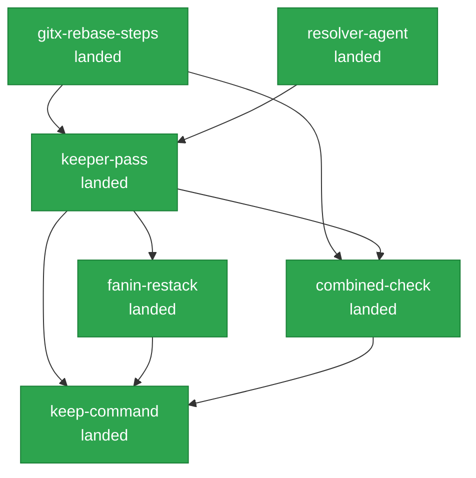

# mill: progress

Tracks finished subtasks per milestone. Milestones and requirement IDs:
[MILESTONES.md](MILESTONES.md), [REQUIREMENTS.md](REQUIREMENTS.md).

## M0. Foundations: done (2026-11-21)

- [x] Repo skeleton: Go module, layout, Makefile (`make check`), `.gitignore`
- [x] `internal/budget`: limits in USD and/or tokens, usage, `billable`/`all` counting (BG1 groundwork)
- [x] `internal/config`: load and validate `.mill/config.toml`, defaults, per-size budgets (BG6)
- [x] `internal/project`: find the repo root and `.mill/` paths
- [x] `internal/store`: SQLite in WAL mode, versioned migrations, schema, append-only event log (ST1–3)
- [x] `internal/runner`: runner interface and scripted `fake` runner (RN1–2)
- [x] `internal/host`: host interface, `exec` host, environment allowlist (HO1–2, SE3 groundwork)
- [x] `internal/doctor`: environment checks
- [x] CLI: `mill init`, `mill doctor [--json]`, `mill version`, stable exit codes (CL1 partial, CL2)
- [x] Exit criterion: `make check` green with zero tokens spent (TS1); also green under `go test -race`

### Notes and decisions

- **Toolchain:** Go 1.24. Dependencies are pinned to versions that build with it
  (`modernc.org/sqlite` v1.40.1, `github.com/BurntSushi/toml` v1.5.0); newer sqlite releases
  require Go 1.26.
- **Module path** is `mill` for now; rename when the repo gets a remote.
- **SQLite driver** is `modernc.org/sqlite` (pure Go, no CGO).
- **Config is strict:** unknown keys are errors, so a typo never silently falls back to a default.
  A file that sets `[sizes]` or `[budget.size]` replaces that whole map.
- **Event log** is append-only, enforced by SQLite triggers; `seq` is the ordering authority.
- **Exec host:** each worker runs in its own process group; Kill and context cancellation kill the
  whole group. A nil environment means an empty one, never mill's own (SE3).
- **Fake runner** reports usage in increments and stops when the context is cancelled, so budget
  enforcement (M1) can be tested without tokens. It can also write files to simulate agent edits.
- **Doctor** never spends tokens: it runs `claude --version` but does not check the login. It never
  creates the database. `host.kind = herdr` (or `auto` inside herdr) is reported as a warning
  until the herdr host exists (M5); exec is used meanwhile.
- **No forge CI:** `make check` is the gate (fmt, vet, test).

### Not in M0 (on purpose)

- No queries for tasks, attempts or branches yet: the tables exist, their APIs come with M1/M2.
- No `claude` runner, worktrees or pipeline: dogfood cut / M1.

## M1. Single-task pipeline: done (2026-11-21, branch `m1-pipeline`)

Includes the dogfood cut. Requirements: TP1–6, RN3, SE1, SE3, BG1, BG3, BG5–6.

- [x] Probe `claude -p` stream-json: usage per `assistant` event, final `result` with
      `structured_output`, `total_cost_usd`; `--json-schema` works with stream-json
- [x] Config: `worktree_root`, `gate_timeout`, `env_allow`, `runner.claude_bin`,
      `runner.attempt_timeout`
- [x] `internal/taskspec`: task file format (one task of a plan), strict validation
- [x] Store: migration 2 (task phase, worktree path); tasks, attempts, branches, per-task usage
- [x] `internal/gitx`: worktrees, commit (mill identity fallback, no hooks), diff; ignores
      inherited `GIT_*` env
- [x] `internal/gate`: run `check_cmd` + task checks in the worktree, per-command logs (TP3)
- [x] Prompts and output schemas for implementer and verifier (TP2, TP4)
- [x] `claude` runner: stream-json parsing, live usage, structured output (RN3)
- [x] Role settings: implementer and verifier permissions, no `git push`, no `.mill/` (SE1, SE3)
- [x] `internal/pipeline`: prepare → implement → commit → gate → verify → retry (TP1–6)
- [x] Budgets: per-attempt USD/token limits with kill, task budget check, `budget_exceeded`
      → blocked (BG1, BG3, BG5)
- [x] CLI: `mill task run --file F [--retry]`, `mill task show ID [--json]`
- [x] Exit criterion: real task on a toy repo reaches verified; low token limit blocks the task
      (2026-11-21, toy Go repo, Sonnet: `add-reverse` verified in 1 attempt, 18.2k tokens,
      $0.08; `budget-probe` with a 1k-token limit killed after 2.3s and blocked)
- [x] Fix found by the real run: a finished run whose final usage correction crossed the limit
      was reported as killed; a `result` event now wins over a late cancel
- [x] Dogfood: a hand-written task on mill's own repo produces a verified branch worth merging
      (`task-list`: adds `mill task list`; verified in 1 attempt, 44.8k tokens, $0.24; reviewed:
      one aggregate SQL query, tests for ordering, aggregation, filters, empty and invalid status;
      merged)

### Notes and decisions

- **Workers run with** `--setting-sources project --strict-mcp-config --no-session-persistence
  --permission-mode dontAsk --permission-prompts none`: the operator's user plugins, hooks and
  MCP servers stay out, and anything the role settings don't allow is denied, never prompted.
- **Tools:** implementer `Bash, Read, Edit, Write, Glob, Grep`; verifier `Read, Glob, Grep`
  (the diff and gate results are in its prompt). No subagents, no web.
- **Deny rules** (a tripwire, SE4): git commit/push/reset/checkout/switch/rebase/merge/branch/
  worktree/tag/remote/config, sudo, mill, and any access to the repo's `.mill/`.
- **Worktrees** live outside the repo: `~/.cache/mill/worktrees/<repo>-<hash>/<task>` by default
  (`worktree_root`). Branch `mill/t/<task>` until goals exist.
- **mill commits** after every implement attempt (trailers `Mill-Task`, `Mill-Attempt`), even
  after a failed run, so the next attempt builds on it. Squashing comes with publishing (M3).
- **Usage:** live token counts come from `assistant` events (deduplicated per message id); the
  final `result` event is authoritative and corrects them. Cost only arrives in the `result`
  event, so live USD enforcement is claude's own `--max-budget-usd`.
- **Known limitation (resolved by the M2 follow-ups, `cost-estimate`):** a run killed for its
  token limit has no `result` event, so its cost was recorded as $0. It is now estimated from
  tokens and marked `~$`.
- **Budget stop rules:** limit crossed while running → killed, `budget_exceeded`, task blocked,
  no automatic retry (BG5). Limit crossed only by the final correction of a finished run → the
  work is kept and a warning is logged.
- **Retry:** `mill task run --file F --retry` reruns a blocked/failed task with the (possibly
  edited) spec, on the same branch and base, continuing attempt numbers, starting from the last
  findings.
- **Exit codes:** 4 = task ran but ended blocked or failed.
- **mill on mill:** `.mill/config.toml` is committed with `check_cmd = "make check"` and
  `base_branch = "m1-pipeline"` (switch to `main` once M1 is merged). Task files live outside the
  repo, in `~/prj/mill-tasks/`.

### Follow-ups found while dogfooding

- [x] Timestamps are stored with RFC3339Nano, which trims trailing zeros, so text ordering by
      `created_at` is wrong for whole-second times (`12:00:00Z` sorts after `12:00:00.1Z`).
      Store a fixed-width format. (Done by mill: task `fixed-timestamps`, 1 attempt, $0.19;
      schema v3 migrates old values.)
- [x] The gate reuses Go's test cache (it ran in 0.8s after the implementer's own run). Fine for
      determinism, but consider `-count=1` in `check_cmd` if a cached pass ever hides a problem.
      (Done: the gate runs `make check GOTESTFLAGS=-count=1`.)

## M2. Planner and graph: done (2026-11-21, branch `m2-graph`)

Requirements: PL1–6, GR1–6, GT2–3, BG2, TS3. Exit criterion: a goal becomes 3–8 tasks, all
verified as local branches; killing and restarting mill finishes with nothing duplicated.

**Dogfooding plan:** mill builds M2 itself. Until the scheduler exists, each piece is a single
task (`mill task run`), reviewed and merged by hand. Once the scheduler is merged, the rest of
M2 runs as a goal through M2's own graph runner. Task files: `~/prj/mill-tasks/`.

### Design decisions

- **Goals** get sequential ids `g1`, `g2`, … and a status: `draft` (plan awaiting approval) →
  `approved` → `running` → `done`, or `blocked` when nothing more can run.
- **Task ids inside a goal** are stored as `<goal>/<task>` (e.g. `g1/config`), so plans from
  different goals never collide. Branch `mill/<goal>/<task>`, worktree
  `<worktrees>/<goal>/<task>`, runs `.mill/runs/<goal>/<task>/`. Single tasks keep
  `mill/t/<id>`.
- **Base rules (GT2):** no deps → `base_branch` tip; one dep → the parent's branch at its
  verified head; several → the deepest parent's branch, with the other parents merged in.
  A merge conflict blocks the task (the keeper handles it in M4).
- **Diff base:** a branch records `base_sha` (parent tip, for restacking later) and `start_sha`
  (after fan-in merges). The verifier reviews `start_sha..HEAD`, so it sees only this task's
  changes.
- **Overlapping `owns`** between tasks with no dependency path are reported as plan warnings;
  the scheduler never runs them at the same time (GR4).
- **Hand-written plans** (`mill plan --file plan.json`) skip the planner. Used for dogfooding
  and tests.
- **Crash recovery:** a run lock (`flock` on `.mill/run.lock`) keeps one mill run per repo. On
  start, tasks left `running` go back to `pending`, attempts left `running` become `abandoned`,
  and uncommitted worktree changes are committed as an interrupted attempt.
- **Project conventions for agents** live in `CLAUDE.md` (workers load it; checked with a probe).

### Subtasks

Built by me (setup):
- [x] Branch `m2-graph`; mill tasks branch from it (`base_branch = "m2-graph"`)
- [x] `CLAUDE.md` with conventions for agents
- [x] Gate runs tests uncached (`make check GOTESTFLAGS=-count=1`)

Built by mill, one task at a time:
- [x] `plan-validate`: `internal/plan`: plan format, validation (PL2–PL3), cycle detection,
      `owns` overlap warnings, topological order, deepest parent (1 attempt, $0.22)
- [x] `goals-store`: goals in the store (create, get, list, status, plan), approving a plan
      creates its tasks and deps in one transaction, `start_sha` on branches (1 attempt, $0.37)
- [x] `plan-cli`: `mill plan --file`, `plan show`, `plan edit`, `plan approve`, `goal list`,
      `goal show` (1 attempt, $0.50)
- [x] `graph-branches`: pipeline for goal tasks: names, base rules with fan-in, `start_sha`
      diffs, goal budget check (GT2–3, BG2) (1 attempt, $0.44)
- [x] `run-safety`: run lock (`flock`), crash recovery in the store, pipeline safe for
      parallel use, interrupted work committed, fake runner per-task scripts and delays
      (1 attempt, $0.55)
- [x] `scheduler`: `mill run <goal>`: ready set, `owns` serialization, `max_parallel`, goal
      status, interruption handling, `--retry-blocked` (GR1–GR5) (1 attempt, Opus, $2.11)

Built by mill as a goal (through the scheduler): goal `g1`, done in one `mill run`, 5/5 tasks
verified on the first attempt, 192.6k tokens, $1.71; two tasks at a time; `workflow-docs`
waited for both of its dependencies and branched from `crash-test` with `planner` merged in.
- [x] `planner`: `mill plan "<goal>"`: repo survey, planner agent, retry once on validation
      errors (PL1, PL4, PL6) (Opus, $1.25)
- [x] `crash-test`: kill -9 a running `mill run` and restart; nothing duplicated (TS3) ($0.18)
- [x] `stream-message-fix`: found in review: `system/permission_denied` stream events carry
      `message` as a string, so the claude runner counted them as unparseable lines ($0.08)
- [x] `scheduler-once`: found in review: a task that returns still `pending` would be restarted
      forever; never start a task twice in one run ($0.11)
- [x] `workflow-docs`: README walkthrough of plan → approve → run (fan-in of `planner` and
      `crash-test`) ($0.09; two inaccurate sentences corrected by hand in review)

Exit criterion (toy Go repo, real agents):
- [x] A real goal through the real planner becomes 3–8 tasks, all verified: `mill plan` made 5
      tasks in one call ($0.13): three independent `strutil` helpers, a three-way fan-in
      `cmd-toy` CLI and a README. All verified; the delivered CLI works.
- [x] Kill and restart finishes with nothing duplicated: `kill -9` while two implementers were
      running; the restart recovered 2 tasks and 2 attempts, committed their finished work as
      interrupted attempts, continued with attempt 2, verified everything, one branch per task,
      nothing verified ran again. Goal total $0.36 (excluding the killed attempts, see below).

### Follow-ups found in M2 reviews

- [x] (done: `mill task edit`.) A goal task's spec cannot be changed after approval; a blocked goal task can only be
      retried as is (`mill run <goal> --retry-blocked`). Add a way to edit a task's spec.
- [x] (done: `planner.Options.Timeout`.) The planner call has no time limit (`runner.attempt_timeout` is only applied in the
      pipeline); a hung planner is stopped only by its budget.
- [x] (done: crash recovery kills leftover workers (`killLeftoverWorkers`).) Workers run in their own process groups, so `kill -9` of mill does not reach them. In the
      real kill test no `claude` process was left 3s later, but that relies on Claude Code
      exiting by itself. Record each worker's process group and kill any survivors during
      crash recovery.
- [x] (done: recovery records their usage (`interruptedUsage`).) Attempts abandoned by a killed run record no usage (mill never saw their final result),
      so goal and task spend under-count killed runs. Recovery could read the attempt's
      stream file and record the usage it reports.

## M2 follow-ups: done (goal `g2`, on `main`)

`m2-graph` was merged into `main` (fast-forward); mill's tasks now branch from `main`. The
follow-ups run as one goal through mill's scheduler (plan:
`~/prj/mill-tasks/followups.plan.json`).

Correction: the planner follow-up was partly a review mistake. `mill plan` does apply
`runner.attempt_timeout` (I reviewed `planner.go` and missed the wrapper in `cli/plan.go`). The
real gap is smaller: the limit is shared by both planner calls and a timeout reads as a bare
"context deadline exceeded".

Goal `g2`: 5/5 tasks verified in one `mill run`, 321.8k tokens, $1.88. First real retries:
`planner-timeout` and `worker-reaper` each failed the gate once and passed on attempt 2.

- [x] `task-edit`: `mill task edit <id>` changes a pending/blocked/failed task's spec, also after
      approval (goal task spec updated in the task row and the stored plan) ($0.39)
- [x] `planner-timeout`: time limit per planner call, with a clear message ($0.16, 2 attempts)
- [x] `worker-reaper`: record each worker's pid; recovery kills leftover workers of a killed run
      ($0.50, 2 attempts)
- [x] `cost-estimate`: price table (overridable in config); runs that end without a result from
      claude get an estimated cost, marked `~$` (resolves the M1 "killed run costs $0"
      limitation) ($0.52)
- [x] `abandoned-usage`: recovery reads abandoned attempts' streams and records their usage
      ($0.31; recovery line changed by hand to billable tokens and the existing `fmtInt`)

Checked with real agents (toy repo): `kill -9` of mill during a `claude` run left the worker
**alive** (so the M2 observation of no survivors was luck). On retry, recovery printed `killed
leftover worker 7074`, the worker was gone, and the abandoned attempt got its usage from its
stream with an estimated cost (`~$0.01`).

The M2 follow-ups section above is resolved by this goal:
- spec cannot change after approval → `task-edit`
- planner time limit → `planner-timeout`
- workers surviving a killed mill → `worker-reaper`
- abandoned attempts record no usage → `abandoned-usage`

### Follow-ups found in the g2 reviews

- [x] (done: fixed in g2 by `worker-reaper`.) Both gate failures in g2 came from the crash test written in g1, not from the code under
      change: the test is flaky. `planner-timeout`'s retry fixed nothing (it re-ran until the
      test passed); `worker-reaper` fixed the test. Two races: (1) it killed mill while task a
      could still be running, so a reran (fixed: wait until a is verified); (2) "run lock still
      held" right after the killed process was reaped, seen twice in gates, not reproduced in 21
      local runs under load. The test now polls the lock for up to 10s, which would also hide a
      real "lock outlives its holder" bug. Watch for it.
- [x] (done: `owns_policy`, and since `g16` an edit to another task's files fails the attempt.) `owns` is advisory: `worker-reaper` changed `internal/cli/crash_test.go`, outside its
      `owns`. Helpful here, but it is the kind of change `owns` exists to catch. Consider
      reporting changes outside `owns` as a finding, or at least showing them to the verifier.
- [x] (done: recovery also kills group members running inside the task's worktree.) The reaper only kills a group whose leader is still alive and matches. If the agent exited
      but a child it started (e.g. a test run from its Bash tool) survives in the group, it is
      left alone.
- [x] (done: gate triage (TP8) and failing-test comparison (`g18`).) A gate failure caused by a flaky or unrelated test makes the implementer "fix" code that
      was fine, or retry until it passes. The verifier and findings could say when a failing test
      is outside the task's diff.

## g2 review follow-ups: done (goal `g3` + task `reaper-cwd`, on `main`)

Plan: `~/prj/mill-tasks/g3-followups.plan.json`, run through mill's scheduler.

Hypothesis for the "run lock still held" flake: `flock` belongs to the open file, and a child
mill is starting (git, a gate command) shares mill's open files until it execs. If mill is
killed in that window, the half-started child keeps the lock for a moment after mill is gone.
Heavy load (parallel gates, `-race`) widens the window. `fcntl` locks belong to the process and
are not inherited by children, so the lock ends exactly when mill does.

- [x] `runlock-fcntl`: run lock on `fcntl` (process-owned); crash test strict again; stress run
      ($0.19). Review: 24/24 strict crash-test runs passed, four at a time under `-race`. Caveat:
      the old failure never reproduced locally either (0/21), so this shows the strict test is
      reliable, not that the hypothesis was right; it removes the only mechanism found.
- [x] `owns-check`: files changed outside `owns` are listed; `owns_policy` = warn (verifier
      judges) | enforce (finding before the gate) | off ($0.29). Changed in review: the enforce
      finding now says how to revert (`git restore --source <start>`; `git checkout` is denied
      to implementers).
- [x] `reaper-orphans`: recovery also kills members of a worker's process group whose leader
      already exited ($0.16)
- [x] `gate-triage`: a failing gate command is re-run once (flaky → passes, verifier told);
      if it still fails it runs on the task's starting point: fails there too → task blocked as
      not caused by it; passes there → finding says the task caused it (Opus, $1.85)
- [x] `reaper-cwd` (found in review of `reaper-orphans`; the flaw was in my spec): a leaderless
      group can be an unrelated process group if the worker's group died and its pid was
      reused before recovery; only kill members whose working directory is inside the task's
      worktree ($0.24). The first run with owns-check and gate triage active: the agent stayed
      in its owns and the gate passed, so neither path was exercised by a real agent yet.

## Real-agent check of gate triage, and what it found (goal `g4`, on `main`): done

On the toy repo, `main` was made red with a failing test, then a small unrelated task ran. Gate
triage worked as designed: one implementer attempt ($0.05), the gate failed, the re-run failed
(not flaky), the same command failed on the starting point, and the task was blocked as not
caused by it, with no wasted attempts. Two gaps showed up:

- [x] `task-rebase` ($0.45): the block reason says "fix the base branch, then retry", but a retry keeps
      the task's original starting point (still red), so it blocked again (a second implementer
      run, $0.01). Add `mill task rebase <id>` to move the task's own commits onto the base's
      current tip; the block reason names it.
- [x] `gitignore-refresh` ($0.19): repos initialized before `run.lock` existed show it as untracked;
      `mill init` never updates an existing `.mill/.gitignore`. Init adds missing lines, doctor
      warns.

Goal `g4`: 2/2 verified on the first attempt, $0.64. Proved on the toy repo: after fixing
`main`, `mill task rebase triage-probe` moved the starting point from the red `ec14fe3` to the
fixed `0d2fc4c`, the retry verified, and `mill init` added `run.lock` to the old `.gitignore`.
The new behaviour since M2 is now written up in REQUIREMENTS.md (GR7–GR8, TP7–TP9, BG7).

Still open: a real agent has not yet changed files outside its `owns`, so `owns_policy` is only
covered by tests; restacking fan-in tasks and publishing (M3) are next.

## M3. Review, publish and merge detection: done (2026-11-22)

Requirements: GT1, GT4–6, RV1–7, KP2–3, SE2, TS2 (merge cases). Exit criterion: the full flow
works against a local bare remote, with merges done by a script playing the forge (merge
commit, rebase, squash), and mill detects each one.

### Design decisions

- **Statuses:** `verified` doubles as *draft* (awaiting review); new `published` and `landed`.
  One helper (`store.Done`) treats verified/published/landed as finished for dependencies,
  goal completion and the base rules.
- **Review:** `mill review` lists drafts and published tasks; `review show <id> [--diff]`;
  `review approve | changes | reject <id>`. Changes: operator comments become findings for the
  next attempt. Reject: blocked, descendants put on hold.
- **Publish (approve):** RV5 checks; the gate is re-run if the head changed since it last
  passed (`gate_sha`); squash into one commit (`git commit-tree`) whose parent is the base
  commit, or the parent task's published commit for a stacked task, so a PR shows only the
  task's own change; description (RV6) and trailers `Mill-Task`, `Mill-Goal`, `Mill-Base`;
  push `review/<task>` with `--force-with-lease`; one push function refuses any other target.
- **`mill sync`:** fetch; detect merges (ancestor, `git cherry`, trailer); mark `landed`; restack
  children of a landed parent onto main, and children of a changed parent onto its new head;
  re-gate; re-publish published ones; a conflict or red gate blocks the task (the keeper, M4,
  resolves it).
- **Deferred:** GT7 (rebuild state from git alone). Task specs live only in mill's database, so
  a real rebuild needs its own design; not part of this M3.
- **Dogfooding:** goal `g5` builds M3 as a chain of five tasks. Then the new binary publishes
  M3's own branches to a local bare "forge" repo, I merge them there with different methods,
  and `mill sync` must detect each merge and restack the rest.

### Subtasks (goal `g5`: 5/5 verified on the first attempt, $6.85; merged after review)

- [x] `publish-core` ($2.03): statuses published/landed + `store.Done`; branch `published_sha`,
      `gate_sha`; git helpers (fetch, merge-tree conflicts, commit-tree, guarded push, cherry,
      trailer search)
- [x] `review-cli` ($0.66): `mill review`, `review show`, `review changes`, `review reject`
- [x] `publish` ($1.83): `mill review approve`: RV5 rules, re-gate, squash + description + trailers,
      guarded push with lease
- [x] `sync` ($2.05): `mill sync`: merge detection, landed, restack (KP2, KP3), re-gate, re-publish
- [x] `publish-e2e` ($0.28): end-to-end test with a bare remote and a forge script (merge commit,
      rebase, squash, trailer-only), SE2 test, README publishing section
- [x] (superseded: every goal since `g5` has been published to GitHub, merged there and detected by `mill sync`.) Dogfood exit: publish M3's own branches to a local bare forge, merge them there, `mill
      sync` detects each
- [x] `publish-guards` ($1.48; found in review of g5): (1) publishing a child whose parent landed
      before `mill sync` restacked it would reuse the parent's unsquashed commits; (2) a child
      of a parent with unpublished changes would carry them; (3) sync blocked a restacked child
      only because its parent was not re-published yet; (4) tasks merged without publishing
      (all of M1/M2, merged by hand) never become landed
- [x] Local forge for mill: `~/prj/mill-forge.git` is `origin`; `main` pushed once. The first
      `mill sync` marked every hand-merged M1–M3 task landed (method `merged`) and goals g1–g5
      landed; the review queue is empty. From here on mill's branches reach `main` only through
      the forge (then `git pull`).
- [x] Dogfood exit: goal `g6` (live usage + `mill watch`, two stacked tasks; $0.86, the
      verifier failed `live-usage` once for a missing rate-limit test, attempt 2 passed) was
      published to the forge (`watch` refused until `live-usage` was published, then stacked on
      its published commit). The forge squash-merged `live-usage`: `mill sync` found it landed
      (method `patch`), restacked `watch` onto the new main, re-gated and republished it. The
      forge merged `watch` with a merge commit: landed (method `ancestor`), goal `g6` landed.
      Local main was then updated from the forge with `git pull`.
- [x] Default branch is `master` (operator decision): local `main` renamed, forge default set to
      `master` and `main` deleted there, `base_branch = "master"`. (The forge's HEAD had first
      pointed at a nonexistent `master` because I created it with `git init --bare` without
      `-b`; that was my setup mistake, not mill.)

### Follow-ups found in M3

- [x] (done: `mill init` writes the current branch.) `mill init` writes `base_branch = "main"` regardless of the repo; it should write the
      repo's current branch (this repo uses `master`).
- [x] (done: they render as `- [x]`.) The published description renders acceptance criteria as `- [ ]`; they are verified, so
      `- [x]` (or plain bullets).
- [x] (done: `mill clean`.) Landed tasks keep their local branches and worktrees (33 now), and `review/*` branches stay
      on the remote after landing. Add a cleanup (`mill clean`): remove worktrees and branches of
      landed tasks, and optionally delete their review branches (allowed under SE2).
- [x] (done: `g15`, plus plan warnings for task checks that repeat `check_cmd`.) mill's own gate now takes ~4 minutes (many end-to-end git tests, run twice: `make check`
      plus the task's `-race` checks). Consider sharding, or skipping the duplicate run when a
      task's checks are a subset of `check_cmd`.
- [x] (done: `defer live.stop()` in the pipeline's agent call.) Minor (from the verifier): if `Runner.Run` panics, the live-usage writer goroutine leaks.
- [ ] GT7 (rebuild state from git) stays deferred, see the design notes.

## M3 follow-ups through GitHub: done (goal `g7`)

Onboarded to GitHub: `origin` is `git@github.com:msidorkevich/mill.git` (the local forge stays as
remote `forge` for now); `master` pushed once, by hand; from here on `master` changes only
through merged PRs (then `git pull`).

Goal `g7`: `module-path` first (it touches nearly every file), the others stacked on it, so
their PRs target `review/g7/module-path` until it merges; then GitHub retargets them to
`master` and `mill sync` should restack and re-publish them.

- [x] `module-path` (4 attempts: the first three hit the Claude usage limit, see below): module `github.com/msidorkevich/mill`
- [x] `init-base-branch` (1 attempt): `mill init` writes the repo's current branch
- [x] `publish-polish` (3 attempts: the verifier caught a test assertion that could never fail, and an off-by-prefix 600-character limit): `- [x]` checklist, trimmed verifier summary
- [x] `mill-clean` (1 attempt): remove landed tasks' worktrees and branches; `--remote` deletes their review
      branches (lease, review/* only)
- [x] `livewriter-panic` (1 attempt): writer stops even if the runner panics

Not in this goal: gate speed (mostly my specs adding a full `-race` run on top of `make check`;
I now write narrower checks), GT7 (deferred).

Goal `g7`: 5/5 verified, $1.27, published to GitHub and merged there (PRs #1, #3–#5). The PRs
were opened against `master` and merged with merge commits, so `mill sync` saw every task land
by `ancestor` (`module-path` came in with `mill-clean`, which was stacked on it); goal `g7`
landed. Not yet exercised on GitHub: stacked-PR retargeting and the squash/rebase buttons.

### Follow-ups found in g7

- [x] Claude usage limit (goal `g8`, published): the first `g7` run hit "You've hit your 5-hour limit"; mill counted it
      as an implementer failure and burned all three attempts in seconds, then blocked the task.
      A usage or rate limit is not the agent's fault: recognise it, do not count the attempt,
      stop starting new agents, and block or pause with the reset time.
- [x] The workers' deny rule for `mill` also matches (goal `g8`, `claude-md-note`) a locally built `./bin/mill`, so an agent
      working on mill cannot run the binary it just built (it verified another way). Fine as a
      safety rule; mention it in CLAUDE.md so agents use `go run ./cmd/mill` or tests instead.

## Usage limits (goal `g8`): done

The real stream showed a machine-readable signal: `rate_limit_event` (`status: rejected`,
`rateLimitType`, `resetsAt`) and a result with `api_error_status: 429`. 3/3 verified on the
first attempt, $2.27; reviewed; published to GitHub and merged (PRs #7, #8; merged with merge
commits, so every task landed by `ancestor`; squash, rebase and stacked retargeting are still
not exercised on GitHub itself). The early usage warning has since shown up in real runs
("usage at 34% of the seven_day limit").

- [x] `limit-detect`: runner status `rate_limited` with limit type and reset time; early
      warning from `allowed_warning` events ($0.21)
- [x] `limit-handling`: a rate-limited attempt is not a failure and no further attempts run;
      the scheduler stops starting agents and blocks the goal with the reset time;
      `mill run --wait-on-limit` waits for the reset and continues; planner and `task run`
      report it too (Opus, $2.03)
- [x] `claude-md-note`: CLAUDE.md tells agents not to run `mill`/`./bin/mill` ($0.04)
- Known gap (accepted): if claude dies after a rejected event without a final result, the run
  is reported as a plain error; the next attempt then hits the limit cleanly.

## Housekeeping

- [x] `mill clean --remote` run on mill itself: 41 worktrees and 41 local branches of landed
      tasks removed, 8 `review/*` branches deleted on GitHub; a second run changed nothing.
- [x] `clean-empty-dirs` (published): `mill clean` also removes empty directories under the
      worktree root (empty goal folders, gate-triage `.base/` leftovers). Review found that the
      first version descended into live worktrees and would delete empty folders an agent may
      need; sent back with `mill review changes` (the operator comments reached the implementer
      as `[operator]` findings), fixed in attempt 2: directories with a `.git` entry are never
      entered. $0.33.

## M4. Keeper: done (goal `g9`, landed 2026-11-22)

Requirements: KP1, KP4–KP8, TS2 (conflict cases). Exit criterion: scenario tests with injected
textual and semantic conflicts are resolved or flagged correctly.

**Planned by mill's own planner** for the first time on real work: `mill plan "<goal>"` with my
design decisions in the goal text produced 6 tasks in one call ($0.93). Edited before approval:
removed a duplicate `make check` from every task's checks (it would have doubled every gate) and
made the CLI task size S.

### Design decisions

- `mill keep [<goal>] [--watch] [--interval] [--combined] [--json]`: one reconcile pass over open
  tasks (verified or published) in dependency order, starting with sync.
- Lazy (KP4): rebase only on a real conflict (`git merge-tree`, KP5).
- Conflicts (KP6): rebase with `rerere`; then a resolver agent (the only new role) edits the
  conflicted files while the rebase is stopped; then gate + verifier; any failure restores the
  branch exactly and blocks the task for the operator.
- Fixer (KP7): a red gate after a restack becomes findings for a normal implement attempt.
- Fan-in restack: rebuild on the deepest parent (or the base branch), re-merge the others,
  replay only the task's own commits.
- Combined check (KP8): merge all ready branches in a throwaway worktree, gate, bisect the
  culprit, find its partner, flag both (not blocked).

### Subtasks (goal `g9`: 6/6 verified, $10.11)

- [x] `gitx-rebase-steps`: rebase/merge that can stop, rerere, conflict hunks ($1.10)
- [x] `resolver-agent`: resolver prompt and pipeline entry points ($1.13)
- [x] `keeper-pass`: one reconcile pass: lazy detection, rerere, resolver, fixer, re-publish ($2.08)
- [x] `fanin-restack`: fan-in restack in keep, sync and task rebase ($3.90)
- [x] `combined-check`: merge all ready branches, bisect culprit and partner ($1.48)
- [x] `keep-command`: `mill keep` with --watch, --combined, --json ($0.42)
- [x] Usage-limit handling proven for real: `fanin-restack` and `combined-check` hit the
      five-hour limit; recorded as rate_limited (no attempts burned), the goal waited until the
      reset (`--wait-on-limit`), resumed, kept the agents' work, and finished.
- [x] Dogfood: `mill keep g9` built from the M4 branches ran on mill itself: no conflicts; the
      combined check merged all six branches onto master and the gate was green.
- [x] Published and merged in four rounds (the fan-in rule: every dependency but the deepest
      must land before a fan-in task is published). Between rounds `mill sync` (built from M4)
      marked the merged tasks landed and restacked the rest, including both fan-in tasks, which
      sync could not restack before M4. Goal `g9` landed.

### Follow-ups found in M4

- [ ] The fan-in publish rule makes a wide DAG land slowly (four merge rounds for six tasks).
      Consider publishing a fan-in on top of a temporary merge of its unlanded parents, or a
      documented "land in waves" helper that says which PRs can be merged now.

## Approval queue (goal `g10`): done (landed 2026-11-22)

Approve once, and `mill keep` publishes each task as soon as the publish rules allow, so
landing a stacked or fan-in goal needs no round-trips (asked for after the four M4 rounds).
Planned by mill's planner ($0.26): three tasks, `store-approval` → `review-approve-queue` →
`keep-publishes-queue`. Approvals are cleared in the store whenever an implementer run starts,
so any new code needs a new approval; restacks keep it.

3/3 verified on the first attempt, $4.52. **Landed with its own feature:** one `mill review
approve --goal g10` published `store-approval` and `review-approve-queue` (stacked) and queued
the fan-in `keep-publishes-queue`; `mill keep g10 --watch --interval 1m` then ran unattended.
After the operator merged the stack on GitHub, the next pass marked both landed, restacked the
queued task onto master, re-gated it and published it from the queue by itself; after its merge
the following pass marked goal `g10` landed. No relaying between the merges.

Afterwards `mill clean --remote` removed the landed tasks' local worktrees and branches; their
`review/*` branches on GitHub were already gone (deleted on GitHub), which clean reported and
skipped.

### Follow-ups found while planning g10

- [x] (done in `g22`: the planner prompt prefers parallel tasks and separate cross-feature test tasks; plan review warns when dependent tasks overlap only in test files.) The g10 plan is a strict chain although `keep-publishes-queue`'s code only needs the
      store API; it depends on `review-approve-queue` only because its end-to-end scenario test
      (a requirement from my goal text) approves tasks through the CLI. Putting that test in its
      own fourth task would have run the two middle tasks in parallel (about one task's time
      saved). Improve the planner prompt: prefer parallelism, and put end-to-end tests that span
      several features in their own task so feature tasks do not depend on each other only for
      a test.
- (part of my plan-review checklist; the planner side is in `g22`.) When reviewing a plan, flag dependencies that exist only because of a test, and consider
      splitting the test out before approving.

### Follow-ups found while landing g10

- [x] (done: "combined check: unchanged since the last check".) `mill keep --watch` re-runs the combined check on every pass with two or more ready
      branches, even when nothing changed since the last green check; on mill that is a full
      gate (several minutes) per pass, so `--interval 1m` became 5+ minutes. Remember the last
      green result per set of ready branches and their heads; re-run only when the set changes.
- [x] (process rule, kept as a memory: check the base branch and the GitHub API before reporting merges.) Process note (mine): I checked GitHub once, just before the operator's merge landed, and
      wrongly said the wrong PR had been merged. Check what the base branch contains (which
      tasks landed), not the top PR number, and re-fetch before concluding.

## Cheaper keep, goal graph, reopening goals (goal `g11` + task `goal-reopen`): published

- [x] `combined-cache` ($0.56, 3 attempts): the combined check is cached by fingerprint (base
      tip + ready branches and heads); an unchanged `mill keep` pass reports the cached result
      instead of running a full gate; `--combined` forces a run. Attempt 1 failed review (no CLI
      test for `--combined`), attempt 2 hit the five-hour limit (waited, resumed), attempt 3
      passed. First real use of the `owns` check in warn mode: the task changed three files
      outside its owns, mill listed them for the verifier, and the verifier judged them needed.
- [x] `goal-graph` ($1.85, 2 attempts): `mill goal graph <g>` draws the task graph (lanes like
      `git log --graph`, status marks, `← dependencies` on each row, independent tasks
      separated) and `--mermaid` prints a flowchart that GitHub renders. Sent back once with
      `mill review changes`: trying it on real goals showed independent tasks looked chained and
      dense fan-ins were hard to read.
- [x] `goal-reopen` ($0.26): found while sending `goal-graph` back. `review changes` left the
      goal `done`, so `mill run` refused to re-run the task. Sending a goal task back now
      reopens its goal, and the scheduler no longer refuses a done goal with unfinished tasks.
      The re-run of `g11` used a binary built from this fix.

M4 graph as `mill goal graph g9 --mermaid` renders it:

## Housekeeping (continued)

- [x] `g11` and `goal-reopen` landed (PRs #23–#25); goal `g11` landed.
- [x] `clean-on-land` ($1.75, PR #26): when sync or keep marks a task landed, the same pass
      removes its worktree and local branch and deletes its `review/*` branch on the remote
      (lease-guarded); `clean_on_land = all | local | off`. Proven on its own landing: the sync
      that detected it cleaned up its worktree, branch and `review/clean-on-land` on GitHub.
- [x] The merged `progress/*` branches were deleted on GitHub and locally. GitHub's "Automatically
      delete head branches" setting is the operator's to enable (no API access from here).
- [x] PR banners: GitHub hides "Compare & pull request" banners after about an hour, so branches
      published earlier looked like they had disappeared. Publish messages now come with direct
      compare links; the M6 `on_publish` hook (`gh pr create`) would remove the manual step.

## M5. TUI and herdr: done (goal `g12` landed 2026-11-23, plus fixes)

Requirements: UI1–UI3, HO3–HO4. Exit criterion: the whole workflow works from the TUI, with and
without herdr. Planned by mill's planner ($0.52), then edited before approval: a `go-upgrade`
task added as the root (the operator allowed upgrading Go: go.mod moves to Go 1.27.4 through the
toolchain directive, so no machine change is needed, and the dependencies pinned for Go 1.24 are
updated), and `docs/PROGRESS.md` removed from a docs task's files (PROGRESS stays the operator's
and mine, updated in its own PRs).

### Design decisions

- Bubble Tea v1.3.10, Lip Gloss v1.1.0, Bubbles v0.21.1: the only new dependencies.
- The TUI is a thin client: it polls the store for state and runs mill's own commands as
  subprocesses for every action, so locking, recovery and logic stay in the CLI.
- Views: goals with their graph, review queue, task detail (spec, verdict, gate, diff, log),
  agents. Keys per UI3; `s` (skip) deferred because mill has no skip operation.
- herdr host: a wrapper records pid and exit code to files, results are still read from
  files; `host.kind = auto` picks herdr only inside herdr. Planned as one pane per worker split
  next to the operator's pane; changed after real use to one unfocused tab per worker
  (`herdr-robust`, see the follow-ups).
- End-to-end tests are a separate task (applying the planner-parallelism follow-up).

### Subtasks (goal `g12`: 8/8 landed, PRs #27–#34, #38, #39; about $9 of agent spend)

- [x] `go-upgrade`: Go 1.27.4, current dependencies ($0.14). The upgrade worked in practice:
      the next `make build` downloaded the toolchain by itself.
- [x] `herdr-host`: herdr host in internal/host
- [x] `herdr-wiring`: host selection, doctor, config comment
- [x] `tui-foundation`: dependencies, `mill tui`, polling, tabs, command runner
- [x] `tui-review-detail`: review queue, task detail, diff, log tail, `$EDITOR` changes
- [x] `tui-agents-open`: agents view, open worktree (herdr pane or shell). It conflicted with
      `tui-review-detail` in `internal/tui/model.go`; after the others landed, the keeper
      restacked it and the **resolver agent's first real job** merged both sides ($0.07); gate
      and verifier then passed.
- [x] `tui-herdr-e2e`: end-to-end tests across the TUI and the herdr host
- [x] `docs-tui-herdr`: README sections for the TUI and hosts

### Exit criterion

The whole workflow runs from the TUI with the exec host and with a fake herdr (end-to-end
tests), and on the real herdr host: task `prepare-cleanup` ran with `host.kind = auto` inside
herdr, each agent in its own tab (`mill prepare-cleanup a1 implementer`), the operator's tab
kept focus, and the tabs closed when the workers ended.

### Process notes

- I passed spec text containing backticks inside a double-quoted shell string, so the shell ran
  them; one was `go get -u ./...` in the main checkout. It failed before writing anything (the
  tree stayed clean) and I repaired the damaged spec text. From now on, code that carries text
  goes in script files, never inline shell-quoted strings.

### Follow-ups found in M5

- [x] **New task branches referred to landed dependencies' deleted branches** (bug, fixed by
      task `prepare-landed-deps`, PR #35; review added one fetch at a time and an offline
      fallback). After the first five `g12` tasks landed,
      `mill run g12 --retry-blocked` failed both remaining tasks before any agent started:
      `merge dependency g12/herdr-wiring: … not something we can merge`. Cause: preparing a new
      task's branch still merged every dependency's branch by name, but `clean_on_land` (task
      `clean-on-land`) had deleted the branches of the landed ones. A landed dependency's code is
      already in the base branch, so it needs no branch. Fix: base new branches like restacks
      already do (`internal/fanin`): landed dependencies come from the remote base tip, and only
      unlanded dependencies are merged by branch. No tokens were spent on the failed attempt.
- [x] (done: goal `g15`.) **Slow gates** (measured during `g12`). A gate takes at least 5 minutes: `internal/cli`'s
      145 integration tests take ~300s, and no test in the repository uses `t.Parallel()`, so
      they use about one of 8 cores. Two gates at once, next to the agents, pushed the load
      average to 132 on 8 cores, and test file churn kept `fseventsd` near 95% CPU.
      (Already done: `~/.cache/mill` is excluded from Time Machine.) Planned as a "fast gates"
      goal right after M5:
  - [x] **A. Run independent tests in parallel:** `t.Parallel()` in every test that does not
        share process state, replacing the 5 `t.Setenv` uses that prevent it (pass the values
        explicitly instead). Target: `internal/cli` from ~300s to 60–90s.
        (done in `g15`: 611 tests call `t.Parallel()`)
  - [x] **B. No duplicate test runs in a gate:** `check_cmd` (`make check`) already runs every
        package, but the planner gave tasks checks like `go test ./internal/cli/...`, so those
        gates ran the slowest package twice. Task checks must stay narrow (`-run …`) when
        `check_cmd` covers the package: a planner prompt rule, plus a plan validation warning.
        (done in `g15`, task `narrow-task-checks`)
  - [x] **E. Limit concurrent gates:** a `max_parallel_gates` setting (default 1), separate
        from `max_parallel`, so agents still work in parallel while gates take turns. Fewer
        load spikes; less important once A is done.
        (done in `g15`: `max_parallel_gates`, default 1)
- [x] **herdr host could not read herdr's real response** (bug, fixed by task `herdr-pane-id`,
      PR #36). `pane split` returns the pane as an object (`.result.pane.pane_id`); the host
      expected a string, because I described herdr's output from memory when planning M5 and
      the tests used that made-up shape. Tests now use a response captured from real herdr.
- [x] **A failed branch preparation leaves its branch and worktree behind** (task
      `prepare-cleanup`, published; run on the real herdr host). The failed
      dependency merge above had already created both task branches; the next retry stopped at
      `branch … already exists in git but mill has no record of it`. I checked them (no work of
      their own, clean worktrees) and removed them by hand. Fix: remove what preparation created
      when it fails.
- [x] **herdr host robustness** (task `herdr-robust`, PR #41, $3.33 over 4 attempts: the
      verifier found two real gaps, two reworks adapted it to M5 code that landed meanwhile). The operator closed two worker
      panes that mill had opened in their own tab without saying what they were. mill then
      waited forever for exit files that never came, and ignored Ctrl-C and SIGTERM (it had to
      be killed with SIGKILL; recovery then worked: tokens recorded, uncommitted work
      committed). Fix: each worker in its own labelled tab (`mill <task> <role>`, never
      focused) that says closing it stops the task; a closed pane fails the attempt within ~2s;
      cancellation always returns. Also found: run inside herdr, `internal/cli`'s tests created
      and closed real herdr panes; tests must never reach the real herdr.
- [x] **`mill watch` says "nothing running" during gates** (task `watch-shows-gates`, PR #40).
      It lists only agent attempts, and the gate is not one; the TUI Agents view has the same
      gap. Fix: show every running stage with elapsed time and the gate log's last line.
- [x] (done: goal `g13`.) **One scheduler for all goals** (operator decision 2026-11-23; planned as the next goal,
      before fast gates). Today each `mill run <goal>` or `mill task run` starts its own
      scheduler, and the repository lock allows one such process, so only one goal (or one
      single task) runs at a time, and work had to be queued by hand. A goal is only a group of
      tasks, so there is no reason for that. Design:
  - `mill run` without arguments runs every ready task of every approved goal and every queued
    single task; `max_parallel`, file ownership and budgets apply across all of them.
  - A running scheduler picks up newly approved work from the store: `mill plan approve` or
    `mill task run` during a run joins it instead of being refused.
  - `mill run <goal>` stays as a filter.
  - The lock means "one scheduler per repository". `mill review approve/changes/reject` hold
    it only while they write, so publishing never waits for a run.
  - Per-goal budgets, statuses and dependency rules stay as they are (they are task data).

Order after M5: `herdr-robust`, `watch-shows-gates`, one scheduler for all goals, fast gates
(A, B, E).

More follow-ups found while landing M5:

- [x] (done: goals end as `landed` once every task has landed.) **"done" hides unmerged work.** A goal whose tasks are all published shows `done`, and I
      reported M5 as landed while PR #39 was still open. `mill goal show` should say
      `published, not merged` until every task has landed.
- [x] (done in `g22`: the verifier and `mill review show` list base changes to the task's files.) **Branches planned against an old base.** Tasks running in parallel with merges started
      from a base without the latest docs, so one added a second README "Hosts" section. Seen
      by hand, not by mill. When a task's owned files changed on the base branch since it
      started, mill should rebase it before the gate (or at least warn in the review).
- [x] (done in `g22`: `review approve --goal` runs the combined check before publishing.) **Clashes between verified branches are found by hand.** `herdr-robust` and
      `tui-herdr-e2e` each passed alone but together redeclared a test helper and disagreed on
      herdr's protocol. It happened again in `g13`: `short-locks-review-rebase` and
      `short-locks-sync-keep-clean`, built in parallel, both defined `assertNoClaims` in package
      `cli`. The keeper's combined check would catch it, but only for published branches; it
      should also run on verified sibling branches before publishing a batch (`review approve
      --goal`), and the planner prompt should tell parallel tasks to give test helpers
      task-specific names.
- [x] **Locks block unrelated work** (publish, sync, single tasks): short per-task claims landed
      in `g13` (PRs #44, #45, #49); `mill sync` now runs next to `mill run`.

## One scheduler for all goals: done (goal `g13` landed 2026-11-24, $15.15)

Planned by mill's planner ($0.70, 9 tasks), reviewed and edited before approval (a claim held by
a reused pid must not count as live; the docs task neither edits PROGRESS nor reruns `make
check`). Design: commands that only change records or publish claim the tasks they change in the
store instead of taking the repository lock; one scheduler runs every approved goal and queued
single task, and picks up new work while running; only the scheduler runs crash recovery.

First run: 7 of 9 verified ($9.22); the end-to-end task was blocked before it started because
two of its dependencies collided (see below). After the fixes all 9 tasks are verified or
landed; landed so far: `store-task-claims`, `short-locks-sync-keep-clean`,
`scheduler-all-goals`, `runlock-holder-probe`, `short-locks-review-rebase` (PRs #44–#47, #49).
`run-command-one-scheduler` is blocked by a restack (see "Restacks replay every attempt") and
the rest of the stack (`task-run-joins-scheduler`, `e2e-one-scheduler`, `docs-one-scheduler`)
publishes after it. Published so far: `store-task-claims`,
`short-locks-sync-keep-clean`, `scheduler-all-goals`, `runlock-holder-probe` (checked merged
together: they compile and their packages pass).

### Follow-ups found in `g13`

- [x] **The verifier does not see the rest of the plan.** (Fixed in `g19`, task
      `verifier-plan-context`.) It rejected
      `run-command-one-scheduler` because `sync`, `keep` and `clean` still took the run lock on
      that branch, which is the sibling task `short-locks-sync-keep-clean`'s job, built in
      parallel. The implementer then did the sibling's work in the sibling's files, and the two
      branches collided. The verifier prompt should list the other tasks of the goal with their
      files and summaries, and treat findings in another task's scope as out of scope.
- [x] **An edit to another task's files is only a warning.** (Fixed in `g16`, task
      `owns-sibling-finding`.) The owns check recorded
      `owns-outside` for five files that belonged to a sibling task and let the attempt pass.
      When a file is owned by another task of the same goal, the owns check should fail the
      attempt (revert hint included), not warn.
- [x] **Overlapping acceptance criteria.** (Partly fixed in `g19`: plan review warns when a
      criterion names a file owned by another task.) The planner gave `run-command-one-scheduler` a
      criterion ("recovery output only from `mill run` and `mill task run`") that could only be
      met by changing a sibling's files, so a revert failed the same way a second time; I
      corrected the criterion with `mill task edit`. My plan review checked file ownership but
      not whether each criterion can be met within the task's own files; plan validation (or
      the planner prompt) should check that too.
- [x] **`mill task edit` needs bare ids and explicit fields.** (Fixed in `g19`, task
      `task-edit-accepts-show-json`.) Editing a goal task from
      `mill task show --json` failed twice: the id must be the bare plan id
      (`run-command-one-scheduler`, not `g13/...`) and `depends_on` must be present even though
      `task show` leaves it out. `task edit` should accept what `task show --json` prints.
- [x] (obsolete since one scheduler (`g13`).) **Publish before restarting a run.** I restarted `g13` before publishing its ready tasks,
      so the run's lock blocked publishing again. Goes away with this goal; until then, publish
      first.
- [x] **Restacks replay every attempt** (task `restack-net-change`, PR #51). `mill sync`
      blocked `run-command-one-scheduler` while restacking it onto the base: it replays the
      task's commits one by one, and two of its five attempts edited a sibling's files that
      later attempts reverted. The net change merges cleanly. Fix: a restack applies the task's
      net change as one commit, as publishing already squashes.
- [x] **`mill sync` during a run mishandles a running child of a landed parent** (fixed by
      task `sync-busy-child`, PR #64; it ran as the first single task joined to a running
      `mill run`) (found by the
      `e2e-one-scheduler` agent, which left `TestSyncDuringRunReportsRunningChildBusy` skipped
      with the reason). Sync skips the busy child silently instead of listing it as busy, and
      clean_on_land removes the parent's worktree, branch and review branch while the child is
      still based on it. Fix: task `sync-busy-child` (after `e2e-one-scheduler` lands and after
      `restack-net-change`).
- [x] **End-to-end tests must be fast.** The scheduler end-to-end tests start real `mill run`
      loops that poll; with default intervals every gate pays for that waiting. Tests must
      inject polling intervals of milliseconds, the way tests already inject clocks, and the
      planner prompt should say so for test tasks. Part of the fast-gates goal.
      (done in `g15`: injected millisecond polls)
- [x] (process rule, kept as a memory.) **I listed merged PRs as open** three times (#33, #37, #49). Before sending a PR link I
      check the GitHub API for its state, not only that the branch exists.

- [x] **Sync never retried a task it had blocked** (task `sync-retries-restack-blocks`, PR #52,
      $3.92). Only verified and published tasks were restack candidates, so a task blocked by a
      restack conflict stayed blocked after the cause was fixed, and the only way out re-ran the
      implementer on verified, approved work. Now the block records the former status, every
      sync retries it and restores the status (approval kept) on success, and blocks from before
      the fix are recognised by sync's message. Proven on `run-command-one-scheduler`: a plain
      `mill sync` restacked it and brought it back to verified.

## Improvements collected while running `g12` and `g13` (2026-11-24)

Not yet planned into a goal unless noted. Grouped by area; each names what was seen.

### Visibility

- [x] **Work done by `sync`, `keep` and `review approve` is invisible.** (Fixed in `g19`:
      claims carry an activity, shown by `mill watch` and `mill task list`.) While `mill sync`
      restacked and re-gated four `g13` tasks for about 20 minutes, the tasks stayed `verified`,
      `mill task list --status running` printed `no tasks` and `mill watch` printed `nothing
      running`; only the claim row showed it. Claims should carry what their holder is doing
      (`sync: restack`, `sync: gate 3m`, `approve: push`), and `mill watch`, `goal show`,
      `task list` and the TUI Agents view should list claimed tasks next to running ones.
- [x] **`mill task list` buries current work.** (Fixed in `g19`, task
      `task-list-current-first`.) It lists every task oldest first (80 rows now),
      so active tasks are at the bottom. Show running and claimed tasks first, then the rest
      (or newest first, with `--all` for history).
- [x] **Skipped tests are found by reading summaries.** (Fixed in `g19`: added `t.Skip` calls
      are listed by `mill review` and `mill task show`.) The `e2e-one-scheduler` agent correctly
      left `TestSyncDuringRunReportsRunningChildBusy` skipped with the bug in its reason. mill
      should detect `t.Skip` added by a task's diff and list it in the review and in `task
      show`, so it becomes a follow-up without me spotting it.

### Speed of sync and gates

- [x] **A stack is re-gated one task at a time.** When the bottom of a stack changes, sync
      restacks and re-gates every task above it in sequence (4 × ~5 minutes in `g13`). Pipeline
      it: restack the next task while the previous one's gate runs, within `max_parallel`.
      (done in `g15`, task `pipelined-restacks`)
- [x] **Identical trees are gated again.** A restacked task whose tree equals one that already
      passed its gate should reuse that result, like the combined check's fingerprint cache.
      (done in `g15`, task `gate-result-reuse`)
- [x] (done: goal `g15`.) Fast gates (A, B, E and fast end-to-end tests above) stay the biggest win: `internal/cli`
      now takes about 290 seconds per gate.

### Robustness of the graph

- [x] (done in `g22`: they go to the resolver.) **Conflicts between dependencies at preparation block the task, with no resolver.** In
      `g13` the end-to-end task could not start because two dependencies collided; restack
      conflicts go to the resolver agent, preparation conflicts only block. Use the resolver
      there too (or at least offer it in the block message).
- (rule for new code.) **Re-check what a block records.** Twice a state change that recorded a problem also
      stopped mill from looking again (a blocked restack never retried; a published goal shown as
      done). Rule for new code: every blocked or terminal state names what clears it, and the
      code that can clear it re-checks it.

### Planning and review

- (my plan-review checklist; partly automated by plan warnings since `g19`.) **My plan review checks ownership, not scope.** Besides overlapping criteria (above), the
      checklist when I review a plan: every criterion can be met in the task's own files; no
      task's checks rerun a whole package that `check_cmd` covers; parallel tasks that add tests
      to the same package use task-specific helper names; docs tasks run last and own only
      docs.

## Models chosen by task size and complexity: done (goal `g14` landed 2026-11-24, $6.70)

Planned as its own goal after `g13`, before fast gates. Today the planner sets only `size`, and
`.mill/config.toml` maps size to one model (`S → sonnet`, `M → opus`) for every role, with no
escalation. Design:

- **Complexity next to size.** The planner rates each task `low | medium | high` with a
  one-line reason ("concurrency and crash recovery", "text only"); size stays the amount of
  code.
- **The mapping lives in config, not in the planner.** `(size, complexity) → model`, default:
  S/low → haiku; S/medium and M/low → sonnet; M/medium and anything high → opus. `mill plan
  show` prints each task's model and estimated cost; the operator can override a task's model
  before approving.
- **Per-role models.** The verifier uses at least the implementer's tier and never less than
  sonnet; the resolver uses the task's model; the planner stays on opus.
- **Escalation.** A retry after a failed attempt moves one tier up, within the task's budget;
  the step is recorded so `mill task show` explains the cost.
- **Measurement.** Every verdict records the model that produced it, so the mapping can be
  tuned from first-attempt pass rates.

Order after `g13`: models by size and complexity, then fast gates (A, B, E, fast end-to-end
tests, pipelined and cached sync gates), then visibility (claims in watch/list/TUI, task list
order, skipped tests in review).

`g14` landed as 10 tasks (PRs #58–#63, #65, #66, #68, #69); mill's own `.mill/config.toml` got
the `[models]` and `[roles]` sections (PR #67). It was the first goal run by one `mill run`
without arguments, with the single task `sync-busy-child` joined to the same run through
`mill task run`. Three tasks needed a second attempt after a verifier finding. `mill stats
models` works; tasks from before `g14` show complexity `medium` and model `-` because neither
was recorded then.

## Fast gates: done (goal `g15` landed 2026-11-25, $21.02)

Measured before planning: `internal/cli` 250s (210 tests), `internal/keeper` 82s,
`internal/pipeline` 74s, `internal/gitx` 44s; no `t.Parallel()` anywhere; `t.Setenv` 25 times in
11 test files. Scope: A parallel tests, B no duplicate test runs, fast polling in tests, a gate
limit (`max_parallel_gates`), reused gate results for identical trees and pipelined restacks.
The first goal planned with complexity ratings.

Planned by mill's planner ($0.74, 11 tasks), the first plan with complexity ratings: the four
test tasks and the env-injection task on opus (M/medium), the gate-slot chain on opus (M/high),
`narrow-task-checks` on sonnet, the README on haiku. Landed so far (PRs #73–#78):
`cli-env-injection`, `narrow-task-checks`, `cli-parallel-group-a`,
`parallel-tests-infra-packages`, `parallel-tests-core-packages`, `gate-slots-store`; 611 tests
now call `t.Parallel()` (0 before). `cli-parallel-group-b` timed out once (its implementer
waited for its own 15-minute `-race -count=3` run and hit the 30-minute attempt limit with the
work done); it was restarted with the instruction to leave that check to the gate.

A `mill sync` during the run behaved as `sync-busy-child` intended: it landed the six merges,
listed `cli-parallel-group-b` as busy, and kept `cli-env-injection`'s branch for it.

### First measurement: the suite got slower

`go test -count=1 ./...` on master after the six merges, with an agent running next to it
(load 17–20 on 8 cores), so not a fair comparison:

| Package | Before (serial) | After (parallel) |
|---|---|---|
| `internal/cli` | 250s | 432s |
| `internal/keeper` | 82s | 144s |
| `internal/pipeline` | 74s | 124s |
| whole suite | ~5 min | ~7.5 min |

Likely cause besides the load: oversubscription. `go test` runs up to 8 packages at once
(`-p`) and each runs up to 8 tests at once (`-parallel`), so up to 64 tests at the same time,
almost all creating git repositories and starting git processes. On 8 cores that thrashes
process startup and file-system work instead of speeding up. The goal's target (`internal/cli`
under 90s) is not met yet.

- [x] **Measure fairly** on an idle machine: the whole suite with default flags, then with
      `-p 4`, `-parallel 4`, `-p 2 -parallel 4` and similar combinations, each twice; compare
      with the serial baseline (`-parallel 1`). (Done; see "Fair measurement" below.)
- [x] **Set the best combination** in the `Makefile` (`GOTESTFLAGS`, so `check_cmd` uses it) in
      a small PR, with the measured numbers in its description. (Not needed: the default flags
      won, so the `Makefile` stays as it is.)
- [x] **If no setting beats the serial run,** say so here; the rest of `g15` (gate limit, reused
      gate results, pipelined restacks) then carries the speed-up by saving whole gate runs,
      and test speed needs another approach (fewer git processes per test, shared fixture
      repositories). (Every setting beat the serial run.)
- [x] Review the remaining `g15` tasks with this in mind: `max_parallel_gates = 1` matters more
      than expected, because parallel test runs compete for the same cores. (Reviewed; the
      default stays 1.)

### `g15` landed

All 11 tasks landed (PRs #73–#78, #80–#84), $21.02 in total. What changed for gates:

- **Gate slots.** `max_parallel_gates` (default 1) bounds the gates running at once across every
  mill process: task gates, the combined check and the gates `sync` and `keep` re-run after
  restacks. Agents still run up to `max_parallel`. `mill watch` shows `waiting for gate`.
- **Gate reuse.** A tree that already passed the same `check_cmd` and task checks is not gated
  again; mill prints `gate reused (tree <sha>)`.
- **Pipelined restacks.** `sync` and `keep` restack the next task of a stack while the previous
  task's gate runs; a child of a red parent is blocked with the reason and not published.
- **Narrow task checks.** Plan validation warns when a task check repeats a whole-package
  `go test` that `check_cmd` already runs.

Findings from running it:

- [x] **The budget check blocks a task that only needs a verifier.** (Fixed in `g16`:
      `[budget] verifier_share`, default 0.25 of an attempt.) `pipelined-restacks`
      passed its gate on attempt 2 with $5.51 of its $8 task budget spent, and was blocked
      because "an attempt may use $3.00". Only a verifier run (about $0.55) was left. The check
      should reserve what the next step costs (the verifier after a passed gate, a whole attempt
      only before an implementer). It was unblocked by raising the task budget for one run.
- [x] **`--retry-blocked` on a task blocked in `verify` reruns the implementer.** (Fixed in
      `g16`, task `resume-at-verifier`.) The
      implementer found nothing to do ($0.40, 8 minutes) before the verifier ran. A task
      blocked after a passed gate should resume at the verifier.
- [ ] **Background re-publishes fetch while the next task is restacked.** Since pipelined
      restacks, a re-publish (fetch and push in the shared repository) can overlap with the
      next task's rebase. Git locks refs one at a time, so a clash is unlikely; watch for
      "cannot lock ref" errors in `sync` and `keep` and serialise those git calls if they occur.
- [x] **An attempt's wall time includes the Mac's sleep.** (Fixed in `g19`, task
      `agent-duration`; see finding 14 below for runs with several results.) `pipelined-restacks` attempt 2 shows
      2h40m for 13 minutes of work. Stats that average attempt time should use the agent's own
      duration, not wall time.

### This machine throttles

mill runs on a MacBook Air M2 (Mac14,15): fanless, 4 performance and 4 efficiency cores, 16 GB,
often on battery. Under a sustained load (two agents, a gate and `go test` with 8 packages of
8 parallel tests each) it heats up and slows down, which is part of why the first
measurement above was slower than the serial run. Also seen eating CPU next to mill:
`fseventsd` (file events for the worktrees), AirBuddy's `AirStatsService` and the Colima VM
(stopped on 2026-11-24).

- Measure test settings only on power and with nothing else running.
- Keep parallelism conservative on this machine: `max_parallel_gates = 1`, and test flags chosen
  by the fair measurement, not by the core count.
- [x] Consider running gates under `nice`, (done in `g19`: `gate_nice`, default 10) so agents and the terminal stay responsive while a
      gate runs.

### Fair measurement: parallel tests are 1.8× faster

`go test -count=1 ./...` on master `acc3b73` (all of `g15`), on power, no mill run, the build
cache warm. Seven settings, two rounds, the settings alternating so heat and background load
(AirBuddy, `fseventsd`, Spotlight) hit every setting alike. Wall seconds:

| Settings | Round 1 | Round 2 | `internal/cli` |
|---|---|---|---|
| `-parallel 1` (tests serial, as before `g15`) | 247 | 238 | 246 / 235 |
| **default (`-p 8 -parallel 8`)** | **136** | **129** | 133 / 127 |
| `-p 4` | 140 | 141 | 138 / 139 |
| `-parallel 4` | 147 | 152 | 145 / 151 |
| `-p 4 -parallel 4` | 141 | 171 | 140 / 169 |
| `-p 2 -parallel 4` | 149 | 139 | 132 / 122 |
| `-p 4 -parallel 2` | 179 | 153 | 178 / 151 |

- The default flags are fastest, so the `Makefile` keeps them. The slowdown in the first
  measurement came from the agent running next to it, not from oversubscription.
- `internal/cli` is the critical path: the whole run takes as long as that one package. It went
  from about 240s to 130s; the goal's target of 90s is not met. The whole suite went from about
  4 minutes to about 2m10s (target: under 2 minutes). Gates now take 2m10s–2m30s.
- One run of 14 failed: `TestPipelinedRestackKeepParentGateFailureBlocksChild` depends on
  goroutine timing (task 3 is either blocked or skipped, both correct). Fixed by the task
  `flaky-pipelined-keep-test`.

- [x] **Find the slowest `internal/cli` tests** (done; see "The macOS git shim" below) (`go test -json`, per-test elapsed time) and
      speed them up or split the package, so that `internal/cli` stops being the gate's
      critical path. The next step toward a 90-second gate.

## Budget, retry and owns fixes: done (goal `g16` landed 2026-11-25, $3.43)

Eight tasks (PRs #88–#95), every one verified on its first attempt; the planner estimated
$12–53. Before the verifier, the budget check now reserves `verifier_share` (default 0.25) of an
attempt instead of a whole one. A task blocked in `verify` after a passed gate resumes at the
verifier on `--retry-blocked` ("resuming at the verifier"), only when the head and worktree are
unchanged and the passed gate is recorded. An edit to a file owned by a sibling task that has
not landed fails the attempt under `warn` too, and `mill review` names the owner. The approval
queue in `mill keep` published the goal in three waves (two parents, then the fan-in task and its
chain, then the README) with one combined check over all five ready branches.

## The macOS git shim: the biggest cost in tests and in mill

Profiling `internal/cli` alone: 77s for 212 tests whose times add up to 589s; no single test
dominates (the slowest takes 15s; 84 take 3–10s). One slow sync test runs 182 git commands. On
macOS `/usr/bin/git` is Apple's `xcrun` shim, which finds the developer directory and then starts
the real git: `git rev-parse HEAD` takes 18.7 ms median through it and 5.9 ms when the real
binary (`/Library/Developer/CommandLineTools/usr/bin/git`) is started directly.

| Whole `go test ./...` | Run 1 | Run 2 | `internal/cli` |
|---|---|---|---|
| `/usr/bin/git` (the shim) | 153s | 182s | 151s / 180s |
| real git first on PATH | 94s | 88s | 92s / 86s |
| real git, confirmation run | 85s | | 83s |

So most of the test time was the shim, and every real `mill sync`, `keep`, publish and pipeline
step pays the same per git call. The same test also repeats lookups whose answers do not change
during a command (`config user.email` 12 times, `rev-parse --show-toplevel` 11 times,
`remote get-url` 7 times). Planned as goal `g17`: mill resolves the real git once (asking
`xcrun --find git` when `PATH` gives the shim), caches per-command lookups, and `mill doctor`
shows the git it uses. (The two failing runs above failed only because I linked git into a
temporary directory, where it found no templates and created repositories without
`.git/hooks`; one test assumed that directory, and `g17` fixes that too.)

### Follow-ups found in `g17`

- [x] **Triage compares commands, not failing tests.** (Fixed in `g18`.) `g17/doctor-git-path` broke three doctor
      tests in `internal/cli` (its git check asked the test fake for a resolved path the fake
      did not know). Triage re-ran `make check` on the task's starting point, where an unrelated
      flaky herdr test failed, and blocked the task as "fails on the task's starting point too,
      so this task did not cause them". A task is innocent only when the same tests fail on the
      starting point: compare the failing test names (`--- FAIL` lines, or `go test -json`),
      and treat a command whose failures differ as the task's failure. I fixed the task with
      `mill task edit` (it now also owns `internal/cli/cli_test.go`, where the fake lives; the
      planner had missed that file).
- [x] **Flaky herdr host tests: `Wait: operation not permitted`.** (Fixed by task
      `killgroup-eperm`, PR #106. Cause confirmed with a probe: on macOS, killing a process group
      whose members are all unreaped zombies fails with EPERM instead of ESRCH; all 373 EPERM
      results in a stress loop had only zombie members. `KillGroup` now checks the members with
      `ps` on EPERM and fails only when one is still alive.)
      `TestHerdrKillStopsProcessGroupAndClosesPane` (`herdr_unix_test.go:202`) and
      `TestHerdrContextCancelKills` (`herdr_unix_test.go:222`) each failed once in a full
      `make check` with `Wait: operation not permitted`. Find why waiting for the killed
      process group returns EPERM under load and make the tests (or the host) handle it.
- [x] **Dependencies cannot change after approval.** (Fixed in `g18`: dependencies can be
      added, not removed.) To fix `doctor-git-path` I wanted it to
      depend on `git-callers-use-bin` (which also edits `cli_test.go`); `mill task edit`
      refuses any change to `depends_on`. Owning the file without the dependency works but
      risks a conflict between the two branches. Allow adding a dependency on a task of the
      same goal while the task is not yet running (and rebase it onto the new parent).

## Fast git calls: done (goal `g17` landed 2026-11-25, $6.82)

Seven tasks (PRs #98–#104). mill now starts the real git: `gitx.Bin()` resolves it once per
process and, when `PATH` gives Apple's `/usr/bin/git` shim, asks `xcrun --find git`; a git found
earlier on `PATH` (Homebrew) is used as is. Every place that starts git, test helpers included,
goes through it, and `mill doctor` prints the path (`git 2.56.1 (>= 2.38.0) at
/opt/homebrew/bin/git`). Each command (and each `keep --watch` pass) caches the lookups that do
not change during it: work tree root, common dir, remote URL, identity; a failed git command
drops the remote and identity answers for its directory.

Whole `go test ./...` with only `/usr/bin/git` on `PATH` (no Homebrew git):

| | Run 1 | Run 2 | `internal/cli` |
|---|---|---|---|
| before `g17` (every call through the shim) | 153s | 182s | 151s / 180s |
| after `g17` (mill finds the real git) | 99s | 110s | 95s / 108s |
| real git first on `PATH` (Homebrew, or measured before `g17`) | 85–94s | | 83–92s |

The suite target (under 2 minutes) is met; `internal/cli` is at 95–108s against 90s. The same
3× cheaper git call applies to every real `sync`, `keep`, publish and pipeline step.

What went wrong:

- **I set a wrong target.** The goal asked the lookup cache for 30% fewer git processes per
  sync. I took the repeated lookups from a profile of a whole test, including its setup
  (`plan`, `run`, `approve`); one sync alone saves 3 of about 49 processes. `wire-lookup-cache`
  spent three attempts on it; the agent lowered the threshold and the verifier refused that,
  correctly. I rewrote the criterion with `mill task edit` (fewer processes, each cached lookup
  at most once, nothing about refs, heads or trees cached) and it passed: 5 attempts, $5.05 of
  the goal's $6.82. Targets in a goal must come from measuring the operation the task changes.
- **The planner missed a file.** `doctor-git-path` broke three doctor tests in `internal/cli`
  whose fake lives in `cli_test.go`, which the task did not own; triage then blamed the base
  (see "Triage compares commands, not failing tests" above). Fixed by `mill task edit`.

## Triage by failing tests, dependencies added after approval: done (goal `g18` landed 2026-11-26, $4.69)

Seven tasks (PRs #108–#114). When a gate command fails and also fails on the task's starting
point, triage now compares the failing Go tests (`--- FAIL` lines, subtests and package build
failures, read from the full log): the task is innocent only when every test that failed on its
head also fails on the starting point. Tests that fail only on the head become findings with an
excerpt of their output, and the attempt is retried; tests that fail on both are listed as "not
your fault". Output that is not `go test` output keeps the whole-command comparison, and the
compared sets are recorded in the `gate-base-failing` / `gate-base-compared` events.
`mill task edit` can add dependencies on tasks of the same goal to a pending, blocked or failed
task, moves its branch onto the new parent (a conflict blocks it with the files named) and
refuses to remove dependencies; `mill task show` lists dependencies and the ones added later.

The run was killed once by Claude Code because the Mac was critically low on memory (five tasks
verified, one agent mid-attempt). `mill run g18` recovered it: it recorded the interrupted
attempt's tokens, committed the work the agent had left uncommitted and resumed the task. Usage
then reached 97% of the five-hour limit; the rest ran after the reset.

## Improvements found while watching `g19` (2026-11-26)

Seen from outside while `g19` ran (two agents, one gate slot, herdr host). Items 1–4 cost the most
time; together they are a candidate for the next goal.

- [x] **1. Implementers run the whole gate themselves.** (Fixed in `g20`, `prompt-gate-wording`.) The implementer prompt lists
      `check_cmd` under "Gate (must pass; run these yourself before you finish)", so every
      implementer ran `make check` (one ran it three times), outside the gate slots and next to
      other tasks' gates. Load average reached 82, `skipped-tests-detect`'s gate took 3m22s
      instead of about 1m45s, and implementers took 13–18 minutes. The habit pays off: only 5
      of 204 gates ever failed. So keep the early check but run it through mill: the agent asks
      for it, it waits for a gate slot, runs under `nice`, and its result is stored by tree
      fingerprint, so the gate reuses it when the tree is unchanged (reuse exists since `g15`).
      Cheaper alternative: the prompt asks only for the task's checks and the tests of the
      changed packages, and leaves `check_cmd` to the gate.
- [x] **2. Agents act on machine-wide processes and shared temp files.** (Fixed in `g20`, `runner-attempt-isolation`.) One implementer waited
      with `pgrep -f "go test"` (which also matches other tasks' gates), ran
      `pkill -f "until \[ -s"` (which can kill a sibling worker's shell) and wrote to
      `/tmp/g19check.log` (a name two agents can share). Role settings do not deny `pkill` or
      `killall`. Wanted: deny them, give each attempt its own `TMPDIR` in its run directory, and
      tell agents to wait on their own background jobs only.
- [x] **3. A host start failure is reported as a flaky gate.** (Fixed in `g20`, `gate-start-failure`.) In `g18/readme-triage-and-deps`
      attempt 2 the herdr wrapper did not write its pid within 10s under load; the gate counted
      the command as failed (`could not run`), the re-run passed, and the command was recorded as
      `gate-flaky`, so the verifier was told the tests are flaky. The passing result was also
      recorded twice. Wanted: a command the host could not start is retried (or run on the exec
      host) and never counted as flaky; the pid wait allows for load.
- [x] **4. `max_parallel` slots idle during gates.** (Fixed in `g20`, `scheduler-agent-slots`.) A task in `gate` or "waiting for a free gate
      slot" holds one of the `max_parallel` slots although no agent runs; with two slots and one
      gate slot, one agent slot is often empty for the 2–4 minutes of a gate. Count only agent
      runs (implementer, verifier, resolver, fixer) against `max_parallel`; gates are already
      limited by `max_parallel_gates`. Best done together with item 1, or load rises further.
- [x] **5. `mill goal show` gets very wide.** (Fixed in `g20`, `output-fixes-doctor`.) DEPENDS ON lists every dependency;
      `readme-followups` has nine, which makes a line of about 230 columns. Show a count or the
      first few, or wrap.
- [x] **6. Duplicate lines.** (Fixed in `g20`, `scheduler-agent-slots`.) The run log prints `verified at <sha> (...)` and then `verified` for
      every task; one of them is enough.
- [x] **7. Gate tabs have no task name.** (Fixed in `g20`, `gate-labels-claim-activity`.) The herdr tab of a gate is labelled `mill gate 1`;
      agent tabs say `mill g19/<task> a1 implementer`. Label gates the same way
      (`mill g19/<task> a1 gate`).
- [x] **8. `mill doctor` does not report ignored config.** (Fixed in `g20`, `output-fixes-doctor`.) `.mill/config.toml` still has legacy
      `[sizes.S]`/`[sizes.M]` blocks, which are ignored because `[models]` exists; doctor says
      nothing. Warn and say which block to delete.
- [x] **9. `mill task show` prints `model (mapping)`.** (Fixed in `g20`, `output-fixes-doctor`.) The header shows the placeholder; only the
      attempts table names the real model. Show the model the next attempt would use and why
      (`opus (M/high)`).
- [x] **10. Shared files make long chains, and plan review does not show it.** (Fixed in `g20`, `plan-longest-chain`.) `g19`'s tasks that
      share `task.go`, `pipeline.go` and `migrations.go` were chained into a sequence of seven,
      which sets most of the goal's duration. `mill plan show` could print the longest chain
      with its estimated time, so splitting a shared file can be weighed at plan review.

## Follow-ups landed: done (goal `g19` landed 2026-11-26, $9.79)

Twelve tasks (PRs #118–#132), eleven verified on their first attempt. What changed:

- Crash recovery closes the herdr tabs of recovered attempts (the herdr host records each
  worker's tab next to its pid and exit files).
- `mill plan show` estimates each task from past tasks of the same size, complexity and model
  (25th–90th percentile, once there are three) and falls back to budget limits, saying which.
  For `g19`'s own plan it now gives $7.26–$24.57 against $9.79 spent; the budget-based estimate
  was $40–89.
- Claims carry what their holder is doing (`sync: restack`, `keep: gate`, `approve: push`, ...);
  `mill watch` and `mill task list` show claimed tasks and how long they have been held.
- `mill task list` shows running and claimed tasks first, then blocked and failed ones, then the
  20 newest others; `--all` keeps the old listing.
- `t.Skip` calls a task adds are recorded when it is verified and listed in `mill review` and
  `mill task show`.
- The verifier sees the goal's other tasks (id, title, owns, summary) and is told not to fail a
  task for another task's scope; plan review warns when a criterion names a sibling's file.
- `mill task edit` accepts what `mill task show --json` prints.
- Gates run under `nice -n 10` (`gate_nice`); `mill doctor` reports it.
- Attempt times use the agent's reported duration, so Mac sleep no longer counts.

Publishing took four waves. Two stacked PRs (#123, #124) were merged into their parents' review
branches after the parents had landed, so their code missed `master`; `keep` restacked both onto
`master` and they landed as #125 and #126. "Automatically delete head branches" is now on in
GitHub, which retargets open child PRs, but a child PR can then no longer be opened once its
parent merged. Opening and retargeting stacked PRs is now part of the M6 hook requirements
(HK1–HK4, PR #130), planned as M6's first goal.

### Found while running and reviewing `g19`

Continues the numbered list in "Improvements found while watching `g19`".

- [x] **11. The owns check counts dependent tasks as siblings.** (Fixed in `g20`, `owns-dependents-verifier-scope`.) `task-list-current-first` edited
      README.md (the verifier asked for it); README.md belongs to `readme-followups`, which
      depends on it and builds on top, so the edit could not conflict. The owns check failed the
      attempt anyway (`internal/pipeline/owns.go` counts every sibling that has not landed).
      Exempt tasks that depend on the edited task, directly or not.
- [x] **12. A verifier finding about a sibling's file reaches the next attempt.** (Fixed in `g20`, `owns-dependents-verifier-scope`.) Attempt 2 then
      got "update README.md" from the verifier and "revert README.md" from mill. The verifier
      gave opposite verdicts on the same tree (fail on attempt 1, pass on attempt 3). Since `g19`
      the verifier sees the siblings; mill could also drop or flag a finding whose file another
      task owns before it reaches the implementer.
- [x] **13. Read-only commands migrate the database, and older mill then refuses it.** (Fixed in `g20`, `store-additive-migrations`.) I ran a
      `g19` build's `mill plan show` on the live database: it applied migrations 13–14 and the
      `master` binary then failed with "schema version 14 is newer than this mill (12)", although
      both migrations only add columns. I restored v12 by hand (backup kept). Migrate only on
      write commands or on an explicit `mill migrate`, and let an older mill open a database
      whose newer migrations are additive.
- [x] **14. Tokens and agent time come from the last `result` event only.** (Fixed in `g20`, `runner-sum-results`.) When a background
      task wakes the agent after it finished, claude emits a second `result` covering only that
      last turn. Cost is cumulative and correct, but tokens and `duration_ms` are not:
      `pipelined-restacks` attempt 2 recorded 1,406 output tokens instead of about 35k, and
      `task-edit-accepts-show-json` attempt 1 shows 5s instead of 5m13s. 4 of 301 runs so far.
      Sum usage and durations over all `result` events.
- [x] **15. Small things from the review.** (Fixed in `g20`, `review-fixes-skips-tabs` and `gate-labels-claim-activity`.)
      - The event kind `skipped_tests` uses an underscore; every other kind uses hyphens.
      - A skip removed by a later attempt still shows: nothing is recorded when there are none.
      - A claim says `gate` while the task is still waiting for a gate slot, and has no activity
        (`-`) during the combined check.
      - Recovery does not close the tabs of keeper gates (`runs/<task>/keeper`).

## `g19` follow-ups: done (goal `g20` landed 2026-11-26, $13.95)

Twelve tasks (PRs #136–#147), planned at $10.46–$43.34 from past tasks. Nine passed on their
first real attempt; two attempts were lost to the five-hour usage limit right after the start
(the run waited with `--wait-on-limit` and resumed at the reset). What changed:

- Implementers run their task's checks and the tests of the packages they changed, not
  `check_cmd`; the gate runs it (`implementer_runs_check = true` restores the old wording).
- Agents cannot use `pkill`, `killall` or `pgrep`, get their own `TMPDIR`, and are told to wait
  only on their own background jobs.
- A gate command the host could not start is retried, then run on the exec host, and never
  counted as flaky; the herdr start timeout is 30s.
- `max_parallel` counts running agents: a task gives its agent slot back while it waits for and
  runs its gate, and takes one again before its next agent step (tasks coming back from a gate
  go first). `max_in_flight` (default `max_parallel + max_parallel_gates`) caps started tasks.
- Gate tabs are named after their task; claims say `waiting for gate`, `gate` and
  `combined check`; the run log prints `verified` once; `goal show` lists at most three
  dependencies; `task show` names the next attempt's model; doctor warns about ignored
  `[sizes]` blocks; `plan show` prints the longest chain and its estimated duration.
- The owns check ignores tasks that depend on the edited task; verifier findings about another
  task's files go to a `verifier-out-of-scope` note instead of the next attempt, and a fail
  verdict with only such findings counts as a pass with notes.
- An older mill opens a database whose newer migrations only add tables and columns
  (`schema_min_reader`).
- Usage and agent time are summed over every `result` event of a run.
- `skipped-tests` events (the old name is still read), stale skips cleared, and recovery closes
  herdr tabs anywhere under `.mill/runs` whose mill process is gone, never a live one.

The verifiers caught two real problems: a busy-loop in the new scheduler slots (a task busy in
another mill process woke the run loop on every poll) and three inaccurate README statements.

Publishing: four stacks. The first PR of stack A was merged before the others were opened, and
with "Automatically delete head branches" on, its child could no longer target the deleted
branch, so it targeted `master` directly. The rule until the M6 hooks open PRs: open every PR of
a stack, then merge from the bottom.

### Found while running and reviewing `g20`

- [x] **16. The per-attempt `TMPDIR` is inside `.mill/runs`,** (Fixed in `g21`, `worker-tmpdir-outside-mill` and `clean-removes-task-tmpdir`.) where role settings deny Read,
      Write and Edit (`.mill/**`), while the prompt tells agents to put scratch files there.
      Shell redirection works; the tools do not. Move it outside `.mill` (e.g. next to the
      worktrees).
- [x] **17. Only pipeline gates fall back to the exec host.** (Fixed in `g21`, `gate-fallback-everywhere`.) `gate.Options.Fallback` is set in
      `internal/pipeline/pipeline.go`; publish/restack gates (`internal/publish/publish.go`) and
      the combined check (`internal/keeper/combined.go`) get the retry but no fallback, although
      they can run on herdr.
- [x] **18. Out-of-scope verifier findings include landed tasks.** (Fixed in `g21`, `out-of-scope-skips-landed`.) `splitOutOfScope` matches every
      other task of the goal; the owns check skips landed ones, so a task may edit their files,
      and a real finding about such a file is dropped (and can turn a fail into a pass with
      notes). Skip landed tasks there too.
- [x] **19. Running tasks show a redundant claim.** (Fixed in `g21`, `task-list-hide-run-claims`.) `mill task list` prints
      `(claimed: mill run, held …)` for every task `mill run` is running.
- [x] **20. The plan warning about siblings' files fires on mentions.** (Fixed in `g21`, `plan-warning-only-changes`.) In `g20` it flagged a
      criterion that used README.md as a test scenario and one that read `config.go` to check
      stated defaults. Warn only when the criterion asks for a change to that file, or list such
      warnings as "check" rather than "warning".
- [x] **21. `blocked` is printed twice** (Fixed in `g21`, `blocked-logged-once`.) in the run log (`<task>: blocked: ... (task total ...)`
      and `<task>: blocked: ...`), like `verified` was.

## `g20` follow-ups: done (goal `g21` landed 2026-11-26, $3.62)

Eight small tasks (PRs #149–#156), planned at $1.99–$6.29 from past tasks; `plan show` printed
the longest chain (three tasks, about 27 minutes). Agents' `TMPDIR` now lives under the worktree
root (`<worktree root>/<repo>-<hash>/.tmp/<task>/a<n>-<role>`), outside `.mill`, removed after a
successful run and by `mill clean`. Publish/restack gates and the combined check fall back to the
exec host too. Verifier findings about files of landed tasks are no longer dropped. `mill task
list` hides `mill run`'s own claims on running tasks. The plan warning about another task's file
fires only when a criterion asks to change it. `blocked` is logged once.

Four tasks needed a second attempt, all for real problems the verifiers found: a test that
imitated the pipeline's log line instead of checking the real one, an untested planner path, a
wrong README path, and a bug that came from the plan itself: `mill clean` derived the temp
directory from the worktree's parent, which is wrong for goal tasks (`<root>/<goal>/<task>`).

## Open items from earlier goals (reviewed 2026-11-26)

Every unticked item above was checked against the code: 20 were already done, superseded or
obsolete and are now ticked with what did it; five are process rules (two of them kept as my
memories). Still open:

- planned as `g22`: preparation conflicts go to the resolver; warn or rebase when a task's owned
  files changed on the base; combined check over verified siblings before a batch is published;
  the planner puts cross-feature tests in their own task;
- for M6, with the PR hooks: the fan-in publish rule makes wide graphs land in many rounds;
- deferred: GT7 (rebuild state from git);
- watching: "cannot lock ref" from overlapping re-publishes (not seen so far).

## Open items from earlier goals: done (goal `g22` landed 2026-11-26, $4.93)

Eleven tasks (PRs #160–#170), planned at $3.70–$12.38. A conflict between a task's dependencies
at preparation now goes to the resolver agent (counted as an attempt) and blocks only when the
resolver fails. The verifier prompt and `mill review show` list the files the task owns or
changed that also changed on its base since it started, with the hint to rebase.
`mill review approve --goal` runs the combined check over the verified branches before
publishing; a clashing pair is held back, the rest are published, and nothing is published when
the check cannot decide (`--no-combined` skips it). The planner prompt prefers parallel tasks
and puts cross-feature tests in their own task; plan review warns when dependent tasks overlap
only in test files. Two tasks needed a second attempt (a missing test, an imprecise README).

### Found while reviewing `g22`

- [x] **22. A failure to compute base changes fails verification.** `baseChanges` in
      `internal/pipeline/pipeline.go` returned the error of `FindBaseChanges`, so a missing base
      record or base commit stopped the verifier step. Done in `g23`
      (`basechanges-advisory`): mill logs the error and verifies without the list.

## Publish hooks: done (goal `g23` landed 2026-11-27, $9.01)

The first M6 goal: twelve tasks (PRs #172–#183), planned at $6.17–$19.42; planning cost $2.01
because the first planner call timed out (finding 23). `on_publish` and `on_update` run a shell
command from the repository root after a task's first publish and after every later push, with
the `mill/hook@1` JSON document on stdin (task, branches, previous base, stack position,
verdict, gate, cost, added skips), the worker environment allowlist plus `hook_env`, and
`hook_timeout`. All publish paths (`review approve`, the approval queue, sync, keep) go through
`publish.Publish`, which runs the hook; a failed hook is reported with the re-run command and
never changes task state or the exit code. Each run is a `hook-run` event shown in `mill task
show` and `mill review show`; `mill hook run <task>` re-runs one; `mill doctor` runs each hook
with `MILL_HOOK_CHECK=1`. The example hooks `hooks/github/pr.sh` and `hooks/bitbucket/pr.sh`
(POSIX sh, git, curl, jq) open a draft PR per review branch or update and retarget it, with
"Stacked on #N" for stacked tasks; Go tests run them against fake APIs. Follow-up 22 is done:
base changes are advisory. The `status` hook and the CI signal (KP9) are a later goal.

The verifier caught an import cycle (the document test imported `internal/publish`, which
`publish-hooks` made import `internal/hook`). Two problems showed only at fan-in, when
`readme-hooks` and `hooks-e2e-test` merged their dependencies: `hook-run-cli`'s test declared
`type hookRun`, as `hook-run-show` did in `task.go`; and `hook-run-cli`'s test assumed that
approve does not run hooks, which `publish-hooks` changed. Both were sent back with
`mill review changes`; the second needed a dependency the plan did not have. The combined check
before publishing was green on the first probe for all twelve branches.

### Found while running and reviewing `g23`

- [x] **23. A planner timeout is labelled as success.** The first `g23` planner call ended with
      "claude success: Request timed out" ($1.10) and no plan. Report it as a failure (timeout)
      with what to do.
      Done in `g24` (`runner-transient`, `planner-transient-and-rules`): the error reads
      "claude error: ..."; API timeouts and overloads are `transient` and the planner retries
      once.
- [x] **24. The planner has no raised API timeout.** Large goals time out at the default; pass a
      longer `API_TIMEOUT_MS` (or the runner's equivalent) to planner runs.
      Done in `g24` (`runner-transient`): `[runner] api_timeout` (default 15m) is passed as
      `API_TIMEOUT_MS`.
- [x] **25. Test clones flake on `maintenance.lock`.**
      `TestSyncChangedPatchWithTrailerLandsTaskByTrailer` failed at `git clone` of a local bare
      remote: "failed to copy file to .../objects/maintenance.lock". Git 2.56 runs automatic
      maintenance in the background after some commands; test git helpers should set
      `maintenance.auto=false` and `gc.auto=0` (or clone with `--no-local`).
      Done in `g24` (`test-hygiene`): `internal/testenv` turns off git maintenance and gc in
      every test package's `TestMain` and in the Makefile.
- [x] **26. A successful hook's output is not shown during approve and keep.** The PR URL the
      example hooks print is recorded but not printed; print the last line on success
      (`hook on_publish for <task>: <url>`). `mill hook run` already prints it.
      Done in `g24` (`hook-success-line`): approve, keep and sync print `hook on_<event> for
      <task>: <last line>`.
- [x] **27. The example hooks pass the token on the curl command line.** `-H "Authorization:
      ..."` and `-u` are visible in `ps` while curl runs; pass headers with `curl --config -` on
      stdin.
      Done in `g24` (`github-hook-token`, `bitbucket-hook-token`): credentials go to curl with
      `-K -` on stdin.
- [x] **28. Triage counts a re-run that fails on other tests as a real failure.** The
      `publish-hooks` gate failed one `pipeline` test; the re-run passed it but failed two
      timing-sensitive `keeper` tests, so the failure went to the implementer as a finding
      (an unneeded attempt, load average about 80). When the re-run fails only on different
      tests, treat the first failure as flaky and re-run the new failures too.
      Done in `g24` (`triage-disjoint-flaky`): a third run decides; only tests failing in two
      runs are findings.
- [x] **29. Tests leak processes.** Five orphaned processes, 19 hours to 2 days old, were
      polling for files in deleted temp directories (`TestSyncClaimActivity…`,
      `TestApproveDuringRun…`, `TestHerdrWait…`, a stuck `pre-receive` hook). Tests that start
      shells must kill their process groups in cleanup.
      Done in `g24` (`test-hygiene`): waiting shells give up after 60s or when their directory
      is gone and are killed in cleanup.
- [x] **30. Clashes between verified siblings show up only at fan-in.** Two tasks of one package
      each declared `hookRun`; each branch was green alone. When a task is verified, build and
      vet it merged with verified siblings that touch the same packages, and send the later one
      back with the clash as a finding.
      Done in `g24` (`merge-check`): `merge_check_cmd` merges a newly verified task with its
      siblings and sends it back on a clash.
- [x] **31. A task reopened during a run is reported as stuck.** After `mill review changes`
      during `mill run`, the run ended with "stuck (it did not leave pending after running)";
      a later reopen in another run was picked up. Pick up reopened tasks, or report "reopened
      during the run; run again".
      Done in `g24` (`scheduler-reopen`).
- [x] **32. `--retry-blocked` retries on a stale starting point.** A task blocked because the
      gate fails on its starting point was retried on the same merge after the dependency was
      fixed, and blocked again. Re-prepare (rebase and re-merge dependencies) when a dependency's
      head changed since the task's preparation.
      Done in `g24` (`retry-reprepare`).
- [x] **33. Dependents start while a reopened dependency is pending.** After `hook-run-cli` was
      sent back, `hooks-e2e-test` and `readme-hooks` started at once on its old head instead of
      waiting for it to be verified again.
      Done in `g24` (`scheduler-reopen`).
- [x] **34. The planner misses dependencies between behaviours.** `hook-run-cli`'s tests observe
      what `mill review approve` records, which `publish-hooks` changed, but the two were
      planned in parallel. The planner prompt should chain a task whose tests observe another
      task's behaviour, not only tasks that share code.
      Done in `g24` (`planner-transient-and-rules`).

## `g23` follow-ups: done (goal `g24` landed 2026-11-27, $11.32)

Twelve tasks (PRs #186–#197), planned at $9.85–$40.65 (three tasks without history were priced
from budget limits); planning cost $0.69. Transient agent errors (API timeouts, overloads) have
their own status: the planner retries once, the pipeline retries the agent without a finding,
and `[runner] api_timeout` reaches claude as `API_TIMEOUT_MS`. Triage runs a command a third
time when two runs fail on different Go tests. Tests no longer start background git
maintenance or leave shells behind. `merge_check_cmd` checks a newly verified task merged with
its verified siblings. A task reopened during `mill run` runs again in the same run, its
dependents wait for it, and `--retry-blocked` re-prepares a task whose dependencies moved. The
example hooks pass credentials on curl's stdin, and approve, keep and sync print the hook's last
output line (the PR URL).

The planner's assumptions were sound and no fan-in clash occurred. Three tasks needed more than
one attempt, all for real problems the verifiers found: `hook-success-line` missed the keeper
and syncer publish paths (they passed no output writer); `planner-transient-and-rules` edited a
file of its dependency; the README task needed three attempts for nested backticks and two
statements that did not match the code.

This was the first goal published with the GitHub hook on. The first `review approve` published
all ten ready tasks but every `POST /pulls` failed with 403: the token lacked write access to
pull requests, which `mill doctor` had not noticed. After the token was fixed, `mill hook run`
opened the ten draft PRs with the right bases and "Stacked on #N" bodies, and `mill keep` opened
the last two by itself and printed their URLs.

### Found while publishing `g24`

- [x] **35. `mill doctor` passes a hook whose token cannot write.** The example hooks' check
      mode only reads (`GET /repos/{o}/{r}`), which a read-only token passes on a public
      repository. Check the token's pull-request permission (e.g. from the API's
      `X-Accepted-GitHub-Permissions` / permission headers, or a harmless write probe), or say
      plainly in the check output and README that write access is not checked.
      Done in `g25` (`github-hook-status`, `bitbucket-hook-status`): check mode probes PR
      creation with a request that cannot succeed (GitHub 422, Bitbucket 400 means allowed).
- [x] **36. A hook's failure line comes before its task's `Published` line.** The hook runs
      inside `publish.Publish` and reports before the caller prints `Published ...`; print the
      publish line first.
      Done in `g25` (`publish-hook-line-order`): `publish.Publish` returns its hook lines and
      callers print them after their own line.
- [x] **37. Draft PRs need an extra click each.** Merging a draft takes "Ready for review"
      first. Make drafts optional in the example hooks (e.g. `MILL_GITHUB_DRAFT=0`, and the same
      for Bitbucket).
      Done in `g25`: `MILL_GITHUB_DRAFT=0` / `MILL_BITBUCKET_DRAFT=0`; this repository uses
      `env MILL_GITHUB_DRAFT=0 hooks/github/pr.sh` (PR #211).

## Status hook and CI signal: done (goal `g25` landed 2026-11-27, $13.05)

Twelve tasks (PRs #201–#210, #212, #213), planned at $6.85–$18.78; planning cost $0.75. A
`status` hook prints a `mill/status@1` document (state, url, checks) for a published task's
head; `mill sync` and every `mill keep` pass query it for published tasks whose status is not
final for their head or older than `status_interval`, record `ci-status` events, print each
change and show the state in a CI column of `mill review` and in `review show` / `task show`.
With `ci_fix`, a CI failure of the current head starts the fixer like a red gate after a
restack. `mill hook run <task> --event status` queries on demand; `mill doctor` checks the
status hook. The example hooks report GitHub combined statuses and check runs and Bitbucket
build statuses, probe write access in check mode, and can open normal PRs. A macOS CI workflow
(`make check`, PR #200) gives the signal something to read; this repository now opens normal PRs
and reads CI (PR #211).

The run paused once at the five-hour usage limit and resumed by itself; interrupted attempts
kept their work. The merge check caught a real clash between verified siblings (`printCI` in
`internal/cli` from `ci-status-display` and `sync-keep-ci-poll`), sent the later task back and
the scheduler re-ran it in the same run, with no operator step. The end-to-end test task blocked
after three attempts: it needed a clock in files owned by its dependencies, which the owns check
refused, and the verifier insisted on an injected clock; its spec was changed to a long
`status_interval` instead, and it passed on the next attempt. The README needed three attempts
for accurate details.

On the first real PRs the chain worked end to end: `mill keep` published the last two tasks, the
hook opened normal PRs, and `keep`/`sync` printed `CI pending`, then `CI success`.

### Found while running and publishing `g25`

- [x] **38. The herdr wrapper fails under dash.** Ubuntu's `/bin/sh` is dash; the wrapper's
      `set -m` prints "can't access tty; job control turned off" into the pane and the exit-file
      and process-group handling breaks (five herdr tests fail on `ubuntu-latest`).
      Done in `g26` (`pgrun-helper`, `herdr-portable-group`): the wrapper starts the worker
      through the hidden `mill __pgrun --` (setpgid, then exec) instead of `set -m`.
- [x] **39. "text file busy" in herdr tests on Linux.** A test writes a fake `herdr` executable
      while parallel tests fork (`ETXTBSY`); write it to a temp name and rename, or build it
      once per package.
      Done in `g26` (`testenv-exec-helper`, `tests-use-write-executable`):
      `testenv.WriteExecutable` writes under `syscall.ForkLock` and renames into place.
- [x] **40. Test shells survive their cleanup on Linux.** `TestGroupsKillTheirShellsAtCleanup`:
      the shell is alive 10s after its test ended. Linux joins the CI matrix once 38–40 are
      fixed.
      Done in `g26` (`testenv-groups-portable`): test shells get their process group from the
      test binary acting as the pgrun helper. CI runs on `ubuntu-latest` and `macos-latest`
      (PR #224).
- [x] **41. The merge check merges siblings the task already contains.** A dependency's branch
      is an ancestor of the task's head, so merging it changes nothing but costs a gate slot;
      skip siblings whose head is an ancestor.
      Done in `g26` (`mergecheck-skip-contained`).
- [x] **42. The owns check refuses edits to a dependency's files.** A dependent builds on top of
      its dependencies, so such an edit cannot conflict; record it as a note, as for dependents'
      files. (`ci-end-to-end-test` blocked on it.)
      Done in `g26` (`owns-allow-dependencies`): recorded as a note; a verifier finding on
      such a file still counts against the task.
- [x] **43. `mill doctor` takes `NAME=value` as the hook's program.** The README suggests
      `on_publish = "MILL_GITHUB_DRAFT=0 hooks/github/pr.sh"`, which runs fine but fails doctor
      ("program MILL_GITHUB_DRAFT=0 not found"); skip leading assignments when finding the
      program.
      Done in `g26` (`doctor-hook-assignments`): leading `NAME=value` words and `env` are
      skipped.

## Linux and small fixes: done (goal `g26` landed 2026-11-27, $4.64)

Ten tasks (PRs #216–#225), planned at $5.21–$16.09; planning cost $0.49. Workers and test
shells get their own process group without job control: the hidden `mill __pgrun -- cmd`
calls setpgid and execs, the herdr wrapper uses it, and tests use the test binary as the same
helper; macOS ships `/bin/dash`, so tests run the wrapper under dash locally. Test helpers write
executables without "text file busy". CI runs on Linux and macOS. The merge check skips
siblings the task already contains, the owns check allows edits to a dependency's files, and
`mill doctor` finds a hook's program after `NAME=value` and `env`.

Before publishing, a temporary draft PR ran CI over the verified branches: Linux and macOS were
green, so the Linux fixes were known to work before any PR was opened. Three tasks needed a
second attempt for real problems: the owns change would have let the verifier-out-of-scope rule
drop a finding about a dependency's file; the herdr change broke the TUI-in-herdr test, whose
test binary did not provide `__pgrun`; and a README detail.

### Found while running and publishing `g26`

- [ ] **44. A hook timeout that expires while the hook starts is reported as a failure.**
      `internal/hook/run.go`: with a tight timeout the deadline can pass during `cmd.Start`, and
      the run is recorded as "start sh -c: context deadline exceeded" (exit -1, not timed out).
      `TestRunTimeoutKillsHook` and `TestCheckReportsFailureAndTimeout` (5ms timeouts) are flaky
      under load and turned PR #225's macOS CI red. Count a deadline during start as a timeout,
      and give the tests a timeout the start cannot exceed.
- [ ] **45. "Validation failed" when merging a child PR right after its parent.** When the
      parent merges and GitHub deletes its branch, the child PR is retargeted to `master`; a
      merge clicked during the switch fails. The README's stacking advice could say to refresh
      the child PR before merging it.
