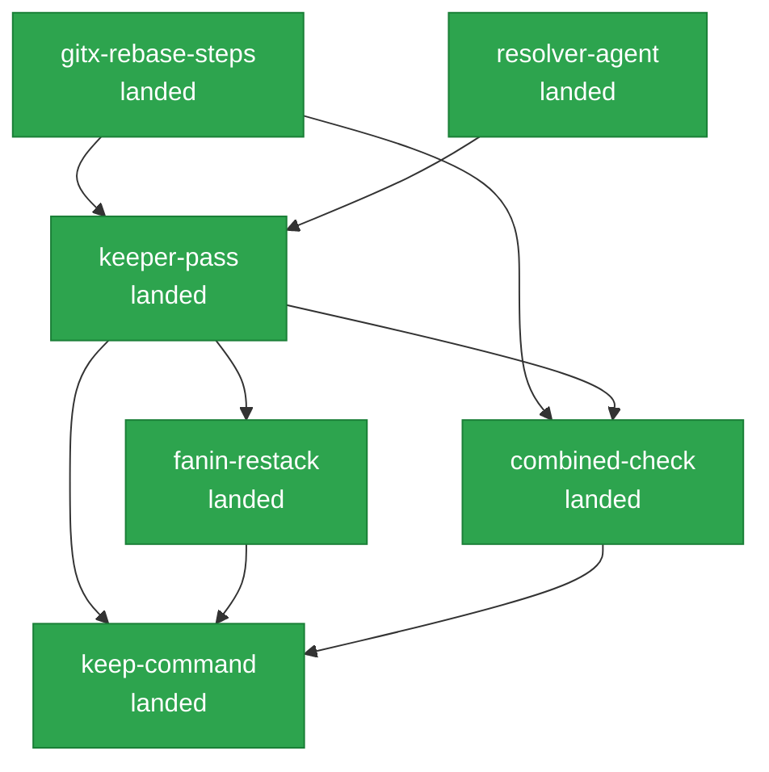

# mill: progress

Tracks finished subtasks per milestone. Milestones and requirement IDs:
[MILESTONES.md](MILESTONES.md), [REQUIREMENTS.md](REQUIREMENTS.md).

## M0. Foundations: done (2026-11-21)

- [x] Repo skeleton: Go module, layout, Makefile (`make check`), `.gitignore`
- [x] `internal/budget`: limits in USD and/or tokens, usage, `billable`/`all` counting (BG1 groundwork)
- [x] `internal/config`: load and validate `.mill/config.toml`, defaults, per-size budgets (BG6)
- [x] `internal/project`: find the repo root and `.mill/` paths
- [x] `internal/store`: SQLite in WAL mode, versioned migrations, schema, append-only event log (ST1–3)
- [x] `internal/runner`: runner interface and scripted `fake` runner (RN1–2)
- [x] `internal/host`: host interface, `exec` host, environment allowlist (HO1–2, SE3 groundwork)
- [x] `internal/doctor`: environment checks
- [x] CLI: `mill init`, `mill doctor [--json]`, `mill version`, stable exit codes (CL1 partial, CL2)
- [x] Exit criterion: `make check` green with zero tokens spent (TS1); also green under `go test -race`

### Notes and decisions

- **Toolchain:** Go 1.24. Dependencies are pinned to versions that build with it
  (`modernc.org/sqlite` v1.40.1, `github.com/BurntSushi/toml` v1.5.0); newer sqlite releases
  require Go 1.26.
- **Module path** is `mill` for now; rename when the repo gets a remote.
- **SQLite driver** is `modernc.org/sqlite` (pure Go, no CGO).
- **Config is strict:** unknown keys are errors, so a typo never silently falls back to a default.
  A file that sets `[sizes]` or `[budget.size]` replaces that whole map.
- **Event log** is append-only, enforced by SQLite triggers; `seq` is the ordering authority.
- **Exec host:** each worker runs in its own process group; Kill and context cancellation kill the
  whole group. A nil environment means an empty one, never mill's own (SE3).
- **Fake runner** reports usage in increments and stops when the context is cancelled, so budget
  enforcement (M1) can be tested without tokens. It can also write files to simulate agent edits.
- **Doctor** never spends tokens: it runs `claude --version` but does not check the login. It never
  creates the database. `host.kind = herdr` (or `auto` inside herdr) is reported as a warning
  until the herdr host exists (M5); exec is used meanwhile.
- **No forge CI:** `make check` is the gate (fmt, vet, test).

### Not in M0 (on purpose)

- No queries for tasks, attempts or branches yet: the tables exist, their APIs come with M1/M2.
- No `claude` runner, worktrees or pipeline: dogfood cut / M1.

## M1. Single-task pipeline: done (2026-11-21, branch `m1-pipeline`)

Includes the dogfood cut. Requirements: TP1–6, RN3, SE1, SE3, BG1, BG3, BG5–6.

- [x] Probe `claude -p` stream-json: usage per `assistant` event, final `result` with
      `structured_output`, `total_cost_usd`; `--json-schema` works with stream-json
- [x] Config: `worktree_root`, `gate_timeout`, `env_allow`, `runner.claude_bin`,
      `runner.attempt_timeout`
- [x] `internal/taskspec`: task file format (one task of a plan), strict validation
- [x] Store: migration 2 (task phase, worktree path); tasks, attempts, branches, per-task usage
- [x] `internal/gitx`: worktrees, commit (mill identity fallback, no hooks), diff; ignores
      inherited `GIT_*` env
- [x] `internal/gate`: run `check_cmd` + task checks in the worktree, per-command logs (TP3)
- [x] Prompts and output schemas for implementer and verifier (TP2, TP4)
- [x] `claude` runner: stream-json parsing, live usage, structured output (RN3)
- [x] Role settings: implementer and verifier permissions, no `git push`, no `.mill/` (SE1, SE3)
- [x] `internal/pipeline`: prepare → implement → commit → gate → verify → retry (TP1–6)
- [x] Budgets: per-attempt USD/token limits with kill, task budget check, `budget_exceeded`
      → blocked (BG1, BG3, BG5)
- [x] CLI: `mill task run --file F [--retry]`, `mill task show ID [--json]`
- [x] Exit criterion: real task on a toy repo reaches verified; low token limit blocks the task
      (2026-11-21, toy Go repo, Sonnet: `add-reverse` verified in 1 attempt, 18.2k tokens,
      $0.08; `budget-probe` with a 1k-token limit killed after 2.3s and blocked)
- [x] Fix found by the real run: a finished run whose final usage correction crossed the limit
      was reported as killed; a `result` event now wins over a late cancel
- [x] Dogfood: a hand-written task on mill's own repo produces a verified branch worth merging
      (`task-list`: adds `mill task list`; verified in 1 attempt, 44.8k tokens, $0.24; reviewed:
      one aggregate SQL query, tests for ordering, aggregation, filters, empty and invalid status;
      merged)

### Notes and decisions

- **Workers run with** `--setting-sources project --strict-mcp-config --no-session-persistence
  --permission-mode dontAsk --permission-prompts none`: the operator's user plugins, hooks and
  MCP servers stay out, and anything the role settings don't allow is denied, never prompted.
- **Tools:** implementer `Bash, Read, Edit, Write, Glob, Grep`; verifier `Read, Glob, Grep`
  (the diff and gate results are in its prompt). No subagents, no web.
- **Deny rules** (a tripwire, SE4): git commit/push/reset/checkout/switch/rebase/merge/branch/
  worktree/tag/remote/config, sudo, mill, and any access to the repo's `.mill/`.
- **Worktrees** live outside the repo: `~/.cache/mill/worktrees/<repo>-<hash>/<task>` by default
  (`worktree_root`). Branch `mill/t/<task>` until goals exist.
- **mill commits** after every implement attempt (trailers `Mill-Task`, `Mill-Attempt`), even
  after a failed run, so the next attempt builds on it. Squashing comes with publishing (M3).
- **Usage:** live token counts come from `assistant` events (deduplicated per message id); the
  final `result` event is authoritative and corrects them. Cost only arrives in the `result`
  event, so live USD enforcement is claude's own `--max-budget-usd`.
- **Known limitation (resolved by the M2 follow-ups, `cost-estimate`):** a run killed for its
  token limit has no `result` event, so its cost was recorded as $0. It is now estimated from
  tokens and marked `~$`.
- **Budget stop rules:** limit crossed while running → killed, `budget_exceeded`, task blocked,
  no automatic retry (BG5). Limit crossed only by the final correction of a finished run → the
  work is kept and a warning is logged.
- **Retry:** `mill task run --file F --retry` reruns a blocked/failed task with the (possibly
  edited) spec, on the same branch and base, continuing attempt numbers, starting from the last
  findings.
- **Exit codes:** 4 = task ran but ended blocked or failed.
- **mill on mill:** `.mill/config.toml` is committed with `check_cmd = "make check"` and
  `base_branch = "m1-pipeline"` (switch to `main` once M1 is merged). Task files live outside the
  repo, in `~/prj/mill-tasks/`.

### Follow-ups found while dogfooding

- [x] Timestamps are stored with RFC3339Nano, which trims trailing zeros, so text ordering by
      `created_at` is wrong for whole-second times (`12:00:00Z` sorts after `12:00:00.1Z`).
      Store a fixed-width format. (Done by mill: task `fixed-timestamps`, 1 attempt, $0.19;
      schema v3 migrates old values.)
- [x] The gate reuses Go's test cache (it ran in 0.8s after the implementer's own run). Fine for
      determinism, but consider `-count=1` in `check_cmd` if a cached pass ever hides a problem.
      (Done: the gate runs `make check GOTESTFLAGS=-count=1`.)

## M2. Planner and graph: done (2026-11-21, branch `m2-graph`)

Requirements: PL1–6, GR1–6, GT2–3, BG2, TS3. Exit criterion: a goal becomes 3–8 tasks, all
verified as local branches; killing and restarting mill finishes with nothing duplicated.

**Dogfooding plan:** mill builds M2 itself. Until the scheduler exists, each piece is a single
task (`mill task run`), reviewed and merged by hand. Once the scheduler is merged, the rest of
M2 runs as a goal through M2's own graph runner. Task files: `~/prj/mill-tasks/`.

### Design decisions

- **Goals** get sequential ids `g1`, `g2`, … and a status: `draft` (plan awaiting approval) →
  `approved` → `running` → `done`, or `blocked` when nothing more can run.
- **Task ids inside a goal** are stored as `<goal>/<task>` (e.g. `g1/config`), so plans from
  different goals never collide. Branch `mill/<goal>/<task>`, worktree
  `<worktrees>/<goal>/<task>`, runs `.mill/runs/<goal>/<task>/`. Single tasks keep
  `mill/t/<id>`.
- **Base rules (GT2):** no deps → `base_branch` tip; one dep → the parent's branch at its
  verified head; several → the deepest parent's branch, with the other parents merged in.
  A merge conflict blocks the task (the keeper handles it in M4).
- **Diff base:** a branch records `base_sha` (parent tip, for restacking later) and `start_sha`
  (after fan-in merges). The verifier reviews `start_sha..HEAD`, so it sees only this task's
  changes.
- **Overlapping `owns`** between tasks with no dependency path are reported as plan warnings;
  the scheduler never runs them at the same time (GR4).
- **Hand-written plans** (`mill plan --file plan.json`) skip the planner. Used for dogfooding
  and tests.
- **Crash recovery:** a run lock (`flock` on `.mill/run.lock`) keeps one mill run per repo. On
  start, tasks left `running` go back to `pending`, attempts left `running` become `abandoned`,
  and uncommitted worktree changes are committed as an interrupted attempt.
- **Project conventions for agents** live in `CLAUDE.md` (workers load it; checked with a probe).

### Subtasks

Built by me (setup):
- [x] Branch `m2-graph`; mill tasks branch from it (`base_branch = "m2-graph"`)
- [x] `CLAUDE.md` with conventions for agents
- [x] Gate runs tests uncached (`make check GOTESTFLAGS=-count=1`)

Built by mill, one task at a time:
- [x] `plan-validate`: `internal/plan`: plan format, validation (PL2–PL3), cycle detection,
      `owns` overlap warnings, topological order, deepest parent (1 attempt, $0.22)
- [x] `goals-store`: goals in the store (create, get, list, status, plan), approving a plan
      creates its tasks and deps in one transaction, `start_sha` on branches (1 attempt, $0.37)
- [x] `plan-cli`: `mill plan --file`, `plan show`, `plan edit`, `plan approve`, `goal list`,
      `goal show` (1 attempt, $0.50)
- [x] `graph-branches`: pipeline for goal tasks: names, base rules with fan-in, `start_sha`
      diffs, goal budget check (GT2–3, BG2) (1 attempt, $0.44)
- [x] `run-safety`: run lock (`flock`), crash recovery in the store, pipeline safe for
      parallel use, interrupted work committed, fake runner per-task scripts and delays
      (1 attempt, $0.55)
- [x] `scheduler`: `mill run <goal>`: ready set, `owns` serialization, `max_parallel`, goal
      status, interruption handling, `--retry-blocked` (GR1–GR5) (1 attempt, Opus, $2.11)

Built by mill as a goal (through the scheduler): goal `g1`, done in one `mill run`, 5/5 tasks
verified on the first attempt, 192.6k tokens, $1.71; two tasks at a time; `workflow-docs`
waited for both of its dependencies and branched from `crash-test` with `planner` merged in.
- [x] `planner`: `mill plan "<goal>"`: repo survey, planner agent, retry once on validation
      errors (PL1, PL4, PL6) (Opus, $1.25)
- [x] `crash-test`: kill -9 a running `mill run` and restart; nothing duplicated (TS3) ($0.18)
- [x] `stream-message-fix`: found in review: `system/permission_denied` stream events carry
      `message` as a string, so the claude runner counted them as unparseable lines ($0.08)
- [x] `scheduler-once`: found in review: a task that returns still `pending` would be restarted
      forever; never start a task twice in one run ($0.11)
- [x] `workflow-docs`: README walkthrough of plan → approve → run (fan-in of `planner` and
      `crash-test`) ($0.09; two inaccurate sentences corrected by hand in review)

Exit criterion (toy Go repo, real agents):
- [x] A real goal through the real planner becomes 3–8 tasks, all verified: `mill plan` made 5
      tasks in one call ($0.13): three independent `strutil` helpers, a three-way fan-in
      `cmd-toy` CLI and a README. All verified; the delivered CLI works.
- [x] Kill and restart finishes with nothing duplicated: `kill -9` while two implementers were
      running; the restart recovered 2 tasks and 2 attempts, committed their finished work as
      interrupted attempts, continued with attempt 2, verified everything, one branch per task,
      nothing verified ran again. Goal total $0.36 (excluding the killed attempts, see below).

### Follow-ups found in M2 reviews

- [ ] A goal task's spec cannot be changed after approval; a blocked goal task can only be
      retried as is (`mill run <goal> --retry-blocked`). Add a way to edit a task's spec.
- [ ] The planner call has no time limit (`runner.attempt_timeout` is only applied in the
      pipeline); a hung planner is stopped only by its budget.
- [ ] Workers run in their own process groups, so `kill -9` of mill does not reach them. In the
      real kill test no `claude` process was left 3s later, but that relies on Claude Code
      exiting by itself. Record each worker's process group and kill any survivors during
      crash recovery.
- [ ] Attempts abandoned by a killed run record no usage (mill never saw their final result),
      so goal and task spend under-count killed runs. Recovery could read the attempt's
      stream file and record the usage it reports.

## M2 follow-ups: done (goal `g2`, on `main`)

`m2-graph` was merged into `main` (fast-forward); mill's tasks now branch from `main`. The
follow-ups run as one goal through mill's scheduler (plan:
`~/prj/mill-tasks/followups.plan.json`).

Correction: the planner follow-up was partly a review mistake. `mill plan` does apply
`runner.attempt_timeout` (I reviewed `planner.go` and missed the wrapper in `cli/plan.go`). The
real gap is smaller: the limit is shared by both planner calls and a timeout reads as a bare
"context deadline exceeded".

Goal `g2`: 5/5 tasks verified in one `mill run`, 321.8k tokens, $1.88. First real retries:
`planner-timeout` and `worker-reaper` each failed the gate once and passed on attempt 2.

- [x] `task-edit`: `mill task edit <id>` changes a pending/blocked/failed task's spec, also after
      approval (goal task spec updated in the task row and the stored plan) ($0.39)
- [x] `planner-timeout`: time limit per planner call, with a clear message ($0.16, 2 attempts)
- [x] `worker-reaper`: record each worker's pid; recovery kills leftover workers of a killed run
      ($0.50, 2 attempts)
- [x] `cost-estimate`: price table (overridable in config); runs that end without a result from
      claude get an estimated cost, marked `~$` (resolves the M1 "killed run costs $0"
      limitation) ($0.52)
- [x] `abandoned-usage`: recovery reads abandoned attempts' streams and records their usage
      ($0.31; recovery line changed by hand to billable tokens and the existing `fmtInt`)

Checked with real agents (toy repo): `kill -9` of mill during a `claude` run left the worker
**alive** (so the M2 observation of no survivors was luck). On retry, recovery printed `killed
leftover worker 7074`, the worker was gone, and the abandoned attempt got its usage from its
stream with an estimated cost (`~$0.01`).

The M2 follow-ups section above is resolved by this goal:
- spec cannot change after approval → `task-edit`
- planner time limit → `planner-timeout`
- workers surviving a killed mill → `worker-reaper`
- abandoned attempts record no usage → `abandoned-usage`

### Follow-ups found in the g2 reviews

- [ ] Both gate failures in g2 came from the crash test written in g1, not from the code under
      change: the test is flaky. `planner-timeout`'s retry fixed nothing (it re-ran until the
      test passed); `worker-reaper` fixed the test. Two races: (1) it killed mill while task a
      could still be running, so a reran (fixed: wait until a is verified); (2) "run lock still
      held" right after the killed process was reaped, seen twice in gates, not reproduced in 21
      local runs under load. The test now polls the lock for up to 10s, which would also hide a
      real "lock outlives its holder" bug. Watch for it.
- [ ] `owns` is advisory: `worker-reaper` changed `internal/cli/crash_test.go`, outside its
      `owns`. Helpful here, but it is the kind of change `owns` exists to catch. Consider
      reporting changes outside `owns` as a finding, or at least showing them to the verifier.
- [ ] The reaper only kills a group whose leader is still alive and matches. If the agent exited
      but a child it started (e.g. a test run from its Bash tool) survives in the group, it is
      left alone.
- [ ] A gate failure caused by a flaky or unrelated test makes the implementer "fix" code that
      was fine, or retry until it passes. The verifier and findings could say when a failing test
      is outside the task's diff.

## g2 review follow-ups: done (goal `g3` + task `reaper-cwd`, on `main`)

Plan: `~/prj/mill-tasks/g3-followups.plan.json`, run through mill's scheduler.

Hypothesis for the "run lock still held" flake: `flock` belongs to the open file, and a child
mill is starting (git, a gate command) shares mill's open files until it execs. If mill is
killed in that window, the half-started child keeps the lock for a moment after mill is gone.
Heavy load (parallel gates, `-race`) widens the window. `fcntl` locks belong to the process and
are not inherited by children, so the lock ends exactly when mill does.

- [x] `runlock-fcntl`: run lock on `fcntl` (process-owned); crash test strict again; stress run
      ($0.19). Review: 24/24 strict crash-test runs passed, four at a time under `-race`. Caveat:
      the old failure never reproduced locally either (0/21), so this shows the strict test is
      reliable, not that the hypothesis was right; it removes the only mechanism found.
- [x] `owns-check`: files changed outside `owns` are listed; `owns_policy` = warn (verifier
      judges) | enforce (finding before the gate) | off ($0.29). Changed in review: the enforce
      finding now says how to revert (`git restore --source <start>`; `git checkout` is denied
      to implementers).
- [x] `reaper-orphans`: recovery also kills members of a worker's process group whose leader
      already exited ($0.16)
- [x] `gate-triage`: a failing gate command is re-run once (flaky → passes, verifier told);
      if it still fails it runs on the task's starting point: fails there too → task blocked as
      not caused by it; passes there → finding says the task caused it (Opus, $1.85)
- [x] `reaper-cwd` (found in review of `reaper-orphans`; the flaw was in my spec): a leaderless
      group can be an unrelated process group if the worker's group died and its pid was
      reused before recovery; only kill members whose working directory is inside the task's
      worktree ($0.24). The first run with owns-check and gate triage active: the agent stayed
      in its owns and the gate passed, so neither path was exercised by a real agent yet.

## Real-agent check of gate triage, and what it found (goal `g4`, on `main`): done

On the toy repo, `main` was made red with a failing test, then a small unrelated task ran. Gate
triage worked as designed: one implementer attempt ($0.05), the gate failed, the re-run failed
(not flaky), the same command failed on the starting point, and the task was blocked as not
caused by it, with no wasted attempts. Two gaps showed up:

- [x] `task-rebase` ($0.45): the block reason says "fix the base branch, then retry", but a retry keeps
      the task's original starting point (still red), so it blocked again (a second implementer
      run, $0.01). Add `mill task rebase <id>` to move the task's own commits onto the base's
      current tip; the block reason names it.
- [x] `gitignore-refresh` ($0.19): repos initialized before `run.lock` existed show it as untracked;
      `mill init` never updates an existing `.mill/.gitignore`. Init adds missing lines, doctor
      warns.

Goal `g4`: 2/2 verified on the first attempt, $0.64. Proved on the toy repo: after fixing
`main`, `mill task rebase triage-probe` moved the starting point from the red `ec14fe3` to the
fixed `0d2fc4c`, the retry verified, and `mill init` added `run.lock` to the old `.gitignore`.
The new behaviour since M2 is now written up in REQUIREMENTS.md (GR7–GR8, TP7–TP9, BG7).

Still open: a real agent has not yet changed files outside its `owns`, so `owns_policy` is only
covered by tests; restacking fan-in tasks and publishing (M3) are next.

## M3. Review, publish and merge detection: done (2026-11-22)

Requirements: GT1, GT4–6, RV1–7, KP2–3, SE2, TS2 (merge cases). Exit criterion: the full flow
works against a local bare remote, with merges done by a script playing the forge (merge
commit, rebase, squash), and mill detects each one.

### Design decisions

- **Statuses:** `verified` doubles as *draft* (awaiting review); new `published` and `landed`.
  One helper (`store.Done`) treats verified/published/landed as finished for dependencies,
  goal completion and the base rules.
- **Review:** `mill review` lists drafts and published tasks; `review show <id> [--diff]`;
  `review approve | changes | reject <id>`. Changes: operator comments become findings for the
  next attempt. Reject: blocked, descendants put on hold.
- **Publish (approve):** RV5 checks; the gate is re-run if the head changed since it last
  passed (`gate_sha`); squash into one commit (`git commit-tree`) whose parent is the base
  commit, or the parent task's published commit for a stacked task, so a PR shows only the
  task's own change; description (RV6) and trailers `Mill-Task`, `Mill-Goal`, `Mill-Base`;
  push `review/<task>` with `--force-with-lease`; one push function refuses any other target.
- **`mill sync`:** fetch; detect merges (ancestor, `git cherry`, trailer); mark `landed`; restack
  children of a landed parent onto main, and children of a changed parent onto its new head;
  re-gate; re-publish published ones; a conflict or red gate blocks the task (the keeper, M4,
  resolves it).
- **Deferred:** GT7 (rebuild state from git alone). Task specs live only in mill's database, so
  a real rebuild needs its own design; not part of this M3.
- **Dogfooding:** goal `g5` builds M3 as a chain of five tasks. Then the new binary publishes
  M3's own branches to a local bare "forge" repo, I merge them there with different methods,
  and `mill sync` must detect each merge and restack the rest.

### Subtasks (goal `g5`: 5/5 verified on the first attempt, $6.85; merged after review)

- [x] `publish-core` ($2.03): statuses published/landed + `store.Done`; branch `published_sha`,
      `gate_sha`; git helpers (fetch, merge-tree conflicts, commit-tree, guarded push, cherry,
      trailer search)
- [x] `review-cli` ($0.66): `mill review`, `review show`, `review changes`, `review reject`
- [x] `publish` ($1.83): `mill review approve`: RV5 rules, re-gate, squash + description + trailers,
      guarded push with lease
- [x] `sync` ($2.05): `mill sync`: merge detection, landed, restack (KP2, KP3), re-gate, re-publish
- [x] `publish-e2e` ($0.28): end-to-end test with a bare remote and a forge script (merge commit,
      rebase, squash, trailer-only), SE2 test, README publishing section
- [ ] Dogfood exit: publish M3's own branches to a local bare forge, merge them there, `mill
      sync` detects each
- [x] `publish-guards` ($1.48; found in review of g5): (1) publishing a child whose parent landed
      before `mill sync` restacked it would reuse the parent's unsquashed commits; (2) a child
      of a parent with unpublished changes would carry them; (3) sync blocked a restacked child
      only because its parent was not re-published yet; (4) tasks merged without publishing
      (all of M1/M2, merged by hand) never become landed
- [x] Local forge for mill: `~/prj/mill-forge.git` is `origin`; `main` pushed once. The first
      `mill sync` marked every hand-merged M1–M3 task landed (method `merged`) and goals g1–g5
      landed; the review queue is empty. From here on mill's branches reach `main` only through
      the forge (then `git pull`).
- [x] Dogfood exit: goal `g6` (live usage + `mill watch`, two stacked tasks; $0.86, the
      verifier failed `live-usage` once for a missing rate-limit test, attempt 2 passed) was
      published to the forge (`watch` refused until `live-usage` was published, then stacked on
      its published commit). The forge squash-merged `live-usage`: `mill sync` found it landed
      (method `patch`), restacked `watch` onto the new main, re-gated and republished it. The
      forge merged `watch` with a merge commit: landed (method `ancestor`), goal `g6` landed.
      Local main was then updated from the forge with `git pull`.
- [x] Default branch is `master` (operator decision): local `main` renamed, forge default set to
      `master` and `main` deleted there, `base_branch = "master"`. (The forge's HEAD had first
      pointed at a nonexistent `master` because I created it with `git init --bare` without
      `-b`; that was my setup mistake, not mill.)

### Follow-ups found in M3

- [ ] `mill init` writes `base_branch = "main"` regardless of the repo; it should write the
      repo's current branch (this repo uses `master`).
- [ ] The published description renders acceptance criteria as `- [ ]`; they are verified, so
      `- [x]` (or plain bullets).
- [ ] Landed tasks keep their local branches and worktrees (33 now), and `review/*` branches stay
      on the remote after landing. Add a cleanup (`mill clean`): remove worktrees and branches of
      landed tasks, and optionally delete their review branches (allowed under SE2).
- [ ] mill's own gate now takes ~4 minutes (many end-to-end git tests, run twice: `make check`
      plus the task's `-race` checks). Consider sharding, or skipping the duplicate run when a
      task's checks are a subset of `check_cmd`.
- [ ] Minor (from the verifier): if `Runner.Run` panics, the live-usage writer goroutine leaks.
- [ ] GT7 (rebuild state from git) stays deferred, see the design notes.

## M3 follow-ups through GitHub: done (goal `g7`)

Onboarded to GitHub: `origin` is `git@github.com:msidorkevich/mill.git` (the local forge stays as
remote `forge` for now); `master` pushed once, by hand; from here on `master` changes only
through merged PRs (then `git pull`).

Goal `g7`: `module-path` first (it touches nearly every file), the others stacked on it, so
their PRs target `review/g7/module-path` until it merges; then GitHub retargets them to
`master` and `mill sync` should restack and re-publish them.

- [x] `module-path` (4 attempts: the first three hit the Claude usage limit, see below): module `github.com/msidorkevich/mill`
- [x] `init-base-branch` (1 attempt): `mill init` writes the repo's current branch
- [x] `publish-polish` (3 attempts: the verifier caught a test assertion that could never fail, and an off-by-prefix 600-character limit): `- [x]` checklist, trimmed verifier summary
- [x] `mill-clean` (1 attempt): remove landed tasks' worktrees and branches; `--remote` deletes their review
      branches (lease, review/* only)
- [x] `livewriter-panic` (1 attempt): writer stops even if the runner panics

Not in this goal: gate speed (mostly my specs adding a full `-race` run on top of `make check`;
I now write narrower checks), GT7 (deferred).

Goal `g7`: 5/5 verified, $1.27, published to GitHub and merged there (PRs #1, #3–#5). The PRs
were opened against `master` and merged with merge commits, so `mill sync` saw every task land
by `ancestor` (`module-path` came in with `mill-clean`, which was stacked on it); goal `g7`
landed. Not yet exercised on GitHub: stacked-PR retargeting and the squash/rebase buttons.

### Follow-ups found in g7

- [x] Claude usage limit (goal `g8`, published): the first `g7` run hit "You've hit your 5-hour limit"; mill counted it
      as an implementer failure and burned all three attempts in seconds, then blocked the task.
      A usage or rate limit is not the agent's fault: recognise it, do not count the attempt,
      stop starting new agents, and block or pause with the reset time.
- [x] The workers' deny rule for `mill` also matches (goal `g8`, `claude-md-note`) a locally built `./bin/mill`, so an agent
      working on mill cannot run the binary it just built (it verified another way). Fine as a
      safety rule; mention it in CLAUDE.md so agents use `go run ./cmd/mill` or tests instead.

## Usage limits (goal `g8`): done

The real stream showed a machine-readable signal: `rate_limit_event` (`status: rejected`,
`rateLimitType`, `resetsAt`) and a result with `api_error_status: 429`. 3/3 verified on the
first attempt, $2.27; reviewed; published to GitHub and merged (PRs #7, #8; merged with merge
commits, so every task landed by `ancestor`; squash, rebase and stacked retargeting are still
not exercised on GitHub itself). The early usage warning has since shown up in real runs
("usage at 34% of the seven_day limit").

- [x] `limit-detect`: runner status `rate_limited` with limit type and reset time; early
      warning from `allowed_warning` events ($0.21)
- [x] `limit-handling`: a rate-limited attempt is not a failure and no further attempts run;
      the scheduler stops starting agents and blocks the goal with the reset time;
      `mill run --wait-on-limit` waits for the reset and continues; planner and `task run`
      report it too (Opus, $2.03)
- [x] `claude-md-note`: CLAUDE.md tells agents not to run `mill`/`./bin/mill` ($0.04)
- Known gap (accepted): if claude dies after a rejected event without a final result, the run
  is reported as a plain error; the next attempt then hits the limit cleanly.

## Housekeeping

- [x] `mill clean --remote` run on mill itself: 41 worktrees and 41 local branches of landed
      tasks removed, 8 `review/*` branches deleted on GitHub; a second run changed nothing.
- [x] `clean-empty-dirs` (published): `mill clean` also removes empty directories under the
      worktree root (empty goal folders, gate-triage `.base/` leftovers). Review found that the
      first version descended into live worktrees and would delete empty folders an agent may
      need; sent back with `mill review changes` (the operator comments reached the implementer
      as `[operator]` findings), fixed in attempt 2: directories with a `.git` entry are never
      entered. $0.33.

## M4. Keeper: done (goal `g9`, landed 2026-11-22)

Requirements: KP1, KP4–KP8, TS2 (conflict cases). Exit criterion: scenario tests with injected
textual and semantic conflicts are resolved or flagged correctly.

**Planned by mill's own planner** for the first time on real work: `mill plan "<goal>"` with my
design decisions in the goal text produced 6 tasks in one call ($0.93). Edited before approval:
removed a duplicate `make check` from every task's checks (it would have doubled every gate) and
made the CLI task size S.

### Design decisions

- `mill keep [<goal>] [--watch] [--interval] [--combined] [--json]`: one reconcile pass over open
  tasks (verified or published) in dependency order, starting with sync.
- Lazy (KP4): rebase only on a real conflict (`git merge-tree`, KP5).
- Conflicts (KP6): rebase with `rerere`; then a resolver agent (the only new role) edits the
  conflicted files while the rebase is stopped; then gate + verifier; any failure restores the
  branch exactly and blocks the task for the operator.
- Fixer (KP7): a red gate after a restack becomes findings for a normal implement attempt.
- Fan-in restack: rebuild on the deepest parent (or the base branch), re-merge the others,
  replay only the task's own commits.
- Combined check (KP8): merge all ready branches in a throwaway worktree, gate, bisect the
  culprit, find its partner, flag both (not blocked).

### Subtasks (goal `g9`: 6/6 verified, $10.11)

- [x] `gitx-rebase-steps`: rebase/merge that can stop, rerere, conflict hunks ($1.10)
- [x] `resolver-agent`: resolver prompt and pipeline entry points ($1.13)
- [x] `keeper-pass`: one reconcile pass: lazy detection, rerere, resolver, fixer, re-publish ($2.08)
- [x] `fanin-restack`: fan-in restack in keep, sync and task rebase ($3.90)
- [x] `combined-check`: merge all ready branches, bisect culprit and partner ($1.48)
- [x] `keep-command`: `mill keep` with --watch, --combined, --json ($0.42)
- [x] Usage-limit handling proven for real: `fanin-restack` and `combined-check` hit the
      five-hour limit; recorded as rate_limited (no attempts burned), the goal waited until the
      reset (`--wait-on-limit`), resumed, kept the agents' work, and finished.
- [x] Dogfood: `mill keep g9` built from the M4 branches ran on mill itself: no conflicts; the
      combined check merged all six branches onto master and the gate was green.
- [x] Published and merged in four rounds (the fan-in rule: every dependency but the deepest
      must land before a fan-in task is published). Between rounds `mill sync` (built from M4)
      marked the merged tasks landed and restacked the rest, including both fan-in tasks, which
      sync could not restack before M4. Goal `g9` landed.

### Follow-ups found in M4

- [ ] The fan-in publish rule makes a wide DAG land slowly (four merge rounds for six tasks).
      Consider publishing a fan-in on top of a temporary merge of its unlanded parents, or a
      documented "land in waves" helper that says which PRs can be merged now.

## Approval queue (goal `g10`): done (landed 2026-11-22)

Approve once, and `mill keep` publishes each task as soon as the publish rules allow, so
landing a stacked or fan-in goal needs no round-trips (asked for after the four M4 rounds).
Planned by mill's planner ($0.26): three tasks, `store-approval` → `review-approve-queue` →
`keep-publishes-queue`. Approvals are cleared in the store whenever an implementer run starts,
so any new code needs a new approval; restacks keep it.

3/3 verified on the first attempt, $4.52. **Landed with its own feature:** one `mill review
approve --goal g10` published `store-approval` and `review-approve-queue` (stacked) and queued
the fan-in `keep-publishes-queue`; `mill keep g10 --watch --interval 1m` then ran unattended.
After the operator merged the stack on GitHub, the next pass marked both landed, restacked the
queued task onto master, re-gated it and published it from the queue by itself; after its merge
the following pass marked goal `g10` landed. No relaying between the merges.

Afterwards `mill clean --remote` removed the landed tasks' local worktrees and branches; their
`review/*` branches on GitHub were already gone (deleted on GitHub), which clean reported and
skipped.

### Follow-ups found while planning g10

- [ ] The g10 plan is a strict chain although `keep-publishes-queue`'s code only needs the
      store API; it depends on `review-approve-queue` only because its end-to-end scenario test
      (a requirement from my goal text) approves tasks through the CLI. Putting that test in its
      own fourth task would have run the two middle tasks in parallel (about one task's time
      saved). Improve the planner prompt: prefer parallelism, and put end-to-end tests that span
      several features in their own task so feature tasks do not depend on each other only for
      a test.
- [ ] When reviewing a plan, flag dependencies that exist only because of a test, and consider
      splitting the test out before approving.

### Follow-ups found while landing g10

- [ ] `mill keep --watch` re-runs the combined check on every pass with two or more ready
      branches, even when nothing changed since the last green check; on mill that is a full
      gate (several minutes) per pass, so `--interval 1m` became 5+ minutes. Remember the last
      green result per set of ready branches and their heads; re-run only when the set changes.
- [ ] Process note (mine): I checked GitHub once, just before the operator's merge landed, and
      wrongly said the wrong PR had been merged. Check what the base branch contains (which
      tasks landed), not the top PR number, and re-fetch before concluding.

## Cheaper keep, goal graph, reopening goals (goal `g11` + task `goal-reopen`): published

- [x] `combined-cache` ($0.56, 3 attempts): the combined check is cached by fingerprint (base
      tip + ready branches and heads); an unchanged `mill keep` pass reports the cached result
      instead of running a full gate; `--combined` forces a run. Attempt 1 failed review (no CLI
      test for `--combined`), attempt 2 hit the five-hour limit (waited, resumed), attempt 3
      passed. First real use of the `owns` check in warn mode: the task changed three files
      outside its owns, mill listed them for the verifier, and the verifier judged them needed.
- [x] `goal-graph` ($1.85, 2 attempts): `mill goal graph <g>` draws the task graph (lanes like
      `git log --graph`, status marks, `← dependencies` on each row, independent tasks
      separated) and `--mermaid` prints a flowchart that GitHub renders. Sent back once with
      `mill review changes`: trying it on real goals showed independent tasks looked chained and
      dense fan-ins were hard to read.
- [x] `goal-reopen` ($0.26): found while sending `goal-graph` back. `review changes` left the
      goal `done`, so `mill run` refused to re-run the task. Sending a goal task back now
      reopens its goal, and the scheduler no longer refuses a done goal with unfinished tasks.
      The re-run of `g11` used a binary built from this fix.

M4 graph as `mill goal graph g9 --mermaid` renders it:

## Housekeeping (continued)

- [x] `g11` and `goal-reopen` landed (PRs #23–#25); goal `g11` landed.
- [x] `clean-on-land` ($1.75, PR #26): when sync or keep marks a task landed, the same pass
      removes its worktree and local branch and deletes its `review/*` branch on the remote
      (lease-guarded); `clean_on_land = all | local | off`. Proven on its own landing: the sync
      that detected it cleaned up its worktree, branch and `review/clean-on-land` on GitHub.
- [x] The merged `progress/*` branches were deleted on GitHub and locally. GitHub's "Automatically
      delete head branches" setting is the operator's to enable (no API access from here).
- [x] PR banners: GitHub hides "Compare & pull request" banners after about an hour, so branches
      published earlier looked like they had disappeared. Publish messages now come with direct
      compare links; the M6 `on_publish` hook (`gh pr create`) would remove the manual step.

## M5. TUI and herdr: done (goal `g12` landed 2026-11-23, plus fixes)

Requirements: UI1–UI3, HO3–HO4. Exit criterion: the whole workflow works from the TUI, with and
without herdr. Planned by mill's planner ($0.52), then edited before approval: a `go-upgrade`
task added as the root (the operator allowed upgrading Go: go.mod moves to Go 1.27.4 through the
toolchain directive, so no machine change is needed, and the dependencies pinned for Go 1.24 are
updated), and `docs/PROGRESS.md` removed from a docs task's files (PROGRESS stays the operator's
and mine, updated in its own PRs).

### Design decisions

- Bubble Tea v1.3.10, Lip Gloss v1.1.0, Bubbles v0.21.1: the only new dependencies.
- The TUI is a thin client: it polls the store for state and runs mill's own commands as
  subprocesses for every action, so locking, recovery and logic stay in the CLI.
- Views: goals with their graph, review queue, task detail (spec, verdict, gate, diff, log),
  agents. Keys per UI3; `s` (skip) deferred because mill has no skip operation.
- herdr host: a wrapper records pid and exit code to files, results are still read from
  files; `host.kind = auto` picks herdr only inside herdr. Planned as one pane per worker split
  next to the operator's pane; changed after real use to one unfocused tab per worker
  (`herdr-robust`, see the follow-ups).
- End-to-end tests are a separate task (applying the planner-parallelism follow-up).

### Subtasks (goal `g12`: 8/8 landed, PRs #27–#34, #38, #39; about $9 of agent spend)

- [x] `go-upgrade`: Go 1.27.4, current dependencies ($0.14). The upgrade worked in practice:
      the next `make build` downloaded the toolchain by itself.
- [x] `herdr-host`: herdr host in internal/host
- [x] `herdr-wiring`: host selection, doctor, config comment
- [x] `tui-foundation`: dependencies, `mill tui`, polling, tabs, command runner
- [x] `tui-review-detail`: review queue, task detail, diff, log tail, `$EDITOR` changes
- [x] `tui-agents-open`: agents view, open worktree (herdr pane or shell). It conflicted with
      `tui-review-detail` in `internal/tui/model.go`; after the others landed, the keeper
      restacked it and the **resolver agent's first real job** merged both sides ($0.07); gate
      and verifier then passed.
- [x] `tui-herdr-e2e`: end-to-end tests across the TUI and the herdr host
- [x] `docs-tui-herdr`: README sections for the TUI and hosts

### Exit criterion

The whole workflow runs from the TUI with the exec host and with a fake herdr (end-to-end
tests), and on the real herdr host: task `prepare-cleanup` ran with `host.kind = auto` inside
herdr, each agent in its own tab (`mill prepare-cleanup a1 implementer`), the operator's tab
kept focus, and the tabs closed when the workers ended.

### Process notes

- I passed spec text containing backticks inside a double-quoted shell string, so the shell ran
  them; one was `go get -u ./...` in the main checkout. It failed before writing anything (the
  tree stayed clean) and I repaired the damaged spec text. From now on, code that carries text
  goes in script files, never inline shell-quoted strings.

### Follow-ups found in M5

- [x] **New task branches referred to landed dependencies' deleted branches** (bug, fixed by
      task `prepare-landed-deps`, PR #35; review added one fetch at a time and an offline
      fallback). After the first five `g12` tasks landed,
      `mill run g12 --retry-blocked` failed both remaining tasks before any agent started:
      `merge dependency g12/herdr-wiring: … not something we can merge`. Cause: preparing a new
      task's branch still merged every dependency's branch by name, but `clean_on_land` (task
      `clean-on-land`) had deleted the branches of the landed ones. A landed dependency's code is
      already in the base branch, so it needs no branch. Fix: base new branches like restacks
      already do (`internal/fanin`): landed dependencies come from the remote base tip, and only
      unlanded dependencies are merged by branch. No tokens were spent on the failed attempt.
- [ ] **Slow gates** (measured during `g12`). A gate takes at least 5 minutes: `internal/cli`'s
      145 integration tests take ~300s, and no test in the repository uses `t.Parallel()`, so
      they use about one of 8 cores. Two gates at once, next to the agents, pushed the load
      average to 132 on 8 cores, and test file churn kept `fseventsd` near 95% CPU.
      (Already done: `~/.cache/mill` is excluded from Time Machine.) Planned as a "fast gates"
      goal right after M5:
  - [ ] **A. Run independent tests in parallel:** `t.Parallel()` in every test that does not
        share process state, replacing the 5 `t.Setenv` uses that prevent it (pass the values
        explicitly instead). Target: `internal/cli` from ~300s to 60–90s.
  - [ ] **B. No duplicate test runs in a gate:** `check_cmd` (`make check`) already runs every
        package, but the planner gave tasks checks like `go test ./internal/cli/...`, so those
        gates ran the slowest package twice. Task checks must stay narrow (`-run …`) when
        `check_cmd` covers the package: a planner prompt rule, plus a plan validation warning.
  - [ ] **E. Limit concurrent gates:** a `max_parallel_gates` setting (default 1), separate
        from `max_parallel`, so agents still work in parallel while gates take turns. Fewer
        load spikes; less important once A is done.
- [x] **herdr host could not read herdr's real response** (bug, fixed by task `herdr-pane-id`,
      PR #36). `pane split` returns the pane as an object (`.result.pane.pane_id`); the host
      expected a string, because I described herdr's output from memory when planning M5 and
      the tests used that made-up shape. Tests now use a response captured from real herdr.
- [x] **A failed branch preparation leaves its branch and worktree behind** (task
      `prepare-cleanup`, published; run on the real herdr host). The failed
      dependency merge above had already created both task branches; the next retry stopped at
      `branch … already exists in git but mill has no record of it`. I checked them (no work of
      their own, clean worktrees) and removed them by hand. Fix: remove what preparation created
      when it fails.
- [x] **herdr host robustness** (task `herdr-robust`, PR #41, $3.33 over 4 attempts: the
      verifier found two real gaps, two reworks adapted it to M5 code that landed meanwhile). The operator closed two worker
      panes that mill had opened in their own tab without saying what they were. mill then
      waited forever for exit files that never came, and ignored Ctrl-C and SIGTERM (it had to
      be killed with SIGKILL; recovery then worked: tokens recorded, uncommitted work
      committed). Fix: each worker in its own labelled tab (`mill <task> <role>`, never
      focused) that says closing it stops the task; a closed pane fails the attempt within ~2s;
      cancellation always returns. Also found: run inside herdr, `internal/cli`'s tests created
      and closed real herdr panes; tests must never reach the real herdr.
- [x] **`mill watch` says "nothing running" during gates** (task `watch-shows-gates`, PR #40).
      It lists only agent attempts, and the gate is not one; the TUI Agents view has the same
      gap. Fix: show every running stage with elapsed time and the gate log's last line.
- [ ] **One scheduler for all goals** (operator decision 2026-11-23; planned as the next goal,
      before fast gates). Today each `mill run <goal>` or `mill task run` starts its own
      scheduler, and the repository lock allows one such process, so only one goal (or one
      single task) runs at a time, and work had to be queued by hand. A goal is only a group of
      tasks, so there is no reason for that. Design:
  - `mill run` without arguments runs every ready task of every approved goal and every queued
    single task; `max_parallel`, file ownership and budgets apply across all of them.
  - A running scheduler picks up newly approved work from the store: `mill plan approve` or
    `mill task run` during a run joins it instead of being refused.
  - `mill run <goal>` stays as a filter.
  - The lock means "one scheduler per repository". `mill review approve/changes/reject` hold
    it only while they write, so publishing never waits for a run.
  - Per-goal budgets, statuses and dependency rules stay as they are (they are task data).

Order after M5: `herdr-robust`, `watch-shows-gates`, one scheduler for all goals, fast gates
(A, B, E).

More follow-ups found while landing M5:

- [ ] **"done" hides unmerged work.** A goal whose tasks are all published shows `done`, and I
      reported M5 as landed while PR #39 was still open. `mill goal show` should say
      `published, not merged` until every task has landed.
- [ ] **Branches planned against an old base.** Tasks running in parallel with merges started
      from a base without the latest docs, so one added a second README "Hosts" section. Seen
      by hand, not by mill. When a task's owned files changed on the base branch since it
      started, mill should rebase it before the gate (or at least warn in the review).
- [ ] **Clashes between verified branches are found by hand.** `herdr-robust` and
      `tui-herdr-e2e` each passed alone but together redeclared a test helper and disagreed on
      herdr's protocol. It happened again in `g13`: `short-locks-review-rebase` and
      `short-locks-sync-keep-clean`, built in parallel, both defined `assertNoClaims` in package
      `cli`. The keeper's combined check would catch it, but only for published branches; it
      should also run on verified sibling branches before publishing a batch (`review approve
      --goal`), and the planner prompt should tell parallel tasks to give test helpers
      task-specific names.
- [ ] **Locks block unrelated work** (publish, sync, single tasks): covered by the next goal,
      one scheduler for all goals.

## One scheduler for all goals: in progress (goal `g13`)

Planned by mill's planner ($0.70, 9 tasks), reviewed and edited before approval (a claim held by
a reused pid must not count as live; the docs task neither edits PROGRESS nor reruns `make
check`). Design: commands that only change records or publish claim the tasks they change in the
store instead of taking the repository lock; one scheduler runs every approved goal and queued
single task, and picks up new work while running; only the scheduler runs crash recovery.

First run: 7 of 9 verified ($9.22); the end-to-end task was blocked before it started because
two of its dependencies collided (see below). After the fixes all 9 tasks are verified or
landed; landed so far: `store-task-claims`, `short-locks-sync-keep-clean`,
`scheduler-all-goals`, `runlock-holder-probe`, `short-locks-review-rebase` (PRs #44–#47, #49).
`run-command-one-scheduler` is blocked by a restack (see "Restacks replay every attempt") and
the rest of the stack (`task-run-joins-scheduler`, `e2e-one-scheduler`, `docs-one-scheduler`)
publishes after it. Published so far: `store-task-claims`,
`short-locks-sync-keep-clean`, `scheduler-all-goals`, `runlock-holder-probe` (checked merged
together: they compile and their packages pass).

### Follow-ups found in `g13`

- [ ] **The verifier does not see the rest of the plan.** It rejected
      `run-command-one-scheduler` because `sync`, `keep` and `clean` still took the run lock on
      that branch, which is the sibling task `short-locks-sync-keep-clean`'s job, built in
      parallel. The implementer then did the sibling's work in the sibling's files, and the two
      branches collided. The verifier prompt should list the other tasks of the goal with their
      files and summaries, and treat findings in another task's scope as out of scope.
- [ ] **An edit to another task's files is only a warning.** The owns check recorded
      `owns-outside` for five files that belonged to a sibling task and let the attempt pass.
      When a file is owned by another task of the same goal, the owns check should fail the
      attempt (revert hint included), not warn.
- [ ] **Overlapping acceptance criteria.** The planner gave `run-command-one-scheduler` a
      criterion ("recovery output only from `mill run` and `mill task run`") that could only be
      met by changing a sibling's files, so a revert failed the same way a second time; I
      corrected the criterion with `mill task edit`. My plan review checked file ownership but
      not whether each criterion can be met within the task's own files; plan validation (or
      the planner prompt) should check that too.
- [ ] **`mill task edit` needs bare ids and explicit fields.** Editing a goal task from
      `mill task show --json` failed twice: the id must be the bare plan id
      (`run-command-one-scheduler`, not `g13/...`) and `depends_on` must be present even though
      `task show` leaves it out. `task edit` should accept what `task show --json` prints.
- [ ] **Publish before restarting a run.** I restarted `g13` before publishing its ready tasks,
      so the run's lock blocked publishing again. Goes away with this goal; until then, publish
      first.
- [ ] **Restacks replay every attempt** (task `restack-net-change`, running). `mill sync`
      blocked `run-command-one-scheduler` while restacking it onto the base: it replays the
      task's commits one by one, and two of its five attempts edited a sibling's files that
      later attempts reverted. The net change merges cleanly. Fix: a restack applies the task's
      net change as one commit, as publishing already squashes.
- [ ] **`mill sync` during a run mishandles a running child of a landed parent** (found by the
      `e2e-one-scheduler` agent, which left `TestSyncDuringRunReportsRunningChildBusy` skipped
      with the reason). Sync skips the busy child silently instead of listing it as busy, and
      clean_on_land removes the parent's worktree, branch and review branch while the child is
      still based on it. Fix: task `sync-busy-child` (after `e2e-one-scheduler` lands and after
      `restack-net-change`).
- [ ] **End-to-end tests must be fast.** The scheduler end-to-end tests start real `mill run`
      loops that poll; with default intervals every gate pays for that waiting. Tests must
      inject polling intervals of milliseconds, the way tests already inject clocks, and the
      planner prompt should say so for test tasks. Part of the fast-gates goal.
- [ ] **I listed merged PRs as open** three times (#33, #37, #49). Before sending a PR link I
      check the GitHub API for its state, not only that the branch exists.

## Next: models chosen by task size and complexity (operator decision 2026-11-24)

Planned as its own goal after `g13`, before fast gates. Today the planner sets only `size`, and
`.mill/config.toml` maps size to one model (`S → sonnet`, `M → opus`) for every role, with no
escalation. Design:

- **Complexity next to size.** The planner rates each task `low | medium | high` with a
  one-line reason ("concurrency and crash recovery", "text only"); size stays the amount of
  code.
- **The mapping lives in config, not in the planner.** `(size, complexity) → model`, default:
  S/low → haiku; S/medium and M/low → sonnet; M/medium and anything high → opus. `mill plan
  show` prints each task's model and estimated cost; the operator can override a task's model
  before approving.
- **Per-role models.** The verifier uses at least the implementer's tier and never less than
  sonnet; the resolver uses the task's model; the planner stays on opus.
- **Escalation.** A retry after a failed attempt moves one tier up, within the task's budget;
  the step is recorded so `mill task show` explains the cost.
- **Measurement.** Every verdict records the model that produced it, so the mapping can be
  tuned from first-attempt pass rates.

Order after `g13`: models by size and complexity, then fast gates (A, B, E and fast end-to-end
tests).
